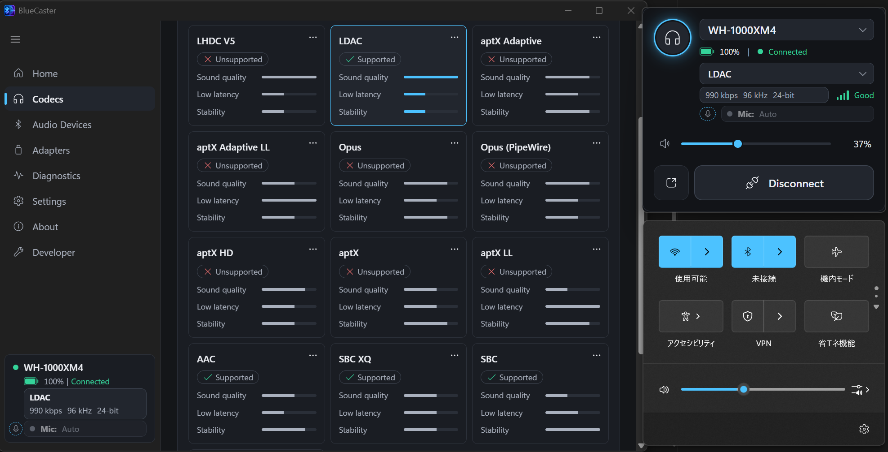

# BlueCaster (formerly A2DP-Windows-Bridge)

BlueCaster turns your Bluetooth adapter — a cheap USB dongle or the one built into many laptops — into a Hi-Fi audio transmitter for Windows. Windows supports only basic codecs; BlueCaster adds LDAC, LHDC V5 and aptX Adaptive at up to 96 kHz (LHDC V5 up to 192 kHz), and also streams AAC, SBC XQ and aptX. It sets up the adapter automatically, and one click returns the adapter to Windows ([how it works](https://seiyafunaokajp.github.io/BlueCaster/architecture)).



**[Download](https://github.com/SeiyaFunaokaJP/BlueCaster/releases)** (installer `-setup.exe` or `-portable.zip`) | **[Documentation](https://seiyafunaokajp.github.io/BlueCaster/)**

## Codecs

| Codec | Bitrate | Sample rate | Bit depth | Windows built-in | BlueCaster |
|-------|---------|-------------|-----------|:----------------:|:------:|
| LHDC V5 | 400–1000 kbps, ABR 160–400 | 44.1–192 kHz | 16/24 bit | ❌ | ✅ |
| LDAC | 330/660/990 kbps | 44.1–96 kHz | 16/24/32 bit | ❌ | ✅ |
| aptX Adaptive | 265/427 kbps (96 kHz: 646) | 48/96 kHz | 24 bit | ❌ | ✅ |
| Opus (Android) | 256 kbps | 48 kHz | 16 bit | ❌ | ✅ |
| aptX HD | 576 kbps | 44.1/48 kHz | 24 bit | ❌ | ✅ |
| aptX | 352/384 kbps | 44.1/48 kHz | 16 bit | ✅ | ✅ |
| aptX Low Latency | 352 kbps | 44.1/48 kHz | 16 bit | ❌ | ✅ |
| AAC | up to 256 kbps | 44.1/48 kHz | 16 bit | Windows 11 | ✅ |
| SBC XQ | up to 552 kbps | 44.1/48 kHz | 16 bit | ❌ | ✅ |
| SBC | up to ~345 kbps | 44.1/48 kHz | 16 bit | ✅ | ✅ |
| FastStream | 198/216 kbps | 44.1/48 kHz | 16 bit | ❌ | ✅ |
| Opus 05 (PipeWire) | 256 kbps | 48 kHz | 16 bit | ❌ | ✅ 🔧 |
| LC3 (LE Audio) | 32–124 kbps per channel | 16–48 kHz | 16 bit | Windows 11 | 🔧 |

✅ supported · 🔧 developer mode only · ❌ not supported

## Requirements

- **Windows 10 (22H2) or 11**, x64 or ARM64 (ARM64 and Windows 10 not yet tested on real hardware)
- **A USB Bluetooth adapter for BlueCaster**. A separate dongle is recommended. A built-in adapter also works if it is a USB device (as on many laptops), but Windows loses its own Bluetooth while BlueCaster uses it. See [Recommended Adapters](https://seiyafunaokajp.github.io/BlueCaster/setup#adapters) and the [verified hardware](https://seiyafunaokajp.github.io/BlueCaster/hardware).

### Why does BlueCaster take over a whole adapter?

Windows loads only kernel drivers signed through Microsoft, and that requires an EV code signing certificate (several hundred US dollars a year, usually issued only to companies). Instead, BlueCaster switches the adapter to WinUSB, Microsoft's own signed driver, and runs the Bluetooth stack in user mode. If you'd rather keep things simple, commercial software with a signed driver works with the built-in Bluetooth.

## Setup

1. **Install**: run `BlueCaster-<version>-win64-setup.exe` (`-arm64-setup.exe` on ARM64; no administrator rights needed), or extract the portable zip and run `bluecaster.exe`. Installing over v1 or A2DP Windows Bridge 2.0.x replaces the old version and keeps its settings, pairings and firmware.
2. **Plug in the adapter.**
3. **Follow the first-run setup**: choose the adapter and press **Set up this adapter**. BlueCaster assigns WinUSB to the adapter (Windows asks for administrator permission) and downloads any firmware a Realtek adapter needs. Then press **Connect** next to your headphones.
4. After that, connect from **Home** or the tray icon.

> **Warning:** While WinUSB is assigned, Windows' own Bluetooth cannot use the adapter. With the built-in adapter, the PC has no Windows Bluetooth at all until you restore the driver. **Adapters > Restore original driver** returns the adapter to Windows at any time; the uninstaller offers the same option.

See the [Setup guide](https://seiyafunaokajp.github.io/BlueCaster/setup) and the [Usage guide](https://seiyafunaokajp.github.io/BlueCaster/usage). If audio drops out or connections fail, see [Dropouts and Connection Problems](https://seiyafunaokajp.github.io/BlueCaster/wireless).

## Features

- **Codec choice**: uses the best codec your headphones support, or the one you choose; ABR for LHDC V5, LDAC and aptX Adaptive
- **LE Audio (developer mode only)**: LC3 to LE Audio headphones and earbuds with a Bluetooth 5.2 adapter; tested on one MediaTek MT7925 only ([details](https://seiyafunaokajp.github.io/BlueCaster/usage#le-audio))
- **Capture**: all system audio, a virtual audio device (e.g. VB-CABLE), or one application
- **Runs in the tray**: keeps streaming when the window is closed, and reconnects after a dropped link or sleep
- **Driver setup in the app**: switches the adapter to WinUSB and back without Zadig; headphones that Windows paired through the adapter connect without pairing again
- **Headphone controls**: volume sync and play / pause / next / previous
- **Diagnostics**: link quality, AFH (avoids your Wi-Fi channels), connection flow, log, HCI capture
- **Command line**: `bluecaster-core.exe --cli` ([CLI Mode](https://seiyafunaokajp.github.io/BlueCaster/usage#cli-mode))
- **Updates**: checks daily and installs updates automatically
- **10 languages**: English, Japanese, Chinese (Simplified / Traditional), Korean, German, French, Spanish, Ukrainian, Russian
- **Headset microphone**: use the headphones' microphone in Windows through a virtual audio cable such as VB-CABLE; classic Bluetooth headphones drop to call quality while it is in use, LE Audio keeps full quality ([details](https://seiyafunaokajp.github.io/BlueCaster/usage#codecs))
- **Works with** third-party apps such as earbud control apps: [Works With](https://seiyafunaokajp.github.io/BlueCaster/works-with) (not supported by this project)

## Building

Requirements: **Rust** 1.90+, **Visual Studio 2022+** with the C++ desktop workload, **Node.js 22** with **pnpm** (`corepack enable`), **Git**, **PowerShell 7**.

```powershell
git clone --recursive https://github.com/SeiyaFunaokaJP/BlueCaster.git
cd BlueCaster
pwsh ./build.ps1                      # bluecaster.exe, bluecaster-core.exe, bluecaster-driver.exe in target/release/
pwsh ./build.ps1 -Release -Arch x64   # installer and portable zip (-Arch arm64 for ARM64)
```

Double-clicking `build.bat` runs the first command. The other switches (debug build, tests, emulator test) are listed at the top of [build.ps1](build.ps1). See [Building](https://seiyafunaokajp.github.io/BlueCaster/building) for step-by-step instructions and [Architecture](https://seiyafunaokajp.github.io/BlueCaster/architecture) for how the programs fit together.

## License

The BlueCaster source code is dual-licensed under the **Apache License 2.0** ([LICENSE-APACHE](LICENSE-APACHE)) or the **MIT License** ([LICENSE-MIT](LICENSE-MIT)), at your option. See [LICENSE](LICENSE).

> **Important:** The distributed programs include [BTstack](https://github.com/bluekitchen/btstack), whose license allows use and redistribution only for **personal, non-commercial purposes** ("solely for personal benefit and not for any commercial purpose or for monetary gain"). Commercial licenses are available from BlueKitchen GmbH.

Third-party libraries (BTstack, libldac, libopenaptx, fdk-aac, the LHDC V5 encoder, libopus, Tauri, SolidJS and others) come under their own licenses; see [THIRD_PARTY_LICENSES.md](THIRD_PARTY_LICENSES.md).
