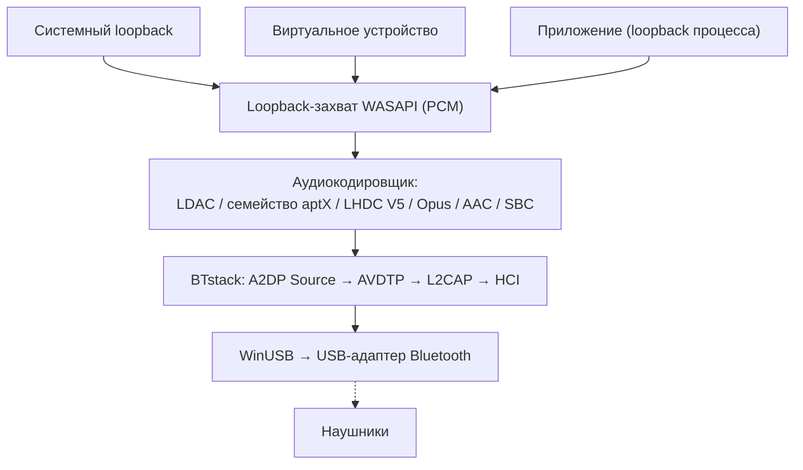

# BlueCaster

Продвинутый Bluetooth-аудиопередатчик для Windows с полной поддержкой кодеков.
{: .fs-6 .fw-300 }

Превращает обычный адаптер Bluetooth -- дешёвый USB-донгл или встроенный адаптер многих ноутбуков -- из устройства с простыми кодеками, которые ему даёт Windows, в Hi-Fi-передатчик: **LHDC V5, LDAC и aptX Adaptive** с частотой до 96 kHz (LHDC V5 до 192 kHz), а также **aptX HD, aptX, aptX Low Latency, Opus, AAC, SBC XQ, SBC и FastStream** и LE Audio (LC3, экспериментально, только в режиме разработчика). BlueCaster сам настраивает адаптер и одним щелчком возвращает его Windows ([как это работает](architecture)).

[Начало работы](setup){: .btn .btn-primary .fs-5 .mb-4 .mb-md-0 .mr-2 }
[GitHub](https://github.com/SeiyaFunaokaJP/BlueCaster){: .btn .fs-5 .mb-4 .mb-md-0 }

---

## Поддерживаемые кодеки

| Кодек | Битрейт | Частота дискретизации | Разрядность | Задержка |
|:------|:--------|:----------------------|:------------|:---------|
| LHDC V5 | 400/500/900/1000 kbps, ABR 160--400 kbps | 44,1/48/96/192 kHz | 16/24 бит | -- |
| LDAC | 330/660/990 kbps | 44,1--96 kHz | 16/24/32 бит | ~200 ms |
| aptX Adaptive | 265/427 kbps (96 kHz: 646) | 48/96 kHz | 24 бит | -- |
| Opus | 256 kbps | 48 kHz | 16 бит | -- |
| aptX HD | 576 kbps | 44,1/48 kHz | 24 бит | ~150 ms |
| aptX | 352/384 kbps | 44,1/48 kHz | 16 бит | -- |
| aptX Low Latency | 352 kbps | 44,1/48 kHz | 16 бит | ~32 ms |
| AAC | до 256 kbps | 44,1/48 kHz | 16 бит | ~150 ms |
| SBC XQ | ~385/505/552 kbps | 44,1/48 kHz | 16 бит | ~150 ms |
| SBC | до ~345 kbps | 44,1/48 kHz | 16 бит | ~150 ms |
| FastStream | 198/216 kbps | 44,1/48 kHz | 16 бит | -- |
| Opus 05 | 256 kbps | 48 kHz | 16 бит | -- |
| LC3 (LE Audio) 🧪 | 32--124 kbps на канал | 16/24/32/48 kHz | 16 бит | ~140 ms |
| LC3 LL (LE Audio GMAP) 🧪 | 64--96 kbps на канал | 32/48 kHz | 16 бит | ~30 ms |

### Поддержка кодеков по платформам (передача на наушники)

| Кодек | Встроенная в Windows 10 | Встроенная в Windows 11 | Встроенная в Ubuntu (PipeWire) | **BlueCaster** (Windows 10 / 11) |
|:------|:-----------------------:|:-----------------------:|:------------------------------:|:----------------------------:|
| LHDC V5 | ❌ | ❌ | ❌ | ✅ |
| LDAC | ❌ | ❌ | ✅ | ✅ |
| aptX Adaptive | ❌ | ❌ | ❌ | ✅ |
| Opus (A2DP Opus из Android) | ❌ | ❌ | ✅ PipeWire 1.2+ (`opus_g`); нет в Ubuntu 24.04 (PipeWire 1.0.5) | ✅ |
| aptX HD | ❌ | ❌ | ✅ | ✅ |
| aptX | ✅ | ✅ | ✅ | ✅ |
| aptX Low Latency | ❌ | ❌ | ✅ | ✅ |
| AAC | ❌ | ✅ | ❌ нет в пакетах Ubuntu | ✅ |
| SBC XQ | ❌ | ❌ | ✅ | ✅ (приёмники, чей SBC допускает dual channel, bitpool ≥ 29) |
| SBC | ✅ | ✅ | ✅ | ✅ |
| FastStream | ❌ | ❌ | ✅ | ✅ (только музыка, только при явном выборе) |
| Opus 05 (собственный Opus PipeWire) | ❌ | ❌ | ✅ PipeWire 0.3.57+ (`opus_05`, только на устройства с PipeWire) | ✅ (только при явном выборе, только в режиме разработчика) |
| LC3 (LE Audio, BAP unicast) | ❌ | ✅ на ПК, чьё оборудование и драйвер Bluetooth поддерживают LE Audio | ✅ PipeWire BAP `lc3` (LE Audio в BlueZ) | 🧪 экспериментально, только в режиме разработчика (запись LE Audio устройства; GMAP с низкой задержкой на игровых гарнитурах; адаптер Bluetooth 5.2 с ISO, [Использование](usage#le-audio)) |

✅ поддерживается · 🧪 экспериментально · ❌ не поддерживается. Все столбцы относятся к передающей стороне (ПК → наушники). «Встроенная» -- это собственная поддержка Bluetooth-звука в ОС, без BlueCaster; столбец Ubuntu -- набор кодеков PipeWire в Ubuntu 26.04 (`libspa-0.2-bluetooth`).

{: .warning }
**aptX HD и aptX Low Latency** следуют реализациям Android / PipeWire и проходят тесты кодирования/декодирования туда и обратно, но ещё не проверены на реальных наушниках. Значения задержки в этой таблице -- типичные цифры, а не измерения с BlueCaster.

{: .warning }
**О LHDC V5.** Используется перенос на C кодировщика LHDC V5, который Google добавила в Android 17 (AOSP, Apache-2.0); перенос побитово сверен с кодировщиком AOSP на Rust, а сигнализация A2DP следует `a2dp_vendor_lhdcv5` из Android. Пользователь проверил его на реальных наушниках с LHDC V5 при 1000 kbps / 192 kHz в v1.1.1-beta.1 ([#50](https://github.com/SeiyaFunaokaJP/BlueCaster/issues/50)); v2 использует тот же кодировщик. Поддерживается только LHDC V5 с потерями: для LHDC V2/V3 (старые наушники) и режима без потерь «LHDC-RAW» нет кодировщика с открытым исходным кодом. В режиме «Авто» LHDC V5 стоит первым, выше LDAC.

{: .warning }
**Opus** -- это вендорный кодек A2DP Opus из Android (Android 13+, vendor ID 0x000000E0 Google): 48 kHz, кадры по 20 ms, 256 kbps стерео, как запрашивает Android (Standard 192, Mobile 128 kbps), кодирование libopus 1.6.1. Он проходит сквозной тест с виртуальным приёмником, но ещё не проверен на реальных наушниках с Opus. В режиме «Авто» он стоит ниже aptX Adaptive и выше aptX HD.

{: .warning }
**Opus 05** -- собственный вендорный кодек A2DP Opus проекта PipeWire (vendor ID 0x000005F1, codec 0x1005; PipeWire `opus_05`), который реализован только в PipeWire, поэтому приёмником должен быть ПК с PipeWire в роли приёмника A2DP. BlueCaster передаёт только стереонаправление для музыки (без 5.1 / 7.1, без обратного канала): 48 kHz, кадры по 10 ms (20 ms, если приёмник поддерживает только их), тот же кодировщик libopus и те же битрейты, что и у Opus, с ограничением по пределу приёмника. «Авто» никогда его не выбирает; выберите его на экране **Кодеки** или с помощью `-c opus05`. Он проходит сквозной тест с виртуальным приёмником, предлагающим возможности PipeWire, но с реальным приёмником PipeWire не испытывался. PipeWire в роли приёмника A2DP декодирует Opus 05 начиная с 0.3.57, а Opus из Android (`opus_g`) -- начиная с 1.2.0: Ubuntu 24.04 LTS поставляется с PipeWire 1.0.5 (только Opus 05), Ubuntu 25.10 (1.4.7) и 26.04 LTS (1.6.2) -- с обоими; ни один из вариантов пока не проверен с BlueCaster.

{: .warning }
**SBC XQ** проверен на Sony WH-1000XM4 (dual channel, bitpool 43 при 48 kHz, 552 kbps). Приёмники, которые отклоняют такую конфигурацию, переподключаются с обычным SBC. **FastStream** проходит сквозной тест с виртуальным приёмником, но на реальных наушниках с FastStream не испытывался. Только направление для музыки; «Авто» никогда его не выбирает.

{: .note }
**Нужен только классический aptX?** Windows 10 уже поддерживает классический aptX во встроенном стеке Bluetooth (но не aptX HD, aptX LL или aptX Adaptive), поэтому BlueCaster для него не нужен. BlueCaster полезен прежде всего для LHDC V5, LDAC, aptX Adaptive, aptX HD и aptX Low Latency.

{: .note }
**Об aptX Adaptive.** Кодирование выполняет кодировщик на чистом Rust под лицензией MIT из [AKS-Logic/aptx-adaptive-linux](https://github.com/AKS-Logic/aptx-adaptive-linux), таблицы которого авторы восстановили по поставляемым двоичным файлам Qualcomm и записям эфира. 48 kHz стерео (запросы 44,1 kHz захватываются с частотой 48 kHz), 24 бит: «Высокое» 427 kbps или «Низкая задержка» 265 kbps (приёмники R2: 270), ABR в режиме «Высокое». 96 kHz («Высокое», 646 kbps) используется, если вы выберете эту частоту в его настройках, при условии что наушники -- приёмник R2, сообщающий о 96 kHz, и никогда в режиме «Низкая задержка»; «Авто» передаёт 48 kHz. «Авто» выбирает его после LHDC V5 и LDAC; либо выберите его на экране **Кодеки** или с помощью `-c aptxad`. Пользователь подтвердил его работу на EarFun Air Pro 4+ при 48 kHz в 2.0.2-beta.6, так же стабильно, как классический aptX, а затем и 96 kHz на реальных наушниках ([#86](https://github.com/SeiyaFunaokaJP/BlueCaster/issues/86)); исходный проект сообщает о работе в Linux с Bose QuietComfort Ultra (1-го поколения) и B&W Px7 S2e. См. [Семейство aptX и aptX Adaptive](usage#aptx-compatibility).

## Поддержка платформ {#platform-support}

| Компонент | Windows 10 (x64 / ARM64) | Windows 11 (x64 / ARM64) | Linux (Ubuntu) |
|:----------|:----------------:|:----------------:|:--------------:|
| **BlueCaster** (окно, область уведомлений, CLI) | ✅ (ещё не проверялся на реальном оборудовании) | ✅ | ❌ |
| [Сборка из исходного кода](building) (Rust, Visual Studio 2022+, Node.js) | ✅ | ✅ | ❌ |
| `bluecaster_decode` (проверка потока) | ✅ | ✅ | ❌ |
| Сквозной тест `tools/emu/run_test.py` | ✅ | ✅ | ❌ |
| Виртуальный адаптер `tools/emu/emu_vhci.py` | ❌ | ❌ | ✅ |
| [Измерительный приёмник](usage#receiver) `tools/linux_sink` | ❌ | ❌ | ✅ |

Сам BlueCaster работает только в Windows (Windows 10 22H2 или Windows 11) и собирается для x64 и ARM64. Инструментам для Linux нужен Python 3.11 или новее (проверено в Ubuntu 26.04); `setup.sh` рассчитан на Ubuntu / Debian, в других дистрибутивах пакеты нужно установить вручную.

## Проверенное оборудование {#verified-hardware}

Проверено с Sony WH-1000XM4 и WH-1000XM6, EarFun Air Pro 4+, Grado GW100x и другими на адаптерах TP-Link UB500, типовом RTL8761B, встроенном в ноутбук RTL8852BE, ASUS BT400 и CSR8510. Полный список с кодеками, версиями и отчётами, на которых он основан: **[Проверенное оборудование](hardware)**.

## Выпадения звука и проблемы с подключением

Чем в итоге оказались сообщения о выпадениях звука и проблемах с подключением, что проверить перед тем, как сообщать о проблеме, и как читать «Качество связи»: **[Выпадения звука и проблемы с подключением](wireless)**.

## Совместимые инструменты

Сторонние приложения, которые работают вместе с BlueCaster, например приложения для управления наушниками, по сообщениям в issues (не созданы и не поддерживаются BlueCaster): **[Совместимые инструменты](works-with)**.

## Режимы захвата звука

BlueCaster захватывает звук через WASAPI и предлагает три режима:

| Режим | Описание | Применение |
|:------|:---------|:-----------|
| **Устройство по умолчанию** | Захватывает весь системный звук с устройства воспроизведения по умолчанию | Простая настройка -- передаются все звуки |
| **Виртуальное устройство** | Захватывает звук с выбранного виртуального аудиоустройства (например, VB-CABLE, VoiceMeeter) | Направить отдельные приложения на Bluetooth, оставив остальной звук на динамиках |
| **Приложение** | Захватывает только то, что воспроизводит одно приложение, после его собственной обработки (Windows 11 / Windows 10 2004+) | Передать одно приложение или вывод общесистемного приложения эффектов (эквалайзер, улучшитель звука) |

В режиме **Виртуальное устройство** BlueCaster может сделать выбранное виртуальное устройство устройством воспроизведения по умолчанию в Windows (**Делать устройством вывода по умолчанию на время подключения**), а затем захватывает его loopback-вывод. Приложения, выводящие звук на виртуальное устройство, передаются по Bluetooth. Когда передача прекращается, прежнее устройство по умолчанию восстанавливается.

Источник **Устройство по умолчанию** не забирает звук у устройства воспроизведения по умолчанию: он звучит и там, и через Bluetooth. Если выбранное виртуальное устройство не удаётся открыть, подключение передаёт вместо него системный звук и сообщает об этом. См. [Режимы захвата](usage#capture-modes).

## Как это работает

BlueCaster полностью обходит стек Bluetooth Windows. Он обменивается данными с USB-адаптером Bluetooth напрямую через WinUSB и с помощью [BTstack](https://github.com/bluekitchen/btstack) реализует весь стек протоколов Bluetooth в пользовательском режиме. Звук передаёт небольшая резидентная программа (`bluecaster-core.exe`, со значком в области уведомлений); окно лишь показывает её состояние, поэтому его закрытие не останавливает звук (см. [Архитектура](architecture)).

## Возможности

- **Много кодеков**: LHDC V5, LDAC, aptX Adaptive, aptX, AAC, aptX HD, aptX Low Latency, Opus, Opus 05, FastStream, SBC XQ и SBC с автоматическим согласованием
- **LE Audio (экспериментально, только в режиме разработчика)**: LC3 на наушники LE Audio (BAP unicast, оба наушника пары, громкость гарнитуры, кнопки управления воспроизведением, GMAP с низкой задержкой). Нужен адаптер с изохронными каналами Bluetooth 5.2; проверено только на одном MediaTek MT7925, есть известные проблемы ([Использование](usage#le-audio))
- **Три режима захвата**: системный loopback, маршрутизация через виртуальное аудиоустройство или вывод одного приложения
- **Окно, область уведомлений и CLI**: окно для настройки и диагностики, мини-окно и меню в области уведомлений для повседневного подключения и командная строка (см. [Использование](usage))
- **WinUSB прямо в приложении**: назначает адаптеру драйвер WinUSB и восстанавливает исходный драйвер, Zadig не нужен (см. [Настройка](setup#winusb)); наушники, сопряжённые в Windows через этот адаптер, подключаются без повторного сопряжения
- **Настройка при первом запуске**: адаптер, драйвер и прошивка, наушники, первое подключение, общие настройки
- **ABR**: адаптивный битрейт для нестабильных соединений (LDAC, LHDC V5 и aptX Adaptive; адаптивный bitpool для SBC и SBC XQ)
- **Автоматическое переподключение**: переподключается после потери связи (3 попытки; 10, если адаптер приходится запускать заново) и после выхода ПК из спящего режима; **Переподключаться автоматически** на экране **Аудиоустройства** отключает это
- **Качество связи и AFH**: показывает, что передаётся, RSSI и используемые каналы; сообщает адаптеру, каких каналов Wi-Fi избегать (см. [Использование](usage#link-quality))
- **Управление с наушников (AVRCP)**: ползунок громкости, синхронизированный с наушниками и громкостью Windows; их кнопки воспроизведения/паузы, следующего и предыдущего трека управляют воспроизведением на ПК (см. [Использование](usage#headphone-buttons))
- **Настройки для каждого устройства**: кодек (со своими настройками) и источник вывода для каждого аудиоустройства, рядом друг с другом на экране «Главная», с подключением из области уведомлений
- **Обновления**: установленная версия обновляется сама после отключения аудиоустройства (см. [Использование](usage#updates))
- **Локализация**: английский, японский, китайский (упрощённый / традиционный), корейский, немецкий, французский, испанский, украинский и русский
- **Прошивка Realtek**: пошаговое скачивание прошивки для адаптеров Realtek
- **Диагностика**: ход подключения, журнал, запись HCI, диагностические сведения для отчётов об ошибках, тест с приёмником на ПК с Linux (см. [Использование](usage#receiver))
