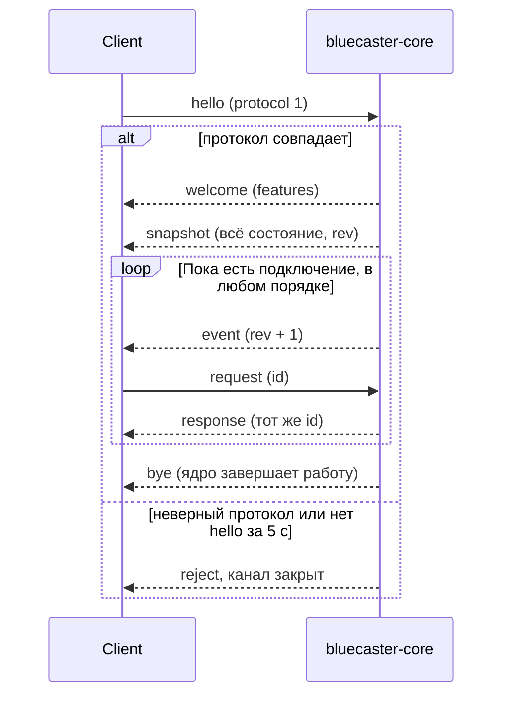

# Интеграция (IPC)
{: .no_toc }

Как сторонний инструмент взаимодействует с ядром BlueCaster: показывает состояние потока, запускает и останавливает профили, задаёт громкость или обращается к собственным службам наушников через Bluetooth-соединение BlueCaster. Инструменты, которые это делают, перечислены на странице [Совместимые инструменты](works-with).

{: .warning }
> Протокол ещё может измениться в ходе бета-версий 2.0.2. Источник истины — [`app/src/crates/ipc/src/protocol.rs`](https://github.com/SeiyaFunaokaJP/BlueCaster/blob/main/app/src/crates/ipc/src/protocol.rs) и сгенерированные из него типы TypeScript в [`app/src/ui/src/ipc/bindings`](https://github.com/SeiyaFunaokaJP/BlueCaster/tree/main/app/src/ui/src/ipc/bindings). Эта страница объясняет, как ими пользоваться, но не перечисляет все поля.

## Содержание
{: .no_toc .text-delta }

1. TOC
{:toc}

## Подключение {#connecting}

Ядро (`bluecaster-core.exe`) работает, пока работает BlueCaster, с окном или без него. Оно ожидает подключений на именованном канале пользователя, от имени которого запущено:

```
\\.\pipe\bluecaster-<user SID>
```

- `<user SID>` — строка SID вошедшего в систему пользователя (`S-1-5-21-...`), например из `whoami /user`. У каждого пользователя свои ядро и канал; DACL канала допускает только этого пользователя, а удалённые клиенты отклоняются.
- Канал работает в байтовом режиме. Одновременно могут быть подключены несколько клиентов (окно BlueCaster — один из них); каждый получает одно и то же состояние и одни и те же события.
- До 2.0.x канал назывался `\\.\pipe\a2dpwb-<user SID>`. BlueCaster 3.0.0 обслуживает **оба** имени и будет обслуживать старое ещё не менее 6 месяцев после 3.0.0. Клиенту следует сначала пробовать `bluecaster-<user SID>`, а при неудаче — старое имя. Версия протокола остаётся 1.
- Если канала нет, ядро не запущено. Проверяйте это по каналу, а не по мьютексу ядра.
- Сборки для разработки, запущенные с `BLUECASTER_INSTANCE=<name>`, вместо этого ожидают подключений на `\\.\pipe\bluecaster-<SID>-<name>`, чтобы работать рядом с установленной копией.

### Кадры

Каждое сообщение в обоих направлениях — один кадр: длина JSON в виде **u32 little-endian**, затем сам JSON (UTF-8). Кадры больше 4 MiB отклоняются.

### Рукопожатие

1. Клиент отправляет `hello` в течение 5 секунд после подключения:
   ```json
   {"type": "hello", "protocol": 1, "client": "mytool/1.2.0"}
   ```
   `client` — произвольное имя с версией; оно появляется в журнале ядра.
2. Ядро отвечает `welcome` или же `reject` и закрывает канал (неверная версия протокола или нет hello):
   ```json
   {"type": "welcome", "protocol": 1, "server": "bluecaster-core/2.0.2-beta.12", "features": ["rfcomm"]}
   {"type": "reject", "reason": "protocol 2 not supported (core speaks 1)"}
   ```
3. Ядро отправляет `snapshot` со всем своим состоянием, затем события `event`.

Версия протокола должна совпадать точно. Дополнения, с которыми версия 1 продолжает работать, вместо этого объявляются в `features` (см. [Совместимость](#compatibility)).



## Состояние и события {#state-and-events}

```json
{"type": "snapshot", "rev": 41, "state": {"adapter": {...}, "devices": [...], "stream": {...}, "profiles": [...], "active_profile": "WH-1000XM5", "settings": {...}, ...}}
{"type": "event", "rev": 42, "event": {"kind": "stream", "value": {"state": "streaming", "profile": "WH-1000XM5", "info": {"codec": "ldac", "bitrate_kbps": 990, ...}, "volume": 80, ...}}}
```

Клиент не хранит собственного состояния: он держит последний снимок и применяет к нему каждое событие. Каждое событие состояния **целиком заменяет одну часть** снимка:

| Событие `kind` | Заменяет |
|:--|:--|
| `adapter` | `adapter` |
| `devices` | `devices` |
| `scanning`, `le_scanning` | `scanning`, `le_scanning` |
| `stream` | `stream` (состояние, сообщение, профиль, сведения о кодеке, громкость, заряд батареи) |
| `profiles` | `profiles` и `active_profile` |
| `settings` | `settings` |
| `update` | `update` |
| `capture` | `capture` |
| `v1_running`, `verbose`, `crashes` | одноимённое поле |

`stream.state` принимает одно из значений `idle`, `connecting`, `streaming`, `reconnecting`, `error`; `stream.message` сообщает причину в виде [ключа сообщения](#errors-and-messages).

**Ревизии.** Каждое событие состояния несёт следующую ревизию (`rev` + 1). Пропуск означает, что событие потеряно: отправьте `state.snapshot`, чтобы получить новый снимок. Клиент, который читает слишком медленно, тоже получает от ядра новый `snapshot` без запроса. События, не относящиеся к состоянию (`link`, `log`, `receiver`, `rfcomm_data`, `rfcomm_closed`), несут текущую ревизию и не увеличивают её.

Завершая работу, ядро отправляет событие `bye` и закрывает канал.

## Запросы {#requests}

```json
{"type": "request", "id": 7, "method": "stream.start", "params": {"profile": "WH-1000XM5"}}
{"type": "response", "id": 7, "result": null, "error": null}
```

- `id` — любое число, которое выбирает клиент; ответ возвращает его обратно. Запросы выполняются параллельно, поэтому ответы могут приходить не в том порядке, в котором отправлены запросы.
- Для методов без параметров `params` не указывается.
- Запрос, изменяющий состояние, отвечает после завершения, а само изменение также приходит событием. Клиентам следует показывать состояние по событиям, а не по ответу.

### Ошибки и сообщения {#errors-and-messages}

```json
{"type": "response", "id": 8, "result": null, "error": {"code": "rfcomm.not_connected", "message": {"key": "ipc.error.rfcomm_not_connected", "args": []}}}
```

`code` предназначен для программы (`adapter.driver_missing`, `app.streaming`, ...). `message` — ключ перевода из языковых файлов BlueCaster ([`app/lang`](https://github.com/SeiyaFunaokaJP/BlueCaster/tree/main/app/lang)) с аргументами в стиле printf, как и тексты состояния в снимке; инструмент может найти ключ там или показать для кода собственный текст.

### Методы {#methods}

Методы для инструментов:

| Метод | Параметры | Результат |
|:--|:--|:--|
| `state.snapshot` | -- | `Snapshot` |
| `stream.start` | `profile` | `null`; сначала останавливает уже идущий поток |
| `stream.stop` | -- | `null` |
| `stream.set_volume` | `volume` (абсолютная громкость AVRCP 0-127) | `null` |
| `profile.set_active` | `name` | `null` |
| `device.scan` | `seconds` (3-600) | `Device[]`, также в виде события `devices` |
| `device.scan_stop` | -- | `null`; отвечает идущий `device.scan` |
| `audio.devices` | -- | `AudioDevice[]` (источники захвата) |
| `diag.subscribe` | `logs` (уровень или `null`), `link` (bool), `receiver` (bool, необязательно) | `null`; включает или выключает события `log` / `link` / `receiver` для этого подключения |
| `diag.info` | `{"mask": bool}` (необязательно) | `DiagInfo` (текст «Копировать диагностику») |
| `rfcomm.open`, `rfcomm.send`, `rfcomm.close` | см. [Сквозной канал RFCOMM](#rfcomm-passthrough) | |

Методы, которые использует окно BlueCaster и которыми инструменту следует пользоваться с осторожностью: `profile.save` / `profile.delete`, `settings.set` (заменяет **все** настройки: отправляйте последние полученные `settings` со своим изменением, никогда не частичный объект), `device.forget` / `device.rename`, `adapter.*` (`adapter.assign_winusb` и `adapter.restore_driver` показывают запрос UAC; `adapter.probe` и `adapter.run_script`, инструменты для чипов из режима разработчика, останавливают стек Bluetooth), `app.quit`. Остальные (`stream.start_custom`, прочие `device.*` (`device.import_windows_pairings` показывает запрос UAC), `audio.apps`, `audio.mixer` / `audio.mixer_set`, `diag.*` помимо двух указанных выше, `receiver.*`, `app.*`) обслуживают собственные экраны окна и могут меняться без предупреждения. Полный список с параметрами и результатами — перечисление `Method` в `protocol.rs`.

## Сквозной канал RFCOMM {#rfcomm-passthrough}

Доступен, если `welcome.features` содержит `"rfcomm"` (2.0.2-beta.10 и новее). Позволяет инструменту обращаться к собственным службам RFCOMM наушников (фирменные приложения производителей: батарея, шумоподавление, эквалайзер) через уже установленное соединение BlueCaster, поскольку Windows не видит наушники, подключённые через BlueCaster.

- `rfcomm.open {address, uuid}` → `{channel_id, mtu}`. `address` должен быть устройством, на которое идёт передача; ядро ради этого никогда не подключается и не выполняет сопряжение (`rfcomm.not_connected`). `uuid` — полный 128-битный UUID или 16-битный `"xxxx"` на базе Bluetooth Base UUID. Ответ приходит в течение 20 с, даже если запрос стоит в очереди за другими открытиями: ждите не менее 25 с. Ошибки: `rfcomm.not_connected`, `rfcomm.service_not_found`, `rfcomm.open_failed`, `rfcomm.busy`.
- `rfcomm.send {channel_id, data}` → `null`. `data` — base64 (стандартный, с дополнением), не более 64 KiB на запрос, отправляется кадрами не больше `mtu` в порядке запросов. Ошибки: `rfcomm.no_channel`, `rfcomm.busy` (очередь заполнена, не отправлено), `rfcomm.timeout` (неизвестно, отправлено ли: не повторяйте, откройте канал заново).
- Принятые данные приходят событиями `rfcomm_data` `{channel_id, data}` только тому подключению, которое открыло канал.
- `rfcomm.close {channel_id}` → `null`, после данных, отправленных до него; событие `rfcomm_closed` после этого не приходит.
- Канал также закрывается, когда завершается подключение к именованному каналу, или событием `rfcomm_closed` `{channel_id, reason}`: `remote` (устройство закрыло его или соединение разорвалось), `disconnected` (подключение A2DP завершилось), `stopped` (стек Bluetooth остановлен), `overflow` (клиент оставил непрочитанными более 1 MiB принятых данных).

## Совместимость {#compatibility}

- **Возможности.** Проверяйте `welcome.features`, прежде чем использовать дополнение. Ядра до 2.0.2-beta.10 не передают это поле.
- **Неизвестные запросы.** На запрос, который ядро не может разобрать (неизвестный метод, неверные параметры), приходит ошибка `ipc.bad_request`; подключение остаётся открытым. Ядра до 2.0.2-beta.10 вместо этого закрывают подключение. Любой другой нечитаемый кадр закрывает его.
- **Новые поля.** Со временем ядро добавляет поля в состояние и в события. Игнорируйте незнакомые поля и не отклоняйте из-за них сообщение.
- **Переименование в 3.0.0** ([#193](https://github.com/SeiyaFunaokaJP/BlueCaster/issues/193)): канал становится `\\.\pipe\bluecaster-<SID>`. Ядро продолжает ожидать подключений и на `\\.\pipe\a2dpwb-<SID>`, с тем же протоколом, не менее 6 месяцев после 3.0.0; о его удалении будет заранее объявлено в заметках к выпуску. Сначала пробуйте `bluecaster-<SID>`, а при неудаче — `a2dpwb-<SID>`. Мьютекс ядра становится `Local\BlueCaster_Core`; в течение того же срока ядро продолжает удерживать и `Local\A2DPWB_v2_Core`, и об удалении обоих будет объявлено одновременно.

## Пример {#example}

Минимальный клиент на Python (только стандартная библиотека), который выводит состояние потока и следит за его изменениями:

```python
import json, struct, subprocess

sid = subprocess.run(["whoami", "/user", "/fo", "csv", "/nh"],
                     capture_output=True, text=True).stdout.strip().split(",")[1].strip('"')
pipe = open(rf"\\.\pipe\bluecaster-{sid}", "r+b", buffering=0)

def send(msg):
    b = json.dumps(msg).encode()
    pipe.write(struct.pack("<I", len(b)) + b)

def read_exact(n):
    buf = b""
    while len(buf) < n:
        chunk = pipe.read(n - len(buf))
        if not chunk:
            raise EOFError
        buf += chunk
    return buf

def recv():
    (n,) = struct.unpack("<I", read_exact(4))
    return json.loads(read_exact(n))

send({"type": "hello", "protocol": 1, "client": "example/0.1"})
welcome = recv()
assert welcome["type"] == "welcome", welcome
snap = recv()
print("stream:", snap["state"]["stream"]["state"])
while True:
    m = recv()
    if m["type"] == "event" and m["event"]["kind"] == "stream":
        s = m["event"]["value"]
        print("stream:", s["state"], (s.get("info") or {}).get("codec"))
    elif m["type"] == "event" and m["event"]["kind"] == "bye":
        break
```

Чтобы опробовать инструмент, не затрагивая установленный BlueCaster, запустите сборку для разработки с заданными `BLUECASTER_INSTANCE` и `BLUECASTER_CONFIG_DIR` (см. [Сборка](building)) и подключитесь к её каналу.
