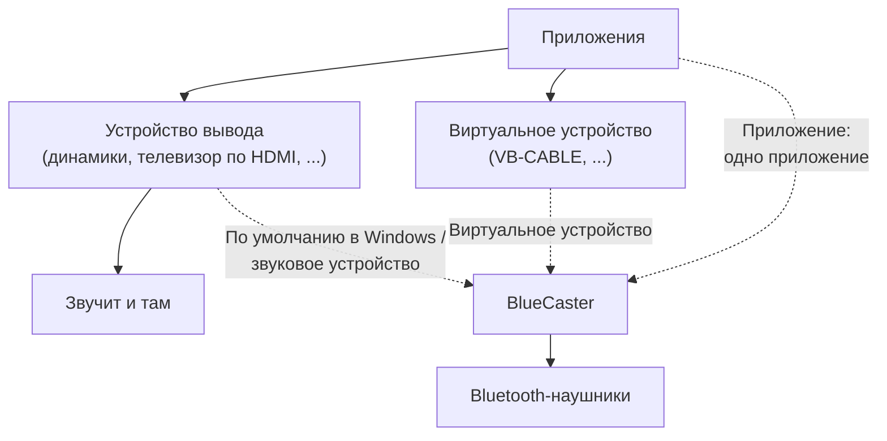
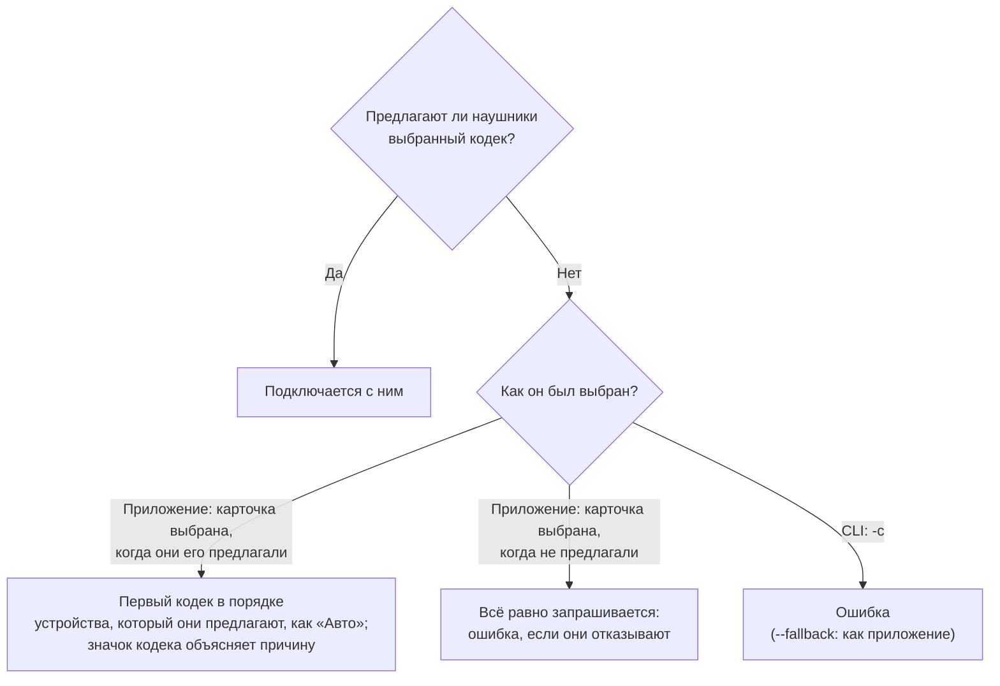

# Использование
{: .no_toc }

## Содержание
{: .no_toc .text-delta }

1. TOC
{:toc}

---

## Окно

Запустите **BlueCaster** из меню «Пуск» (или `bluecaster.exe`). В меню слева находятся описанные ниже экраны («Главная», «Кодеки», «Аудиоустройства», «Адаптеры», «Диагностика», «Параметры», «О программе», а в режиме разработчика — «Разработчик» и, если он там включён, «Микшер громкости»); в узком окне меню сворачивается до значков. Окно только показывает, что делает резидентная программа `bluecaster-core.exe`: его закрытие не останавливает передачу звука (см. [Область уведомлений и мини-окно](#tray)).

### Главная

- Карточка для каждого сохранённого аудиоустройства, рядом друг с другом: его состояние, заряд батареи и, для подключённого устройства, используемый кодек (список вместо его названия, см. ниже) с битрейтом. Если используется не тот кодек, что выбран, строка кодека на несколько секунд показывает причину рядом с его названием, например **aptX Adaptive (Opus не поддерживается)** (или *уже используется*), после чего остаётся только значок предупреждения (причина видна при наведении указателя); строка состояния показывает просто **Подключено**
- **Подключить** / **Отключить** под каждой карточкой. Одновременно подключено одно устройство: **Подключить** у другого устройства отключает используемое и подключает это
- **Громкость**: громкость наушников (см. [Громкость](#volume)); щелчок по значку динамика выключает звук (передаётся тишина), повторный — включает. На карточках остальных устройств ползунок остаётся, но неактивен
- Кодек используемого устройства, выбираемый из списка на его карточке для быстрого переключения (скажем, один для игр, другой для музыки): кодеки, которые поддерживает устройство, как на экране [Кодеки](#codecs), только по названию. Список показывает используемый кодек, в том числе при автовыборе; выбор кодека отключает автовыбор (снова включить его можно на экране «Кодеки»). Выбор применяется сразу (устройство переподключается с ним; следующий выбор ждёт, пока оно не подключится, как на экране «Кодеки»)
- Для используемого устройства — качество связи с небольшим графиком на его карточке, пока идёт передача. Источник вывода выбирается на экране **Аудиоустройства**; пока приложение, заданное как источник вывода, ещё не запущено, карточка устройства сообщает об этом
- Ошибка показывается вместе с причиной и, если она есть, кнопкой, которая её устраняет (**Заменить на драйвер WinUSB**, **Открыть страницу загрузки**, **Перезапустить Bluetooth**, **Повторить**, **Кодеки**, **Аудиоустройства**, ...)
- Над карточками, пока их не закроют: предупреждение, если в Windows активен другой адаптер Bluetooth, и если наушники OPPO включили Hi-Res (см. [Кодеки](#codecs))

Боковая панель показывает то же самое для каждого устройства на каждом экране, а мини-окно в области уведомлений — для используемого устройства.

### Кодеки {#codecs}

Кодек каждого сохранённого аудиоустройства, по разделу на устройство (точка, которая горит зелёным, пока устройство подключено, его название, метки **Сопряжено** / **Аудио**; адрес указан на экране **Аудиоустройства**) с карточками кодеков — сначала с наилучшим качеством звука, если вы не задали свой порядок, — у каждой три полосы (качество звука, низкая задержка, стабильность) и отметка, предлагало ли устройство этот кодек при последнем подключении: **Поддерживается** (зелёный значок) или **Не поддерживается** (красный значок). Когда включён параметр **Показывать только поддерживаемые кодеки** (по умолчанию), показанным карточкам метка **Поддерживается** не нужна, и её нет. Устройство, которое ещё ни разу не подключалось (например, импортированное из Windows), тогда показывает только карточку **SBC** — кодек, который есть у любого аудиоустройства Bluetooth, — плюс выбранный для него кодек; остальные карточки появятся после первого подключения или при выключенном переключателе. Наушники Huawei и Honor сохраняют свою карточку **LDAC** с меткой **Не подтверждено**, пока не сообщат о нём: они могут сделать это только после того, как он выбран. У наушников OPPO, сообщающих пиковый битрейт для LHDC V5, один раз запрашивается Hi-Res, когда передаётся LHDC V5, выбранный вручную или режимом «Авто» (но не с качеством **Низкое** и не с ABR): ради этого они один раз переподключаются, а экран «Главная» сообщает, если это повысило их битрейт; после этого Hi-Res в наушниках остаётся включённым (наушникам, которым это ничего не дало, настройка возвращается обратно). В режиме разработчика **Снова запросить Hi-Res** в настройках LHDC V5 забывает, что сообщило устройство и что у него уже запрашивали, поэтому при следующем подключении запрос повторяется.

- **Автоматически выбирать кодек с наилучшим качеством** (один параметр для всех устройств, вверху страницы; по умолчанию включён): каждое устройство использует поддерживаемый им кодек с наилучшим качеством звука в таком порядке: LHDC V5 > LDAC > aptX Adaptive > Opus > aptX HD > aptX > aptX LL > AAC > SBC XQ > SBC, с настройками по умолчанию: высокое качество, 24 бит, если кодек это поддерживает, и 48 kHz (если у устройства нет 48 kHz — другая частота из его списка, сначала 44,1 kHz; собственная частота Windows пересчитывается), как **Авто** в настройках кодека. Карточки доступны только для чтения, кроме их порядка (перетаскиваются, как описано ниже: «Авто» берёт первую карточку, которую поддерживает устройство), а используемый кодек (или тот, что выберет «Авто») выделен; щелчок по карточке или её **...** спрашивает, отключить ли автовыбор (**Отключить автовыбор** / **Отмена**); когда он отключён, выбирается карточка, по которой щёлкнули (её **...** открывает её настройки). Отключите его, чтобы самостоятельно выбирать кодек и его настройки для каждого устройства; устройство, для которого ещё ничего не выбрано, сохраняет выбор «Авто». Кодек, выбранный для устройства, сохраняется, пока включён автовыбор. Настройки из версий до 2.0.2, в которых для какого-либо устройства был выбран кодек, начинают с выключенным автовыбором
- Когда он выключен, щёлкните карточку, чтобы выбрать кодек этого устройства; выбор сразу сохраняется, а передающее устройство переподключается с ним. Карточка, которую устройство не поддерживает (видна при выключенном **Показывать только поддерживаемые кодеки**), тоже выбирается: BlueCaster всё равно запрашивает этот кодек у устройства, и если оно отказывает, подключение прекращается с сообщением об ошибке (выберите другую карточку или включите автовыбор). Экран «Главная», боковая панель, мини-окно в области уведомлений и всплывающая подсказка значка в области уведомлений при этом называют причину в нескольких словах (например, *LDAC не поддерживается*), как и при любой остановке из-за кодека (кодек, который устройство не поддерживает, отклоняет или использует для другого источника); выбор другой карточки или других настроек для этого устройства либо включение автовыбора снова его подключает. Кодек, выбранный, когда устройство его предлагало, и позже переставший предлагаться (наушники переключились на другой кодек), заменяется первой карточкой в порядке устройства, которую оно поддерживает: лучшим поддерживаемым кодеком, если вы не меняли порядок (см. [Явно выбранный кодек не предлагается](#codec-fallback))
- Перетаскивайте карточки устройства (пока кнопка мыши нажата, отображается рука; при выключенном автовыборе также Alt со стрелкой на карточке), чтобы задать свой порядок кодеков; у каждого устройства свой порядок. Автовыбор и устройство, для которого кодек ещё не выбран, используют первую поддерживаемую им карточку, как и при выбранном кодеке, который оно не поддерживает. FastStream и Opus 05 (карточка **Opus (PipeWire)**, только в режиме разработчика: без него выбранный Opus 05 тоже не используется) используются только при явном выборе, где бы они ни стояли. **Сбросить порядок кодеков** сбрасывает порядок; кнопка видна, только пока показанные карточки стоят не в порядке по умолчанию (если вернуть их на места, порядок снова считается порядком по умолчанию). Передающее устройство, у которого из-за этого меняется кодек, переподключается
- Выбор другого кодека для передающего устройства переподключает его с этим кодеком. Карточки (и список кодеков на экране «Главная» и в мини-окне) затем ждут повторного подключения, прежде чем принять следующий выбор, чтобы быстрая серия щелчков не обрывала ещё устанавливаемое подключение. При смене кодека уведомление о подключении не показывается; при подключении устройства — показывается
- **Показывать только поддерживаемые кодеки** (по умолчанию включено; выключите, чтобы видеть и поддерживаемые, и неподдерживаемые кодеки): кодеки, которые устройство не предлагало, скрываются. До первого подключения устройства показывается только **SBC** (и выбранный для него кодек)
- **...** на карточке открывает настройки этого кодека. Изменение применяется сразу: для используемого кодека оно сохраняется, и устройство переподключается с ним, кроме **Bitpool**, который меняется прямо во время прослушивания, и переключателя ниже, если поток в любом случае будет настроен одинаково; для другого кодека оно сохраняется до момента, когда этот кодек будет выбран. У каждого кодека свои настройки, в том числе отдельно у aptX Adaptive и aptX Adaptive LL: если выбрать другой кодек и вернуться, они восстановятся. Предлагается только то, что умеет этот кодек и о чём устройство сообщило при последнем подключении. Вверху параметр **Показывать только параметры, поддерживаемые *устройство*** (по умолчанию включён; появляется, когда устройство сообщило о них) в выключенном состоянии предлагает всё, что есть у кодека, например частоту дискретизации, разрядность, качество или bitpool, о которых устройство не сообщало (с пометкой *(не поддерживается)*). Устройство может их отклонить: тогда подключение прекращается с сообщением об ошибке. При повторном включении то, о чём устройство не сообщало, возвращается к «Авто». У каждого кодека свой такой переключатель; автовыбор их никогда не использует:
  - **Качество**: LDAC **Высокое** / **Среднее** / **Низкое** (990 / 660 / 330 kbps), LHDC V5 **Высокое** / **Выше среднего** / **Среднее** / **Низкое** (1000 / 900 / 500 / 400 kbps, четыре уровня Android); aptX Adaptive **Высокое** (его режим низкой задержки — отдельная карточка, **aptX Adaptive LL**: 265 kbps, 48 kHz, без ABR; см. [aptX Adaptive](#aptx-adaptive)); при включённом ABR у LHDC V5 качество неактивно (ABR держится на 400 kbps или ниже). У AAC, Opus, Opus 05, SBC и SBC XQ один уровень, **Высокое**, который показывается, а не выбирается: наибольший битрейт, который принимает устройство (ABR или VBR, где они есть, всё равно его меняют; SBC и SBC XQ показывают битрейт, который дают их bitpool и параметры кадра). У aptX, aptX HD, aptX LL и FastStream битрейт задан кодеком. Качество, сохранённое более ранней версией, которого у кодека больше нет (Standard / Mobile у aptX Adaptive, нижние уровни AAC, ...), загружается как «Высокое»
  - **Адаптивный битрейт (ABR)**: для LDAC, LHDC V5, aptX Adaptive, SBC и SBC XQ (см. [ABR](#abr)); **Переменный битрейт (VBR)** для AAC
  - **Частота дискретизации**: «Авто», показываемое с получающейся частотой (например, *Авто (48000 Hz)*), — это 48 kHz или, если у устройства нет 48 kHz, другая частота из его списка, сначала 44,1 kHz (96 kHz добавляет задержку и хуже совместима, без слышимого выигрыша, а Windows микширует на 48 kHz); чтобы использовать 96 kHz, выберите её здесь. Предлагаются только частоты из списка устройства (у LHDC V5 нет 88,2 kHz; 96 kHz у aptX Adaptive — только для устройства, которое её сообщает, см. [aptX Adaptive](#aptx-adaptive)); устройство, сообщающее только одну частоту, показывает её без «Авто»
  - **Разрядность**: 16 или 24 бит для LDAC и LHDC V5 («Авто»: 24 бит; для LHDC V5 — только если устройство её сообщает), в пределах того, что сообщает устройство; 24 бит для aptX HD и aptX Adaptive, 16 бит для остальных. 24 бит у LDAC поступают в кодировщик как 32-битные отсчёты — так же, как при выборе 32 бит в Android: разрядность не входит в конфигурацию LDAC, поэтому наушники в обоих случаях получают одинаковый поток
  - **Bitpool** (SBC, SBC XQ): один ползунок с двумя ручками — минимальным и максимальным bitpool, в пределах диапазона, который сообщает устройство. Максимальный — это используемый bitpool; минимальный — наименьший используемый (нижняя граница диапазона, с которым настраивается подключение, и то, насколько низко может опуститься ABR). **Авто** сбрасывает оба: максимальный — по качеству, минимальный — к значению устройства и ABR. Строка под ним показывает режим каналов, фиксированный для каждого кодека: joint stereo для SBC, dual channel для SBC XQ. Bitpool у SBC XQ доходит до 47 при 44,1 kHz и до 43 при 48 kHz или до 53, если выключен **Показывать только параметры, поддерживаемые *устройство***.
  - **Параметры кадра** (SBC и SBC XQ, только в режиме разработчика): блоки, поддиапазоны, распределение битов и, для SBC, режим каналов. «Авто» оставляет 16 блоков, 8 поддиапазонов, Loudness и Joint stereo. Значение, которое устройство не принимает, при подключении возвращается к «Авто». На устройстве Sony, которое проверял пользователь, 12 блоков искажают звук и могут привести к отключению (вывод кодировщика декодируется правильно; другие числа блоков воспроизводятся). Выбор сохраняется, но не используется, когда режим разработчика выключен. Битрейты AAC и LHDC V5 остаются в пределах максимума, который сообщает устройство

Значения по умолчанию дают наилучший звук; большинству устройств не нужно ничего, кроме **Авто**. У устройства LE Audio (экспериментально) две карточки, **LC3** и **LC3 LL** (см. [LE Audio](#le-audio)); их **...**, как и у кодеков для звонков, показывает те же поля, что и у кодека A2DP, только для чтения. Режим низкой задержки aptX Adaptive — отдельная карточка **aptX Adaptive LL** рядом с **aptX Adaptive**; «Авто» никогда её не выбирает, и aptX Adaptive, переведённый в режим низкой задержки более ранней версией, отображается на ней.

Пока микрофон классического устройства открыт (см. [Аудиоустройства](#audio-devices)), его карточки для музыки уступают место кодекам для звонков, которые оно может использовать: LC3 (32 kHz), mSBC (16 kHz) и CVSD (8 kHz), причём открытый выбран. При автовыборе канал звонка выбирает лучший кодек, поддерживаемый обеими сторонами, а щелчок по карточке спрашивает, отключить ли автовыбор. Когда автовыбор выключен, щелчок по карточке выбирает кодек для звонков: микрофон снова открывается с ним или со следующим более низким, если наушники его не поддерживают. **...** показывает их настройки только для чтения. Когда микрофон закрывается, карточки для музыки возвращаются. Выбранный кодек для звонков сохраняется, пока включён автовыбор. При **Показывать только поддерживаемые кодеки** кодеки, которые наушники не поддерживают, скрываются.

Пока микрофон устройства LE Audio открыт, за его карточками для музыки следует карточка **Микрофон** (LC3, моно). При выключенном автовыборе её **...** позволяет выбрать частоту дискретизации микрофона из поддерживаемых наушниками (**Авто** берёт первую; изменение переподключает устройство); при автовыборе там показана используемая частота.

На самом деле BlueCaster хранит по одной записи на устройство в `profiles.json` (его кодек, настройки каждого кодека и порядок кодеков), где она называется «*устройство* | *кодек*»; окно и меню области уведомлений показывают название устройства. Ранние версии позволяли создавать несколько профилей для одного устройства: при первом запуске версии с экраном «Кодеки» сохраняется последний использованный профиль (иначе первый), а остальные объединяются с ним с сохранением их настроек кодеков (качество, частота дискретизации, разрядность, ABR, настройка SBC) для их кодеков. Их собственные названия, источники вывода и размеры пакетов не сохраняются; `profiles.json` в прежнем виде один раз сохраняется как `profiles-before-codecs.json` в папке настроек. Параметр **Порядок «Авто»…** из предварительных версий 2.0.2 (один порядок для всех устройств, в режиме разработчика) больше не используется: теперь у каждого устройства свой порядок.

### Аудиоустройства {#audio-devices}

Наушники и колонки, на которые BlueCaster может передавать звук, каждое со своими настройками, а под ними — **Добавление аудиоустройства**: **Найти устройства** ищет устройства поблизости с помощью USB-адаптера (30 секунд, устройства появляются по мере ответа; **Остановить поиск** завершает его; переведите наушники в режим сопряжения; если устройство подключено, сначала предлагается его отключить). **Добавить** сохраняет найденное устройство и подключает его. Устройства, с которыми BlueCaster уже выполнял сопряжение, помечены как **Сопряжено**. Если поиск их не находит, введите адрес в поле **Вручную:** и нажмите **Добавить**; введённые или вставленные адреса форматируются по мере ввода (`aa-bb-cc-dd-ee-ff`, `AABBCCDDEEFF` и `AA BB CC DD EE FF` — все превращаются в `AA:BB:CC:DD:EE:FF`). Наушники видят адаптер под именем вашего компьютера с припиской BlueCaster, например *Taro-PC (BlueCaster)*, чтобы его можно было отличить от собственного Bluetooth Windows. Устройство, которое Windows сопрягла через другой адаптер, например встроенный Bluetooth компьютера, сначала выдаёт вопрос (**Сопряжено в Windows**: удалите его там или нажмите **Всё равно добавить**); так же и устройство, которое Windows сопрягла через этот адаптер (импорт его сопряжения выполняется в мастере настройки, см. [Службы и ключи сопряжения](#shared-pairing)). Сохранённое устройство можно переименовать или удалить (при удалении удаляются также его настройки и сопряжение, поэтому оно не сможет подключиться, пока сопряжение не будет выполнено снова), и у него есть:

- **Источник вывода**: **По умолчанию в Windows**, отдельно первым в списке (устройство вывода Windows по умолчанию, названное в скобках, которое тоже может быть виртуальным; значение по умолчанию для нового устройства); в разделе **Звуковые устройства** — одно устройство вывода; виртуальное устройство; или приложение (см. [Режимы захвата](#capture-modes)). Рядом — формат, в котором Windows микширует захватываемое устройство (частота дискретизации и разрядность, только для чтения); он выделен янтарным, если устройство передаёт (или, когда не подключено, его настройки кодека требуют) другой формат, а строка ниже называет оба формата (передача всё равно идёт, с преобразованием); ниже — что делает источник
- **Делать устройством вывода по умолчанию на время подключения** — с виртуальным или звуковым устройством, в режиме разработчика
- **Источник ввода**: микрофон наушников и **Делать устройством ввода по умолчанию на время подключения** в режиме разработчика (см. ниже)

**Источник ввода**, у каждого устройства: микрофон наушников становится доступен Windows для звонков и голосового чата. У BlueCaster нет собственного аудиодрайвера, поэтому он воспроизводит микрофон в виртуальный аудиокабель, например VB-CABLE. Список называет каждый кабель по той стороне, с которой записывают приложения (*CABLE Output* у VB-CABLE), — именно её нужно выбрать в качестве микрофона в приложениях. **Выкл.**, **Авто** или **Вкл.** рядом со списком: **Авто** открывает микрофон, только пока какое-нибудь приложение с него записывает, так что в остальное время воспроизведение сохраняет полное качество; **Вкл.** держит его открытым. В положении **Выкл.** список остаётся на месте, но неактивен. **Выкл.** и кнопка микрофона на экране «Главная» и в мини-окне — один и тот же параметр: для устройства в режиме **Авто** или **Вкл.** положение **Выкл.** выключает микрофон, как и кнопка, и сохраняет режим, который кнопка снова включает. **Делать устройством ввода по умолчанию на время подключения** (в режиме разработчика; без режима разработчика всегда включено) делает записывающую сторону кабеля (*CABLE Output*) микрофоном Windows по умолчанию, пока устройство подключено, так что приложения, записывающие с микрофона по умолчанию, получают микрофон наушников, а **Авто** открывает его для них; когда устройство отключается, возвращается прежнее устройство по умолчанию, если за это время не было выбрано другое. Устройство, добавленное с этого момента, начинает с VB-CABLE, если он установлен, иначе с Hi-Fi Cable, если только его **Источник вывода** не этот кабель: классическое устройство — в режиме **Авто**, устройство LE Audio — в режиме **Выкл.** (там **Авто** держит микрофон открытым). Устройство, у которого микрофон включён без кабеля, получает кабель, как только Windows его покажет. **Аудиоустройства** и мастер настройки предлагают недостающие кабели (см. [Режимы захвата](#capture-modes)); когда кабель устанавливается позже, устройства, которые BlueCaster настроил сам, и устройства с источником **По умолчанию в Windows** и таким микрофоном настраиваются заново, как это сделал бы мастер: при двух кабелях — Hi-Fi Cable для звука и VB-CABLE для микрофона; при одном — этот кабель для микрофона и устройство вывода из раздела **Звуковые устройства** для звука (звук монитора или телевизора, если он есть, а из нескольких — устройство вывода Windows по умолчанию; иначе устройство вывода Windows по умолчанию), какое бы устройство ни было устройством вывода Windows по умолчанию; источник вывода или микрофон, выбранные вами самостоятельно, остаются как есть. Если кабеля нет, а в Windows есть и звук монитора или телевизора, и звуковая карта, звук берётся с первого, а микрофон воспроизводится в звуковую карту в положении **Выкл.**: приложение, записывающее устройство вывода (захват выхода звука в OBS), может взять его оттуда, когда он в положении **Вкл.**; **Авто** не может определить, кто слушает звуковую карту. Устройство, добавленное в разделе **Аудиоустройства**, начинает так же. Устройство с источником **По умолчанию в Windows**, у которого микрофон воспроизводится в кабель, являющийся устройством вывода Windows по умолчанию, тоже переводится на этот звук, так как иначе микрофон звучал бы в наушниках. Если микрофон воспроизводится в Hi-Fi Cable, а сторона воспроизведения и сторона записи этого кабеля работают в параметрах звука Windows с разной частотой дискретизации, об этом сообщает предупреждение: если приложения ничего не слышат, задайте для обеих одинаковую частоту. Список содержит только кабели, с которых приложения могут записывать. Кабель, который захватывает сам BlueCaster (**Источник вывода** или, при **По умолчанию в Windows**, устройство вывода Windows по умолчанию, но не источник вывода другого устройства, ставший устройством по умолчанию, пока то подключено), в нём отсутствует, как и другая сторона того же кабеля (*CABLE In 16ch* у VB-CABLE записывает в тот же *CABLE Output*, что и *CABLE Input*): иначе микрофон смешивался бы с воспроизводимым звуком. Точно так же, пока **Источник ввода** не в положении **Выкл.**, список **Источник вывода** не показывает кабель, в который воспроизводится микрофон. Если включён параметр **Разработчик > Настройки приложения > Показывать все аудиоустройства в списках источников**, оба списка предлагают все устройства: выходы без записывающей стороны (динамики и т. п.) — в разделе **Прослушивание**, так как они только воспроизводят микрофон; 16-канальный кабель VB-CABLE — как *CABLE Output · CABLE In 16ch* (общая записывающая сторона, затем собственное имя); а кабель источника вывода — неактивным, с пометкой *(используется как источник вывода)* после имени. *CABLE Input* и *CABLE Output* — два конца одного кабеля: для виртуального источника вывода и микрофона одновременно нужны два кабеля. Рекомендуется: **Hi-Fi Cable** от VB-Audio (*HiFi-Cable & ASIO-Bridge* на [странице VB-Audio](https://vb-audio.com/Cable/)) для звука, так как он даёт наименьшую задержку, и VB-CABLE для микрофона. Устройство микрофона также не должно быть устройством вывода Windows по умолчанию: приложения слышали бы воспроизводимый звук вперемешку с микрофоном, а источник вывода, являющийся другим устройством, ничего бы не получал; об этом сообщает предупреждение под **Источник ввода**. Классическое устройство Bluetooth, пока открыт микрофон, воспроизводит звук через канал звонка: моно с качеством телефонного звонка (CVSD, mSBC или LC3 — лучшее, что поддерживают обе стороны); его кодек на это время затемнён, а когда микрофон закрывается, устройство возвращается к этому кодеку без переподключения. Устройство LE Audio продолжает воспроизводить LC3 с обычным качеством и передаёт микрофон параллельно; смена режима переподключает его («Авто» там держит микрофон открытым). Некоторые наушники могут отказать в этом или показывать звонок, хотя никакого звонка нет. В режиме **Авто** или **Вкл.** при выбранном устройстве строка **Микр.:** под кодеком — на боковой панели, на экране «Главная» и в мини-окне — показывает микрофон, пока устройство подключено или подключается: его кодек и частоту с красной точкой, пока он открыт (*Микр.: mSBC 16 kHz*), и затемнённый режим, пока он закрыт. На экране «Главная» и в мини-окне кнопка микрофона рядом выключает микрофон (перечёркнута: он закрывается, классическое устройство возвращается к своему кодеку, а **Источник ввода** показывает **Выкл.**); следующий щелчок снова включает его в прежнем режиме, как и выбор **Авто** или **Вкл.** в **Источник ввода**. Кнопка отображается пунктиром, пока «Авто» ждёт приложение, и показывает значок предупреждения с причиной во всплывающей подсказке, если микрофон не открылся.

**Все аудиоустройства** над списком содержит переключатели, действующие для всех устройств: **Синхронизация громкости Windows** (см. [Громкость](#volume)), **Управлять воспроизведением кнопками аудиоустройства** и **Переподключаться автоматически**. **Макс. размер медиапакета** каждого устройства находится на экране **Разработчик** (см. [Максимальный размер медиапакета](#max-packet)).

### Диагностика

- **Качество связи** во время передачи: фактический битрейт, пакеты, пакеты, отброшенные до отправки, звук, потерянный при захвате, очередь отправки, задержка, о которой сообщает устройство (см. [Задержка](#latency)), занятое эфирное время, сигнал (RSSI) и каналы AFH (см. [Качество связи и AFH](#link-quality)). Пока открыт микрофон гарнитуры, канал звонка классического устройства измеряется так же (его кодек, например mSBC, и что он передаёт), а для возвращающихся пакетов есть карточка **Микрофон**: принятые, повреждённые в эфире и скрытые
- **Радио**: 79 каналов Bluetooth в диапазоне 2,4 GHz — какие использует соединение и какие пропускает адаптер, с каналами Wi-Fi под ними и несколькими советами, как получить более чистое соединение. В режиме разработчика **Сканировать** добавляет окружающие сети Wi-Fi 2,4 GHz (см. [Вкладка «Радио»](#radio-tab))
- **Сведения о кодеке** во время передачи: медиаданные, заголовки, кадр кодека и число кадров на пакет, а также что сообщает точка подключения устройства рядом с тем, что используется: для SBC — bitpool, частоты дискретизации, режимы каналов, блоки, поддиапазоны и распределение битов; для AAC — типы объектов, частоты дискретизации, каналы, пиковый битрейт и VBR; для остальных кодеков — частоты дискретизации, разрядности и пиковый битрейт
- **Микрофон**: проверяет микрофон гарнитуры классического устройства Bluetooth во время передачи. **Записать** открывает микрофон (на это время устройство воспроизводит звук с качеством звонка; если в его подключении микрофон ещё ни разу не открывался, оно сначала переподключается) и записывает до 10 секунд, показывая уровень на шкале; **Воспроизвести** воспроизводит запись в наушниках. Уход с вкладки завершает проверку, и воспроизведение возвращается к своему кодеку. Устройства LE Audio пока не поддерживаются
- **Ход подключения**: одиннадцать этапов последней попытки подключения (запуск, адаптер Bluetooth, подключение ACL / AVDTP, обнаружение возможностей, выбор кодека, захват звука, настройка потока, кодировщик, запуск потока, отправка звука, поддержание соединения с отключениями / переподключениями) со статусом «ОК», «Предупреждение» или «Ошибка» и затраченным временем. **Копировать ход** копирует его
- **Журнал**: в реальном времени, с фильтрами по уровню (все, info и выше, предупреждения и ошибки, только ошибки), по тексту и по текущей попытке подключения (**Только текущая попытка**). **Копировать показанный журнал** копирует то, что показано. **Открыть папку журналов** открывает папку с файлами журналов; в отличие от **Копировать диагностику**, эти файлы не обезличены (в них есть адреса Bluetooth и ваше имя пользователя Windows)
- **Начать запись HCI** / **Остановить запись HCI** (см. [Проверка медиапотока](#verify-stream))
- **Копировать диагностику**: версия, ОС, адаптер, аудиоустройство (кодек, его настройки и порядок), ход подключения, предупреждения / ошибки и недавний журнал — в буфер обмена, готовые для вставки в отчёт об ошибке. **Скрывать адреса Bluetooth** (по умолчанию включено) заменяет адреса на `<addr-1>`, `<addr-2>`... (собственный адрес адаптера — на `<adapter>`), а названия устройств — на `<device-1>`, `<device-2>`..., и скрывает серийные номера USB, пути к файлам выше собственной папки приложения (`<path>\BlueCaster\logs\...`) и вашу учётную запись Windows (имя пользователя и SID). То же скрытие применяется к отчёту о сбое и к текстам ошибок, копируемым для отчёта об ошибке
- **Сообщить о проблеме**:
  - **Подробное журналирование**: **Подробно (debug)** или **Всё (trace, 1 час)** записывает в журнал гораздо больше о Bluetooth, USB, захвате и кодировании звука. Debug остаётся включённым 24 часа, в том числе после перезапусков (для проблем при запуске), а затем выключается сам. Включите его, воспроизведите проблему и сохраните диагностический архив
  - **Диагностический архив > Сохранить…**: выберите, включать ли записи HCI (выключено, если вас о них не просили: в них сохраняются адреса и названия устройств) и скрывать ли адреса Bluetooth в текстовых файлах, затем сохраните один `.zip` (в `logs\bundles\` папки настроек, хранятся 3 последних): диагностические сведения, файлы журналов ядра, окна и вспомогательной программы драйвера, отчёты о сбоях, сведения о системе (USB-адаптеры Bluetooth и их драйверы, сопряжённые в Windows устройства, аудиоустройства), настройки и настройки кодеков каждого устройства (но никогда не ключи связи) и бортовой самописец HCI. В записях HCI сохраняются адреса (но не ключи сопряжения). По возможности архив укладывается в ограничение GitHub на вложения в 25 MB (сначала самые новые журналы, до 48 MB текста, 5 последних записей и 2 минидампа)
  - **Сообщить на GitHub** (после сохранения): открывает новый отчёт об ошибке с уже заполненными версией, сборкой Windows, адаптером, наушниками, кодеком, режимом захвата и диагностическими сведениями (адреса скрыты) и показывает архив в проводнике, чтобы перетащить его в отчёт

Кроме того, BlueCaster постоянно записывает некоторые данные, чтобы можно было разобраться даже с проблемой, которая случилась один раз:

- **Бортовой самописец HCI**: последние несколько минут трафика Bluetooth хранятся в памяти (медиаданные обрезаны, ключи сопряжения удалены) и сохраняются в `logs\hci\` при каждом сбое потока или потере соединения (хранятся 10 последних файлов)
- **Отчёты о сбоях**: при сбое BlueCaster минидамп `.dmp` и файл `.txt` сохраняются в `logs\crash\` (по 5 последних для каждой программы)

Место на диске ограничено: журнал за обычный день занимает гораздо меньше 1 MB, хранятся 7 дней; с подробным журналированием файл за день занимает не более 100 MB строк debug и trace (после этого до следующего дня записываются только info и выше); файлы бортового самописца занимают не более нескольких MB, хранятся 10.

### Разработчик {#developer}

Показывается, пока включён параметр **Параметры > Режим разработчика**; большинству пользователей он не нужен. Он предназначен для проверки устройств и устранения неполадок: некоторые его настройки работают только с некоторыми устройствами. Семь вкладок:

- **Настройки приложения**: **Использовать микшер громкости** (по умолчанию выключено): экран **Микшер громкости**, список приложений в мини-окне и отключение звука вывода (см. [Режимы захвата](#capture-modes)). Не рекомендуется; VB-CABLE — лучший способ сохранить тишину на ПК. **Показывать все аудиоустройства в списках источников** (по умолчанию выключено): **Источник вывода** и **Источник ввода** на экране **Аудиоустройства** предлагают все устройства, включая неподходящие для них (см. [Аудиоустройства](#audio-devices)). **Скрыть предупреждение о виртуальных аудиоустройствах** (по умолчанию выключено) убирает предупреждение о том, что не хватает кабеля VB-Audio (см. [Режимы захвата](#capture-modes)). **Включать альфа-версии** (по умолчанию включено в альфа-сборке) предлагает также альфа-выпуски (см. [Обновления](#updates))
- **Настройки кодеков**: переключатели, помогающие выяснить, почему устройство молчит (бит маркера RTP, запись первых медиапакетов в журнал, конфигурация AAC и параметры кодировщика), **Макс. размер медиапакета** каждого сохранённого устройства (см. [Максимальный размер медиапакета](#max-packet)). **Применять настройки кодека при его автовыборе**: при включённом автовыборе **…** на карточке кодека открывается без отключения автовыбора, а кодек, выбранный «Авто», подключается с этими настройками вместо настроек «Авто». **Подстраивать частоту и разрядность под вывод компьютера**: частота дискретизации или разрядность в режиме «Авто» следуют формату устройства вывода в параметрах звука Windows вместо 48 kHz: из частот, которые устройство сообщает для кодека, выбирается собственная частота ПК, иначе ближайшая из того же семейства (кратные 44,1 или 48 kHz), иначе ближайшая выше неё; 16-битный вывод передаётся с разрядностью 16 бит. **Игнорировать пиковый битрейт устройства**: каждый кодек работает с битрейтом выбранного качества, даже если устройство сообщает меньший максимум (битрейт LHDC V5, AAC или Opus 05, bitpool SBC), а экран **Кодеки** предлагает все уровни качества и значения bitpool. Выше своего максимума устройство может терять звук или замолкать. **Лимит очереди отправки**: сколько медиапакет может ждать в очереди отправки, прежде чем будет отброшен, от 50 до 2000 ms (пусто = 350 ms); на хорошем соединении он не уменьшает задержку (см. [Задержка](#latency)). **Кодировать в момент отправки**: пока соединение стоит, звук ждёт в некодированном виде, а не в виде уже закодированных пакетов, поэтому при включённом ABR (SBC, SBC XQ, LDAC, LHDC V5 и aptX Adaptive) он уходит с битрейтом, до которого ABR тем временем снизился, а не с тем, что использовался в начале остановки. Саму остановку это не сокращает: ничего не уходит, пока радиоканал снова не начнёт передавать, и меньше данных требуется только для последующего догоняния. Звук, который ждёт дольше лимита очереди отправки, отбрасывается в любом случае; «Диагностика» учитывает ожидающий звук во времени ожидания в очереди отправки. По умолчанию всё выключено и применяется при запуске следующего потока; пока что-либо включено, об этом сообщает баннер. **Выключить все** сбрасывает их
- **Производители**: когда BlueCaster использует собственные протоколы наушников (Huawei: LDAC, OPPO: Hi-Res; см. [Кодеки](#codecs)), для каждого с параметром **Протокол производителя**: **Авто** (наушники, по названию которых видно, что они этого производителя; по умолчанию), **Всегда** (любое устройство) или **Никогда**. У OPPO есть также **Запрашивать Hi-Res при каждом подключении (каждый раз с переподключением)**. Изменения применяются при запуске следующего потока; пока что-либо изменено, об этом сообщает баннер, а **Выключить все** сбрасывает их. Когда режим разработчика выключен, они не используются
- **Журналирование**: сколько хранить файлы журналов (по умолчанию 7 дней), суточное ограничение размера (по умолчанию 100 MB), подробное журналирование, которое остаётся включённым (без ограничения в 24 часа или 1 час, в том числе с момента запуска ядра), строка о состоянии потока каждые 10 секунд и **Добавить метку** (пронумерованная строка в журнале, чтобы потом найти нужный момент). При выключении режима разработчика возвращаются значения по умолчанию
- **Тест с приёмником**: передаёт звук на измерительный приёмник на другом ПК и сравнивает отправленное с полученным (см. [Тест с приёмником](#receiver))
- **Чип**: выполняет скрипт чипа на адаптере с WinUSB: запросы к чипу, введённые вручную или открытые из файла, для тех, кто добавляет поддержку чипа (см. [Добавление поддержки чипов](chip-support#chip-scripts)). Строки, которые могут изменить чип, выполняются только после **Выполнить их**; Bluetooth для этого останавливается и снова запускается при следующем использовании
- **Отладка**: эксперименты, по умолчанию все выключены. **Realtek**: **Загружать прошивку RTL8761B из драйвера Realtek для Windows на этом компьютере** загружает прошивку, установленную драйвером Realtek для Windows (она остаётся после перевода адаптера на WinUSB), вместо прошивки из папки прошивки; файл конфигурации по-прежнему берётся из папки, а без этого драйвера загружается прошивка из папки. Адаптер может после этого сообщать более новую версию Bluetooth; улучшает ли это что-то ещё, не проверялось. **Ключи сопряжения и Windows**: **Также копировать ключи LE в Windows при восстановлении исходного драйвера** при нажатии **Восстановить исходный драйвер** записывает ключи LE BlueCaster (Long Term Key, EDIV, Rand, размер ключа, Identity Resolving Key) в Windows — только для устройств, ключи LE которых Windows уже хранит для этого адаптера; старые ключи Windows сохраняются в `pairing\replaced_windows_keys.json`, доступном для чтения только вашему пользователю Windows. **Сравнить с Windows** (права администратора) подсчитывает для одного адаптера устройства, ключи связи и ключи LE которых в BlueCaster и Windows совпадают, различаются или есть только на одной стороне. Он показывает и записывает в журнал только числа, никогда не адрес или ключ, поэтому результатом можно делиться. Он также выводит имена, типы и размеры значений, которые Windows хранит для адаптера и его устройств LE, но никогда не их данные

### Адаптеры

- Обнаруженные USB-адаптеры Bluetooth с чипом, адресом, USB ID, версией Bluetooth, **Драйвер** и **Прошивка**; список обновляется сам, когда адаптер подключают или отключают. Драйвер — это **Исходный драйвер** (установленный Windows или производителем; его название видно при наведении указателя) или **Драйвер WinUSB** (тот, который использует BlueCaster). Адаптер Realtek показывает свой адрес, взятый из серийного номера USB, ещё до первого использования; у остальных адрес и версия Bluetooth появляются после того, как адаптер использовал Bluetooth Windows или BlueCaster (почему — видно при наведении указателя на строку). Адаптер, который BlueCaster не может использовать (некоторые MediaTek и Qualcomm), сохраняет свой драйвер: его кнопки WinUSB и прошивки неактивны. В режиме разработчика ему всё равно можно назначить WinUSB, а **Прочитать сведения о чипе** на адаптере с WinUSB сохраняет ответы его чипа на несколько команд чтения в `logs\probe\` для того, кто будет добавлять для него поддержку (Bluetooth для этого останавливается и снова запускается при следующем использовании); затем **Сообщить на GitHub** открывает issue с этими данными. Пока запускается адаптер, прошивку которого BlueCaster загружает сам (Intel, MediaTek, Qualcomm), экран показывает загрузку и то, не завершилась ли она ошибкой
- **Заменить на драйвер WinUSB** / **Восстановить исходный драйвер** (см. [Настройка](setup#winusb)); Windows каждый раз запрашивает права администратора, как и для любой кнопки со щитом. При восстановлении Windows получает от BlueCaster более новые сопряжения устройств, которые Windows тоже сопрягла через этот адаптер, поэтому они подключаются в Windows без повторного сопряжения. **Ограничение:** ключи LE не передаются, поэтому устройство, которое Windows использует через LE (LE Audio), нужно сопрячь в Windows заново (в режиме разработчика это можно попробовать: **Разработчик > Отладка**)
- **Чип Bluetooth** для прошивки с кнопками **Скачать прошивку**, **Открыть страницу загрузки** и **Открыть папку прошивки** (см. [Прошивка](setup#firmware)). Адаптер другого производителя вместо этого показывает, откуда берётся его прошивка, например **Из драйвера MediaTek**, **Из папки прошивки** или **Не требуется**, а также **Загружена**, когда BlueCaster её загрузил
- **Обходить каналы Wi-Fi**: «Авто», «Выкл.» или «Вручную», с каналами Wi-Fi рядом: каналы, которые сейчас обходит «Авто», и ничего для «Выкл.» (оба только для чтения), введённые вами каналы для «Вручную» (см. [Качество связи и AFH](#link-quality))
- **Стек Bluetooth**: остановлен (запускается при первом поиске или подключении), запускается, готов или ошибка, а также **Перезапустить Bluetooth**

### Параметры

| Раздел | Параметры |
|:-------|:----------|
| Оформление | Язык, тема (Системная / Светлая / Тёмная) |
| Запуск | **Запускать вместе с Windows** и **Запускать в области уведомлений** (см. [Запуск вместе с Windows](#autostart)), **Сворачивать в область уведомлений** и **Открывать мини-окно из** (см. [Область уведомлений и мини-окно](#tray)) |
| Уведомления | **Уведомлять о подключении устройства** (устройство, его заряд, кодек и с какими параметрами он работает; по умолчанию включено), **Уведомлять о низком заряде батареи**: **Ниже 20%** (по умолчанию), **Ниже 10%**, **Ниже 5%** или **Никогда**, один раз за подключение (повторно — только после того, как заряд снова поднимется на 5 пунктов выше порога) |
| Обновления | **Проверить обновления**, **Проверять обновления при запуске**, **Включать предварительные версии** (предлагать также бета-выпуски), **Обновить сейчас** (см. [Обновления](#updates)) |
| Дополнительно | **Режим разработчика** (добавляет экран [Разработчик](#developer), **Параметры кадра** SBC в настройках кодека, ключи сопряжения под меткой **Службы** на экране **Аудиоустройства** (см. [Службы и ключи сопряжения](#shared-pairing)), кодек **Opus (PipeWire)**, **Прочитать сведения о чипе** на экране **Адаптеры** и больше подробностей в журнале; перезапуск не нужен), **Папка настроек** с кнопкой **Открыть папку настроек**, **Запустить настройку** |

**Выйти из BlueCaster** находится внизу. На экране **О программе** указаны версия и лицензия BlueCaster, а в разделе **Стороннее ПО** — библиотеки, **Сторонние лицензии**, примечание о том, что кабели VB-Audio являются donationware, и диалог кабелей (**Виртуальные аудиоустройства**).

### Настройка при первом запуске

Первый запуск (аудиоустройств ещё нет или ни у одного адаптера нет WinUSB) открывает **Мастер настройки**, пока его один раз не пройдут или не пропустят: выбор адаптера, драйвер и прошивка (сначала называются устройства, которые Windows сопрягла через адаптер, так как они перестанут работать с Windows), поиск аудиоустройств («Подключить» сохраняет устройство с наилучшими для него настройками и подключает его; устройство, сопряжённое в Windows, сначала выдаёт вопрос; **Импортировать сопряжения из Windows** показывает список устройств, которые Windows сопрягла через этот адаптер, см. [Службы и ключи сопряжения](#shared-pairing); **Далее** работает и без устройства, его можно добавить позже на экране **Аудиоустройства**), затем **Общие настройки**: тема, **Запускать вместе с Windows** и **Запускать в области уведомлений** (первая настройка включает оба), уведомления и **Проверять обновления при запуске**. См. [Настройка](setup#first-run). **Параметры > Запустить настройку** снова открывает мастер.

## Область уведомлений и мини-окно {#tray}

BlueCaster продолжает работать в области уведомлений — с окном или без него:

- **Щелчок левой кнопкой** по значку в области уведомлений открывает мини-окно: устройство и его состояние, **Подключить** / **Отключить**, громкость, переключатель устройств, кодек (список для выбора, как на экране «Главная»), качество связи и **Открыть BlueCaster**. Его высота точно соответствует содержимому. Esc или щелчок в другом месте скрывает его. Если для ошибки нужен экран главного окна («Кодеки», «Аудиоустройства», адаптер), её кнопка открывает окно на этом экране
- **Параметры > Открывать мини-окно из** (по умолчанию **Значок в области уведомлений**): в Windows 11 при выборе **Быстрые параметры (кнопка громкости)** значок в области уведомлений открывает главное окно, а мини-окно открывается вместе с быстрыми параметрами, поверх их панелей, и закрывается вместе с ними. Оно работает там, не закрывая их. Если экран слишком низкий, оно открывается слева от них. При выборе **Нигде** мини-окно не открывается, а значок в области уведомлений открывает главное окно.
- **Щелчок правой кнопкой** открывает меню: **Открыть BlueCaster**, первые 10 устройств по названию (запись LE Audio помечена «(LE Audio)»; передающее устройство отмечено флажком; щелчок по устройству подключает его), **Отключить** и **Выход**. Меню открывается сразу, без запуска окна
- Всплывающая подсказка показывает, бездействует ли BlueCaster или подключён

Если включён параметр **Параметры > Сворачивать в область уведомлений** (по умолчанию), сворачивание или закрытие окна только прячет его в область уведомлений, а передача продолжается. Если он выключен, окно сворачивается на панель задач, а его закрытие завершает BlueCaster. **Выход** в меню области уведомлений или **Параметры > Выйти из BlueCaster** останавливает передачу, освобождает адаптер и полностью закрывает BlueCaster.

## Запуск вместе с Windows {#autostart}

**Параметры > Запускать вместе с Windows** запускает BlueCaster при входе в систему. Если включён параметр **Запускать в области уведомлений**, он запускается в фоновом режиме: появляется только значок в области уведомлений, из которого открывается окно. Если он выключен (по умолчанию), открывается главное окно. Это значение `BlueCaster` в разделе `HKEY_CURRENT_USER\Software\Microsoft\Windows\CurrentVersion\Run` с данными `"<folder>\bluecaster-core.exe"`, за которыми следует `--background`, если включён **Запускать в области уведомлений**. Чтобы отключить автозапуск вручную, удалите это значение. Установка v2 поверх v1 включает **Запускать в области уведомлений**, так как v1 всегда запускалась в области уведомлений.

## Режим CLI

`bluecaster-core.exe --cli` передаёт звук из консоли, используя то же ядро, что и окно. Сначала закройте BlueCaster (область уведомлений > **Выход**): адаптер одновременно может использовать только одна программа. CLI не читает настройки сохранённых устройств; всё задаётся параметрами.

### Основы

```bash
# Автоматически выбрать лучший кодек
bluecaster-core.exe --cli -d AA:BB:CC:DD:EE:FF
```

Ctrl+C останавливает передачу. CLI выводит состояние, кодек и битрейт, а в конце — число отправленных и отброшенных пакетов.

### Выбор кодека

```bash
bluecaster-core.exe --cli -d AA:BB:CC:DD:EE:FF -c ldac      # LDAC
bluecaster-core.exe --cli -d AA:BB:CC:DD:EE:FF -c aptxhd    # aptX HD
bluecaster-core.exe --cli -d AA:BB:CC:DD:EE:FF -c aptxll    # aptX Low Latency
bluecaster-core.exe --cli -d AA:BB:CC:DD:EE:FF -c aptx      # aptX
bluecaster-core.exe --cli -d AA:BB:CC:DD:EE:FF -c aac       # AAC
bluecaster-core.exe --cli -d AA:BB:CC:DD:EE:FF -c sbc       # SBC
bluecaster-core.exe --cli -d AA:BB:CC:DD:EE:FF -c lhdcv5    # LHDC V5
bluecaster-core.exe --cli -d AA:BB:CC:DD:EE:FF -c opus      # Opus (48 kHz, 256 kbps)
bluecaster-core.exe --cli -d AA:BB:CC:DD:EE:FF -c opus05    # Opus 05 от PipeWire (на приёмники PipeWire)
bluecaster-core.exe --cli -d AA:BB:CC:DD:EE:FF -c aptxad    # aptX Adaptive (48 kHz; --rate 96000 для 96 kHz)
```

Приоритет автовыбора: LHDC V5 > LDAC > aptX Adaptive > Opus > aptX HD > aptX > aptX LL > AAC > SBC XQ > SBC (FastStream и Opus 05 — только при явном выборе)

Если наушники не предлагают запрошенный кодек, CLI останавливается с ошибкой, в которой указана причина; используйте `-c auto` (по умолчанию), чтобы взять лучший предлагаемый ими кодек, или `--fallback`, чтобы взять лучший предлагаемый кодек вместо запрошенного, как это делает приложение, — см. [Семейство aptX и aptX Adaptive](#aptx-compatibility).

### Качество

```bash
bluecaster-core.exe --cli -d AA:BB:CC:DD:EE:FF -c ldac -q hq   # Высокое, 990 kbps (по умолчанию)
bluecaster-core.exe --cli -d AA:BB:CC:DD:EE:FF -c ldac -q sq   # Среднее, 660 kbps
bluecaster-core.exe --cli -d AA:BB:CC:DD:EE:FF -c ldac -q mq   # Низкое, 330 kbps

# LHDC V5: hq 1000 / mhq 900 / sq 500 / mq 400 kbps
bluecaster-core.exe --cli -d AA:BB:CC:DD:EE:FF -c lhdcv5 -q sq   # Среднее, 500 kbps

# aptX Adaptive: hq 427 / ll 265 kbps
bluecaster-core.exe --cli -d AA:BB:CC:DD:EE:FF -c aptxad -q ll   # Низкая задержка
```

У остальных кодеков выбора качества нет: они работают как `hq`, с наибольшим битрейтом, который принимают наушники (aptX, aptX HD, aptX LL и FastStream: битрейт задан кодеком). Уровень, которого у кодека нет (`mhq` для любого кодека, кроме LHDC V5, `sq` / `mq` для aptX Adaptive, `ll` для любого кодека, кроме aptX Adaptive), работает как `hq`.

### ABR (адаптивный битрейт) {#abr}

```bash
bluecaster-core.exe --cli -d AA:BB:CC:DD:EE:FF -c ldac -a
bluecaster-core.exe --cli -d AA:BB:CC:DD:EE:FF -c lhdcv5 -a
bluecaster-core.exe --cli -d AA:BB:CC:DD:EE:FF -c aptxad -a
```

ABR автоматически снижает битрейт, когда соединение Bluetooth нестабильно, и повышает его, когда условия улучшаются. LDAC переключается между своими режимами качества; LHDC V5 следует политике Android и держится между 160 и 400 kbps; aptX Adaptive переходит между своими уровнями в режиме «Высокое» (см. [aptX Adaptive](#aptx-adaptive)); SBC и SBC XQ каждую секунду снижают bitpool на 2 и повышают на 1. С SBC, SBC XQ и aptX Adaptive bitpool или уровень, с которого соединение пришлось снизить, пробуется снова только через 10 s, и каждый раз, когда снижение повторяется, вдвое дольше (до 2 минут), так что устройство, которое справляется на ступень ниже, там и остаётся; минута без проблем на этом уровне снова делает попытку первой. В окне ABR находится в настройках кодека (**...** на его карточке на экране **Кодеки**).

### Поиск устройств

```bash
# Устройства поблизости, найденные USB-адаптером (10 секунд; --scan 20 для более долгого поиска)
bluecaster-core.exe --cli --scan
```

Сначала переведите наушники в режим сопряжения.

### Все параметры {#all-options}

| Параметр | Описание |
|:---------|:---------|
| `-d <addr>` | Адрес Bluetooth наушников / приёмника (`AA:BB:CC:DD:EE:FF`; по умолчанию: первое аудиоустройство, сопряжённое с Windows) |
| `--device-name <name>` | Его название, вместе с `-d`, как у сохранённого устройства (по нему распознаются наушники Huawei) |
| `-l` | Вывести список устройств Bluetooth, сопряжённых с Windows, и выйти |
| `-u <adapter>` | USB-адаптер, который нужно использовать, если WinUSB назначен нескольким: ID экземпляра, путь к устройству или `VID:PID` (например, `0bda:8771`) |
| `-c <codec>` | `ldac`, `aptxhd`, `aptxll`, `aptx`, `aptxad`, `aac`, `sbcxq`, `sbc`, `lhdcv5`, `opus`, `opus05`, `faststream`, `auto` (по умолчанию: `auto`) |
| `-q <mode>` | Качество: `hq` («Высокое», по умолчанию); у LDAC и LHDC V5 также `sq` («Среднее») и `mq` («Низкое»), у LHDC V5 также `mhq` («Выше среднего»); у aptX Adaptive также `ll` («Низкая задержка»). Остальные кодеки работают на любом уровне как `hq` |
| `-a` | ABR (LDAC, LHDC V5 и aptX Adaptive; SBC / SBC XQ: адаптивный bitpool) |
| `--fallback` | Если наушники не предлагают кодек `-c`, вместо ошибки используется лучший из предлагаемых, как в приложении |
| `-m <mode>` | Режим захвата: `loopback` (по умолчанию), `virtual`, `app` |
| `--audio-device <id>` | Устройство воспроизведения для `-m virtual` |
| `--app <exe>` | Исполняемый файл для `-m app` (например, `spotify.exe`) |
| `--headset-mic` | Микрофон гарнитуры (см. [Аудиоустройства](#audio-devices)): микрофон наушников воспроизводится в `--mic-output`; классическое устройство на это время воспроизводит звук с качеством звонка. С `--le-audio` — конфигурация LE Audio, которая передаёт и микрофон |
| `--mic-output <name>` | Устройство вывода, в которое воспроизводится микрофон, по части его названия (например, `"CABLE Input"`; по умолчанию: устройство вывода Windows по умолчанию), или файл `.wav` для записи |
| `--voice-codec <cvsd\|msbc\|lc3_swb>` | С `--headset-mic`, классическое устройство: лучший кодек для звонков (следующий более низкий, если наушники его не поддерживают; по умолчанию: лучший, поддерживаемый обеими сторонами) |
| `--mic-rate <Hz>` | С `--headset-mic --le-audio`: частота дискретизации микрофона (например, `16000`; если наушники её не поддерживают, используется первая поддерживаемая) |
| `--rate <hz>` | Частота дискретизации захвата (по умолчанию: 48 kHz или другая частота из списка устройства, если у него нет 48 kHz) |
| `--bits <16\|24>` | Разрядность (по умолчанию: 24, если кодек её поддерживает) |
| `--max-packet <bytes>` | Максимальный размер медиапакета, 679-1679, по умолчанию 1023 (см. [Максимальный размер медиапакета](#max-packet)) |
| `--sbc-blocks <n>`, `--sbc-subbands <n>`, `--sbc-alloc <method>`, `--sbc-bitpool <n>` | Параметры кадра SBC / SBC XQ: блоки 4/8/12/16 (по умолчанию 16), поддиапазоны 4/8 (по умолчанию 8), распределение `loudness` (по умолчанию) или `snr`, bitpool (по умолчанию: по качеству) |
| `--sbc-mode <mode>` | Режим каналов SBC: `joint_stereo` (по умолчанию), `stereo`, `mono` (dual channel — это `-c sbcxq`) |
| `--afh <auto\|off\|6,11>` | Классификация каналов AFH хостом (см. [Качество связи и AFH](#link-quality)) |
| `--remote-sink <host[:port]\|auto>` | Показывать, что получает приёмник; без `-d` — передавать на этот приёмник (см. [Тест с приёмником](#receiver)) |
| `--scan [seconds]` | Вывести список устройств поблизости и выйти (по умолчанию 10 секунд) |
| `--probe` | Сохранить ответы адаптера на команды чтения в `logs\probe\` и выйти — для адаптеров, которые BlueCaster пока не может использовать (см. [Добавление поддержки чипов](chip-support)) |
| `--script <file>`, `--allow-writes` | Выполнить скрипт чипа на адаптере, сохранить отчёт и выйти; `--allow-writes` разрешает выполнять строки, которые могут изменить чип (см. [Добавление поддержки чипов](chip-support#chip-scripts)) |
| `-h` | Показать справку |

Для разработки и тестирования есть также `--hci-tcp <host:port>` (виртуальный контроллер по TCP вместо адаптера WinUSB), `--test-tone` (1 kHz слева / 1,5 kHz справа вместо захваченного звука), `--duration <s>` (остановиться через указанное число секунд), `--sessions <n>` (передавать n раз подряд, как «Отключить» / «Подключить» в приложении), `--restart` (с `--sessions`: перезапускать Bluetooth между ними), `--restart-on-link` (начинать сеанс заново, как только установлено его соединение, как это происходит при изменении настройки во время подключения), `--wait-off` (выключение наушников не завершает работу) и `--hci-capture <file.pklg>` (запись HCI всего запуска); см. [Сборка](building#emu). Параметры LE Audio выводит `-h` (см. [LE Audio](#le-audio)). `--services` после начала передачи выводит список служб, которые устройство сообщает в SDP.

Без `--cli` `bluecaster-core.exe` — это резидентная программа: она запускает и окно, кроме случая с `--background` (только значок в области уведомлений; используется **Запускать вместе с Windows**, когда включён **Запускать в области уведомлений**). `bluecaster-core.exe --quit` просит запущенный BlueCaster остановить передачу и завершить работу (его использует установщик).

## Режимы захвата {#capture-modes}

BlueCaster поддерживает четыре режима захвата звука, которые в списке называются **По умолчанию в Windows** (первым, отдельно) и находятся в разделах **Звуковые устройства**, **Виртуальное устройство** и **Приложение**. Каждый записывает звук в своей точке звукового тракта:

| Режим | Что он записывает |
|:------|:------------------|
| По умолчанию в Windows | То, что воспроизводит устройство вывода Windows по умолчанию: все приложения вместе |
| Виртуальное устройство | То, что приложения воспроизводят на выбранное устройство (например, VB-CABLE) |
| Звуковое устройство | То, что воспроизводит одно устройство вывода (динамики, USB-гарнитура, телевизор, ...) |
| Приложение | Только то, что воспроизводит одно приложение (и его дочерние процессы), после собственной обработки приложения. Нужна Windows 11 или Windows 10 версии 2004 (сборка 19041) или новее |



**Аудиоустройства** показывает то же пояснение под **Источник вывода**. Новое устройство захватывает **По умолчанию в Windows**, что работает без установки чего-либо ещё (если установлен виртуальный кабель, с чего оно начинает, см. **Источник ввода** выше); другой источник для него выбирается там же.

Захват **По умолчанию в Windows** копирует звук; он не забирает его у устройства вывода по умолчанию, поэтому звук воспроизводится и там (динамики, проводные наушники, телевизор по HDMI, ...). Чтобы слышать его только в Bluetooth-наушниках, используйте виртуальное устройство, например VB-CABLE.

В режиме разработчика при включённом **Разработчик > Настройки приложения > Использовать микшер громкости** параметр **Отключать звук устройства вывода по умолчанию на время подключения** (на экране **Микшер громкости**; по умолчанию выключен) выключает звук этого устройства на время передачи и включает его, когда передача прекращается, для любого источника захвата, кроме тестового сигнала. На то, что захватывает BlueCaster, это не влияет. Клавиша выключения звука Windows тогда выключает звук в наушниках (передаётся тишина; нажмите её снова, чтобы продолжить воспроизведение), а устройство остаётся без звука; клавиши громкости, которые в Windows тоже включают звук, оставляют устройство без звука, а наушники — со звуком. С устройством LE Audio клавиша выключения звука только сохраняет устройство без звука. Устройство, звук которого вы выключили сами, так и остаётся без звука, а если BlueCaster неожиданно завершится, устройство останется без звука: включите его звук в Windows. Когда режим разработчика выключен, звук не отключается, что бы ни было задано в этом параметре.

Когда этот переключатель включён, экран **Микшер громкости** и мини-окно задают громкость каждого приложения — с этим отключением звука или без него. Они работают, пока звук вывода выключен, когда микшер Windows может обрезать звук. Если устройство вывода Windows по умолчанию — виртуальное, его отключение может заглушить и поток: выключите отключение звука.

С виртуальным или звуковым устройством параметр **Делать устройством вывода по умолчанию на время подключения** делает выбранное устройство устройством вывода Windows по умолчанию на время передачи, поэтому приложения воспроизводят звук на него без изменения настроек Windows. Когда передача прекращается, BlueCaster возвращает прежнее устройство по умолчанию. Переключатель доступен в режиме разработчика; без режима разработчика он всегда включён, как бы он ни был установлен.

- Список **Источник вывода** предлагает в разделе «Виртуальное устройство» только устройства, которые BlueCaster определяет как виртуальные аудиоустройства.
- **Виртуальные кабели**: для звука рекомендуется **Hi-Fi Cable** от VB-Audio (он даёт наименьшую задержку), а для микрофона наушников — **VB-CABLE**. Пока одного из них нет, **Аудиоустройства** и мастер настройки показывают предупреждение, которое нельзя закрыть, а когда установлены оба — зелёную строку об этом (**Разработчик > Настройки приложения > Скрыть предупреждение о виртуальных звуковых устройствах** убирает и то и другое); его ссылка **Подробнее** перечисляет оба кабеля, этот список доступен и с экрана **О программе**. **Установить** у VB-CABLE скачивает пакет VB-CABLE с сайта VB-Audio (1,3 MB) и устанавливает его как есть (запрос прав администратора; если скачать не удалось, **Скачать** открывает вместо этого страницу VB-Audio; если запрос не появился, перезагрузите Windows); **Скачать** у Hi-Fi Cable открывает страницу VB-Audio. У установленного кабеля есть **Удалить**: эта кнопка запускает собственную программу установки VB-Audio для удаления, а затем обновляет конфигурацию оборудования, как диспетчер устройств (один запрос прав администратора); если кабель после этого всё ещё в списке, перезагрузите Windows. Hi-Fi Cable идёт вместе с ASIO Bridge — программой, с которой он устанавливается. Устройство, которое использовало удалённый кабель, настраивается заново с тем, что осталось, как новое устройство. Оба — donationware от VB-Audio ([vb-cable.com](https://vb-cable.com/)), как указано на экране **О программе**, и пожертвования идут VB-Audio; в компании или другой организации VB-Audio просит приобрести лицензию на каждую установку ([лицензирование](https://vb-audio.com/Services/licensing.htm)).
- Устройство связи по умолчанию (используемое приложениями для звонков) не меняется.
- Некоторые приложения продолжают воспроизводить звук на прежнем устройстве, пока их не перезапустят.
- Если BlueCaster неожиданно завершит работу, устройство по умолчанию не будет возвращено. Измените его в параметрах звука Windows.

В разделе **Звуковые устройства** список **Источник вывода** содержит каждое устройство вывода Windows по одному разу (16-канальный кабель VB-CABLE — только с **Разработчик > Настройки приложения > Показывать все аудиоустройства в списках источников**). BlueCaster записывает то, что воспроизводит выбранное устройство, и, как и с виртуальным устройством, делает его устройством вывода Windows по умолчанию на время передачи (см. **Делать устройством вывода по умолчанию на время подключения** выше), так что свободный выход, например HDMI-звук монитора, может заменить виртуальный кабель; **Синхронизация громкости Windows** синхронизирует громкость этого устройства. Если при подключении его нет (оно отключено от компьютера или отключено в системе), BlueCaster вместо него передаёт **По умолчанию в Windows**, и состояние подключения сообщает об этом; **Аудиоустройства** показывает его как неподключённое.

### Режим «Приложение» {#application-mode}

Режим «Приложение» передаёт звук одного приложения, например музыкального проигрывателя, браузера или приложения эффектов. Выберите приложение в списке **Источник вывода** в разделе «Приложение». Там показаны приложения, которые прямо сейчас воспроизводят звук; если вашего нет, начните в нём воспроизведение и нажмите **Обновить** рядом со списком. Дочерние процессы приложения тоже учитываются, поэтому работает и браузер, воспроизводящий звук из отдельного процесса.

- Приложение не обязательно должно быть запущено. BlueCaster всё равно подключается к наушникам и начинает передачу, как только приложение запустится. Если приложение закрывается во время передачи, BlueCaster остаётся подключённым и снова подхватывает приложение при его перезапуске.
- Приложение продолжает воспроизводить звук и на своём устройстве вывода. Чтобы слышать его только в наушниках, выключите звук этого устройства вывода (его общую громкость): на то, что захватывает BlueCaster, это не влияет. Но не выключайте звук приложения в микшере громкости Windows, иначе в наушники тоже пойдёт тишина.
- Ползунок приложения в микшере громкости Windows меняет уровень, передаваемый в наушники (и на его устройстве вывода). Общая громкость и клавиши громкости не меняют передаваемый звук; при включённой **Синхронизация громкости Windows** они вместо этого меняют громкость наушников (см. [Громкость](#volume)).
- Windows преобразует звук в частоту дискретизации, которую запрашивает BlueCaster, поэтому формат устройства в параметрах звука её не ограничивает.
- В Windows 10 до версии 2004 (сборка 19041) нет захвата звука отдельных приложений. Подключение устройства с захватом «Приложение» тогда показывает ошибку с просьбой выбрать другой источник вывода.

### Громкость {#volume}

Во время передачи ползунок **Громкость** на экране «Главная» и в мини-окне работает, если наушники поддерживают абсолютную громкость AVRCP (иначе он неактивен). Он задаёт громкость в самих наушниках, поэтому передаваемый звук сохраняет полное разрешение. Значок динамика рядом выключает звук (громкость 0 в наушниках) и включает его (возвращает прежнюю громкость). При громкости 0, как бы она ни была задана (значком динамика, ползунком, в Windows или кнопками наушников), BlueCaster передаёт тишину, так как многие наушники и на минимальной громкости ещё тихо звучат. Ползунок также следует за кнопками громкости и сенсорным управлением на наушниках.

**Синхронизация громкости Windows** (на экране **Аудиоустройства**, для всех устройств; по умолчанию включено) объединяет громкость Windows и громкость наушников в одну на время передачи. Синхронизируется громкость Windows того устройства, которое захватывает BlueCaster: устройства вывода по умолчанию для **По умолчанию в Windows** и приложения, выбранного устройства для виртуального или звукового устройства. Если параметр выключен, громкость Windows и громкость наушников независимы.

- Кнопки и жесты громкости на наушниках, а также ползунок **Громкость** меняют синхронизированную громкость Windows, а её ползунок в параметрах звука меняет громкость наушников.
- Клавиши громкости и всплывающая панель громкости Windows всегда действуют на устройство вывода по умолчанию, поэтому они меняют громкость наушников, только когда синхронизируемое устройство — это устройство вывода по умолчанию (всегда, кроме виртуального или звукового устройства без **Делать устройством вывода по умолчанию на время подключения**).
- Когда передача начинается, громкость наушников принимает значение громкости Windows; когда передача прекращается, устройство получает обратно громкость, которая была до этого.
- Звук захватывается до применения громкости Windows, поэтому он по-прежнему понижается только один раз — в наушниках. Если синхронизированная громкость меняет и захватываемый звук, громкость применяется дважды: тогда выключите синхронизацию (см. [Общесистемные приложения эффектов](#effects-apps)).
- Выключение звука не синхронизируется: выключение звука устройства вывода оставляет ПК без звука, но не выключает звук в наушниках.

В более ранних версиях устройство могло следовать громкости другого устройства вывода (в режиме разработчика); этот выбор больше не используется.

BlueCaster сохраняет собственную громкость каждого аудиоустройства и восстанавливает её сразу при подключении, до передачи какого-либо звука, поэтому громкость одного устройства не переносится на другое.

### Кнопки наушников {#headphone-buttons}

Кнопки воспроизведения/паузы, следующего и предыдущего трека на наушниках (кнопки или сенсорные жесты, например двойное касание на WH-1000XM4) управляют воспроизведением на ПК во время передачи: BlueCaster передаёт их в Windows как мультимедийные клавиши, которые попадают в приложение, показанное в элементах управления мультимедиа Windows (Spotify, браузер, проигрыватель...). Команда остановки тоже передаётся.

- Воспроизведение и пауза действуют как клавиша Windows «Воспроизведение/пауза», поэтому касание всегда переключает между воспроизведением и паузой, даже если представление наушников о текущем состоянии устарело.
- BlueCaster сообщает наушникам, идёт ли воспроизведение (по тому, есть ли звук для захвата), поэтому наушники, которые ставят на паузу при снятии, отправляют правильную команду.
- Перемотка вперёд / назад (удержание кнопки) не имеет мультимедийной клавиши в Windows и игнорируется.
- Жесты громкости меняют собственную громкость наушников; при **Синхронизация громкости Windows** за ней следует синхронизированная громкость Windows (см. [Громкость](#volume)).
- Это можно выключить параметром **Аудиоустройства > Управлять воспроизведением кнопками аудиоустройства** (один переключатель для всех устройств), например если другая программа уже реагирует на мультимедийные клавиши и они срабатывают дважды.

Для этого нужен AVRCP на наушниках, который есть почти у всех. Без него передача работает как обычно, только без кнопок.

### Общесистемные приложения эффектов {#effects-apps}

Общесистемное приложение эффектов (эквалайзер, улучшитель звука, приложение виртуального объёмного звука, ...) обычно устанавливает собственное виртуальное устройство вывода. Остальные приложения воспроизводят звук на это устройство; приложение эффектов обрабатывает звук и воспроизводит результат на устройство вывода, выбранное в самом приложении эффектов. От выбранного режима BlueCaster зависит, получат ли наушники эффекты:

| Настройка | Что попадает в наушники |
|:----------|:------------------------|
| Виртуальное устройство: собственное виртуальное устройство приложения эффектов | Звук **до** эффектов: то, что приложения отправляют в приложение эффектов |
| Приложение: приложение эффектов | Звук **после** эффектов: то, что воспроизводит приложение эффектов (рекомендуется) |
| Виртуальное устройство: устройство вывода приложения эффектов (например, VB-CABLE, заданный как его вывод) | Звук после эффектов (для версий Windows без режима «Приложение») |

В режиме «Приложение» устройство вывода приложения эффектов может быть любым: BlueCaster берёт то, что воспроизводит приложение, а не то, что воспроизводит устройство, так что устройство нужно лишь как место, куда уходит звук. Чтобы ПК не воспроизводил звук одновременно, выберите выход, который никто не слушает (например, HDMI-звук монитора), или выключите общую громкость этого устройства. Виртуальное устройство, например VB-CABLE, тоже подходит как беззвучное место для вывода, но оно не обязательно. Устройство должно быть включено и подключено.

Если собственное виртуальное устройство приложения эффектов — это устройство вывода Windows по умолчанию, его громкость понижает и то, что получает приложение эффектов. При включённой **Синхронизация громкости Windows** изменение громкости тогда применяется дважды (на входе приложения эффектов и в наушниках). Выключите её и используйте громкость наушников или ползунок **Громкость**.

#### Почему у BlueCaster нет собственного виртуального устройства вывода {#no-virtual-device}

Для Bluetooth-наушников в списке устройств вывода Windows, которые приложение эффектов могло бы выбрать напрямую, нужен аудиодрайвер режима ядра. В BlueCaster его нет:

- Написание и сопровождение аудиодрайвера ядра — большая работа, а ошибка в нём может привести к сбою Windows (синий экран).
- Windows 10 и 11 загружают только драйверы, подписанные Microsoft. Для получения такой подписи нужен сертификат подписи кода EV (несколько сотен долларов США в год) и учётная запись Microsoft Partner Center, которую обычно регистрирует компания.
- Единственный способ обойти подпись — тестовый режим подписи Windows, который снижает безопасность системы и нарушает работу некоторых программ (например, игр с античитом). BlueCaster не будет на него полагаться.

Режим «Приложение» или бесплатное виртуальное устройство, например VB-CABLE, покрывает те же задачи.

- В Windows нет общедоступного API для смены устройства по умолчанию. BlueCaster использует недокументированный интерфейс IPolicyConfig, как и другие программы для переключения звука (Windows 10 и 11).

{: .warning }
Звуковые и виртуальные устройства используют общий режим WASAPI: при частоте дискретизации «Авто» (и при автовыборе) BlueCaster запрашивает 48 kHz или, если у наушников нет 48 kHz, другую частоту из их списка (сначала 44,1 kHz), а WASAPI пересчитывает в неё **Формат по умолчанию** устройства. Чтобы использовать LDAC на 96 kHz, выберите 96 kHz в настройках кодека; **Формат по умолчанию** в **Параметры звука > Свойства устройства > Дополнительно** менять не нужно.

## Сравнение кодеков

| Кодек | Лучше всего для | Компромисс |
|:------|:----------------|:-----------|
| LHDC V5 | Наибольший битрейт и частота дискретизации (до 1000 kbps, 192 kHz) | Мало устройств; нужно стабильное соединение |
| LDAC (HQ) | Наивысшее качество звука на многих устройствах Sony и устройствах, ориентированных на Android | Большая задержка, нужно стабильное соединение |
| LDAC (ABR) | Качество + стабильность | Битрейт меняется вместе с соединением |
| aptX Adaptive | Высокое качество с режимом низкой задержки, на устройствах на базе Qualcomm | Битрейт зависит от соединения |
| Opus | Эффективность, хорошее качество при 256 kbps | Мало приёмников (A2DP Opus из Android, PipeWire) |
| aptX HD | Высокое качество, более широкая поддержка устройств | Фиксированные 576 kbps |
| aptX | Самая широкая поддержка среди устройств с aptX | 16 бит, 352/384 kbps |
| aptX LL | Игры, видео (низкая задержка) | Более низкое качество звука (16 бит) |
| AAC | Устройства Apple, хорошая эффективность | Среднее качество |
| SBC XQ | Намного лучше SBC на любом устройстве, чей SBC это допускает | Нужны dual channel и bitpool ≥ 29; ~385-552 kbps |
| SBC | Максимальная совместимость | Самое низкое качество звука |

Экран **Кодеки** показывает то же сравнение тремя полосами на каждой карточке кодека.

## Семейство aptX и aptX Adaptive {#aptx-compatibility}

BlueCaster поддерживает три кодека aptX, кодируемых с помощью [libopenaptx](https://github.com/pali/libopenaptx), и aptX Adaptive, кодируемый кодировщиком из [AKS-Logic/aptx-adaptive-linux](https://github.com/AKS-Logic/aptx-adaptive-linux).

{: .warning }
**aptX HD и aptX Low Latency** следуют реализациям Android / PipeWire и проходят тесты кодирования/декодирования туда и обратно, но ещё не проверены на реальных наушниках.

{: .note }
**Нужен только классический aptX?** Windows 10 уже поддерживает классический aptX во встроенном стеке Bluetooth (но не aptX HD, aptX LL или aptX Adaptive), поэтому BlueCaster для него не нужен. BlueCaster полезен прежде всего для LDAC, aptX HD и aptX Low Latency.

| Кодек | Vendor ID / Codec ID | Заголовок RTP | Состояние |
|:------|:---------------------|:--------------|:----------|
| aptX Adaptive | 0x000000D7 / 0x00AD | Да | Поддерживается (265-427 kbps, 48 / 96 kHz, 24 бит) |
| aptX HD | 0x000000D7 / 0x0024 | Да | Поддерживается (576 kbps, 24-битный вход) |
| aptX | 0x0000004F / 0x0001 | Нет | Поддерживается (352/384 kbps при 44,1/48 kHz) |
| aptX Low Latency | 0x0000000A или 0x000000D7 / 0x0002 | Нет | Поддерживается (352 kbps) |

### aptX Adaptive {#aptx-adaptive}

{: .note }
**aptX Adaptive подтверждён на реальных наушниках при 48 kHz:** пользователь передавал его на EarFun Air Pro 4+ в 2.0.2-beta.6 без выпадений и заиканий, так же стабильно, как классический aptX ([#86](https://github.com/SeiyaFunaokaJP/BlueCaster/issues/86)). Он также проходит модульные тесты, побитовый набор тестов исходного проекта и сквозной тест с виртуальным приёмником Bluetooth (`tools/emu`, который проверяет заголовок RTP, размеры пакетов и типы кадров; звук не декодируется, так как открытого декодера нет). Исходный проект сообщает о работе в Linux / PipeWire с Bose QuietComfort Ultra (1-го поколения) и B&W Px7 S2e при 48 kHz в режимах «Высокое» и «Низкая задержка». 96 kHz («Высокое», 646 kbps) тоже подтверждена на реальных наушниках ([#86](https://github.com/SeiyaFunaokaJP/BlueCaster/issues/86)): она используется, если выбрана в настройках кодека (в CLI — `--rate 96000`), при условии что наушники — приёмник R2, сообщающий о ней (только тогда настройки её и предлагают), и никогда в режиме «Низкая задержка». «Авто», в том числе при автовыборе, передаёт 48 kHz. [Отчёты приветствуются](https://github.com/SeiyaFunaokaJP/BlueCaster/issues/11).

Кодировщик — это кодировщик aptX Adaptive на чистом Rust из [AKS-Logic/aptx-adaptive-linux](https://github.com/AKS-Logic/aptx-adaptive-linux) (MIT). Исходный проект описывает его как реализацию методом «чистой комнаты», числовые таблицы которой восстановлены по законно полученным поставляемым двоичным файлам Qualcomm и записям эфира; код, SDK или двоичные файлы Qualcomm в него не входят (см. [Лицензии](licenses)).

- **Как выбрать**: «Авто» выбирает его, если наушники не предлагают ни LHDC V5, ни LDAC. Либо выберите **aptX Adaptive** на экране **Кодеки** или используйте `-c aptxad`.
- **Формат**: 48 kHz стерео, 24 бит; 96 kHz в режиме «Высокое», если выбрана, для устройства, которое её сообщает (aptX Adaptive R2); запрос 44,1 kHz захватывается с частотой 48 kHz.
- **Наушники**: приёмники R1 (без расширения возможностей, например B&W Px7 S2e) и приёмники R2 (поток R2).

| Качество (**...** / `-q`) | Приёмники R1 | Приёмники R2 | Пакеты |
|:--------------------------|:-------------|:-------------|:-------|
| Высокое (`hq`) | 427 kbps | 427 kbps | 12 ms, 656 байт |
| Низкая задержка (`ll`) | 265 kbps | 270 kbps | 10 ms, 348 байт |

`ll` используется только aptX Adaptive; другие кодеки считают его режимом «Высокое». Уровни Standard и Mobile (R1 364 / 318 kbps, R2 270 / 204 kbps) больше не предлагаются как уровни качества: устройство, сохранённое с одним из них, а также `-q sq` / `-q mq` работают в режиме «Высокое»; ABR по-прежнему проходит через них.

**ABR** (параметр **ABR** в настройках кодека, `-a` в CLI): в режиме «Высокое» битрейт снижается на один уровень (Standard, затем Mobile, не ниже), пока в очереди отправки 3 пакета или больше, не чаще чем раз в ~0,5 s, и повышается обратно на один уровень (до «Высокое») после ~3 s, когда в очереди не больше одного пакета. В режиме «Низкая задержка» ABR нет.

### «Отката» с aptX Adaptive на aptX не существует

При подключении BlueCaster наушники сообщают **список кодеков** (точки подключения потоков AVDTP). BlueCaster выбирает из этого списка один кодек. aptX Adaptive и классический aptX — отдельные записи в нём, поэтому внутри кодека ничто не «откатывается» с одного на другой:

- **Наушники сообщают и классический aptX** — так делают многие наушники с aptX Adaptive, потому что Qualcomm позиционирует aptX Adaptive как обратно совместимый с aptX / aptX HD. «Авто» выбирает aptX Adaptive (выше aptX HD и aptX); классический aptX используется, когда вы выбираете его, как отдельный кодек из списка наушников, а не как упрощённый режим aptX Adaptive.
- **Наушники сообщают только aptX Adaptive** (без классического aptX, aptX HD или aptX LL) — при выборе aptX используется лучший предлагаемый ими кодек (в порядке устройства на экране **Кодеки**), обычно сам aptX Adaptive.

Приоритет автовыбора: LHDC V5 > LDAC > aptX Adaptive > Opus > aptX HD > aptX > aptX LL > AAC > SBC XQ > SBC (FastStream и Opus 05 — только при явном выборе)

### Явно выбранный кодек не предлагается {#codec-fallback}

Если вы запрашиваете определённый кодек, которого нет в списке наушников:

| Где | Поведение |
|:----|:----------|
| Приложение (**Кодеки**, «Авто» выключено) | Подключается с первым кодеком в порядке устройства (порядок приоритета «Авто», если вы не перетаскивали карточки), который предлагают наушники, как сделал бы «Авто» (выбран Opus, наушники с aptX Adaptive, aptX, AAC и SBC: aptX Adaptive, а не aptX, следующий ниже Opus; если SBC XQ перетащен на первое место: SBC XQ), а значок кодека на несколько секунд показывает, какой кодек используется вместо выбранного и почему. Это относится к кодеку, выбранному, когда наушники его предлагали: экран **Кодеки** показывает используемый кодек как выбранный. Карточка, выбранная, когда наушники её не предлагали (при последнем подключении), всё равно запрашивается, без отката: если наушники отказывают, подключение прекращается с ошибкой. |
| CLI (`-c <codec>`) | Останавливается с ошибкой («Устройство не поддерживает ...»); если вы запросили aptX, aptX HD или aptX LL, а наушники предлагают только aptX Adaptive, сообщение говорит об этом. Добавьте `--fallback`, чтобы откатываться, как приложение, или используйте `-c auto`. |



Раньше вместо этого был параметр **Использовать другой поддерживаемый кодек, если этот недоступен**; теперь откат включён всегда. Некоторые предварительные версии 2.0.2 брали следующий кодек ниже выбранного, а не лучший.

### Кодек недоступен, пока наушники подключены к другому устройству {#sep-in-use}

Наушники предлагают каждый кодек через точку подключения потока (SEP). При двойном подключении (multipoint) точка, которая передаёт поток на телефон или ПК, сообщается как **in use**, и её кодек нельзя использовать, пока этот поток не остановится. Некоторые наушники также предлагают кодеки высокого разрешения (LDAC, L2HC, ...) только тогда, когда подключено одно устройство. BlueCaster тогда записывает в журнал:

```
remote SEP 6: sink audio, IN USE (codec not queried)
remote SEPs in use by another connection: 1 of 6 audio sink SEP(s); ...
capability discovery complete (LDAC=false ... , 1 of 6 audio sink SEP(s) in use)
```

а ошибка сообщает, что точки подключения используются другим устройством. Отключите наушники от телефона / ПК (или выключите двойное подключение в приложении наушников) и подключитесь снова. ПК, встроенный Bluetooth которого всё ещё сопряжён с наушниками, тоже считается другим устройством.

Наушники Sony, например WH-1000XM4, не предлагают LDAC, пока включён параметр **Подключение к 2 устройствам одновременно** (multipoint): выключите его в приложении Sony Sound Connect и подключитесь снова. Некоторые модели, например WH-1000XM6, поддерживают LDAC вместе с multipoint.

Собственному приложению наушников (заряд, шумоподавление, эквалайзер) нужно отдельное соединение с наушниками — с телефона или через встроенный Bluetooth этого ПК. Пока оно подключено, наушники находятся в двойном подключении, и смена кодека в BlueCaster может занимать больше времени или не удаваться. Перед сменой кодека отключите телефон или закройте приложение. [EncoDeck](works-with) управляет наушниками через собственное соединение BlueCaster, поэтому второго подключения не добавляет.

### Частота дискретизации

aptX, aptX HD и aptX LL поддерживают только 44,1 kHz и 48 kHz (aptX Adaptive — 48 kHz; 96 kHz, если выбрана и наушники её сообщают). BlueCaster выбирает одну из частот, которые сообщают наушники (в режиме «Авто» 48 kHz, иначе 44,1 kHz), и поручает WASAPI пересчитать захваченный звук. Для aptX менять параметры звука Windows не нужно.

### Как проверить, что предлагают наушники

1. Подключитесь к наушникам.
2. Откройте **Диагностика** и введите `remote` в фильтр журнала.

Те же строки есть в файлах журнала в папке настроек (`%APPDATA%\BlueCaster\logs\<YYYY-MM-DD>\core.log`; они не обезличены, поэтому проверьте файл, прежде чем прикладывать его к отчёту); в режиме CLI они выводятся в консоль. Строки возможностей точно показывают, какие кодеки сообщают наушники:

```
remote supports aptX (SEID ..., [...])
remote supports aptX Adaptive (SEID ..., [...])
remote vendor codec 0x........./0x.... (SEID ...) - unsupported
capability discovery complete (LDAC=false aptX HD=false aptX LL=false aptX=true aptX Adaptive=true SBC=true SBC XQ=true AAC=true LHDC V5=false Opus=false Opus 05=false FastStream=false)
```

- `aptX=true` — классический aptX доступен (даже если также `aptX Adaptive=true`); «Авто» использует его.
- `aptX=false`, `aptX HD=false`, `aptX LL=false` при `aptX Adaptive=true` — наушники предлагают только aptX Adaptive; выберите aptX Adaptive либо «Авто», AAC или SBC.
- `aptX Adaptive=true [not usable]` — наушники предлагают aptX Adaptive без стерео 48 kHz, которое нужно BlueCaster.
- `remote vendor codec ... - unsupported` — другой вендорный кодек, который BlueCaster не реализует.

## Максимальный размер медиапакета (для каждого устройства) {#max-packet}

**Макс. размер медиапакета** каждого устройства (экран **Разработчик**, по полю на каждое сохранённое устройство; в CLI: `--max-packet <bytes>`) задаёт верхний предел для аудиоданных в каждом пакете Bluetooth, от 679 до 1679 байт, чтобы аудиоустройства, которым нужно другое значение, могли иметь собственное. Экран «Разработчик» показывается в режиме разработчика (**Параметры > Режим разработчика**); большинству пользователей он не нужен. Собственный предел аудиоустройства (MTU) действует всегда; BlueCaster использует меньшее из двух значений. Изменение применяется со следующего подключения. Раньше это была настройка профиля (в разделе **Дополнительно**): устройство сохраняет значение профиля, оставленного для него (см. [Кодеки](#codecs)); профили, сохранённые v1 до версии 1.1, получают значение, которое тогда было задано глобально.

**Рекомендуется 1023 (по умолчанию).** Это значение умещается в один пакет основной полосы Bluetooth (3-DH5). Большие значения экономят лишь 1-2% накладных расходов, а каждый потерянный пакет тогда уносит больше звука. 679 умещается в один пакет 2-DH5 и является минимумом, который принимает LDAC.

## Проверка медиапотока (bluecaster_decode) {#verify-stream}

Большинство наушников не умеют показывать, какой кодек используется. **Диагностика > Начать запись HCI** / **Остановить запись HCI** записывает журнал пакетов HCI (`logs\hci\hci_<date>_<time>.pklg` в папке настроек) с согласованием кодека и каждым отправленным медиапакетом. При LDAC 990 kbps он растёт примерно на 0,5 GB в час, поэтому записывайте ровно столько, сколько нужно. В режиме CLI `--hci-capture <file.pklg>` записывает весь запуск.

Запись можно начать до подключения или уже во время передачи. Если она начинается во время подключения, BlueCaster сначала записывает запомненные пакеты установки соединения (настройку каналов L2CAP и сигнализацию AVDTP, включая согласование кодека), поэтому файл всё равно можно проанализировать. «Диагностика» показывает путь к файлу во время записи и после её остановки.

Откройте запись в Wireshark или проверьте её инструментом разработчика `bluecaster_decode` (собирается из исходного кода, см. [Сборка](building)):

```
bluecaster_decode "%APPDATA%\BlueCaster\logs\hci\hci_20260925_120000.pklg" -o C:\temp\check
```

Инструмент отслеживает сигнализацию AVDTP (SET_CONFIGURATION / RECONFIGURE и то, приняли ли её наушники), извлекает медиапакеты, отправленные BlueCaster, и проверяет их на соответствие согласованной конфигурации:

| Кодек | Что проверяется | Результат |
|:------|:----------------|:----------|
| SBC, SBC XQ, FastStream, AAC, aptX, aptX HD, aptX LL, Opus, Opus 05 | Полное декодирование эталонными декодерами; параметры кадров в сравнении с конфигурацией; число кадров в заголовке медиаданных | `<prefix>.<n>.<codec>.wav` для прослушивания |
| LDAC | Только заголовки кадров (синхрослово, частота дискретизации, режим каналов, длина кадра), число кадров, битрейт. Декодера LDAC с открытым исходным кодом не существует | Только отчёт |
| LHDC V5 | Только заголовки кадров (число кадров в заголовке медиаданных, порядковые номера), битрейт. Декодера с открытым исходным кодом не существует | Только отчёт |
| aptX Adaptive | Только его собственный заголовок RTP (метка времени по числу отсчётов, режим задержки) и заголовок пакета кодека. Декодера с открытым исходным кодом не существует | Только отчёт |

`bluecaster_decode --le-audio` делает то же самое для записи LE Audio (LC3 по CIS).

Для каждого потока инструмент также сообщает о пропусках порядковых номеров RTP, скорости роста метки времени RTP, битрейте и о том, сколько пакетов ACL контроллер Bluetooth сообщил как завершённые. Последняя строка — `RESULT: OK` или `RESULT: PROBLEMS FOUND` (код выхода 0 или 1).

{: .note }
Это показывает, что отправил BlueCaster и что это корректно для согласованного кодека. Поскольку приёмник может декодировать только согласованный кодек, правильный звук в наушниках вместе с чистым отчётом — веское доказательство того, что кодек действительно используется.

## Качество связи и AFH {#link-quality}

**Диагностика > Качество связи** показывает, что BlueCaster отправляет во время передачи: фактический битрейт, отправленные пакеты, пакеты, отброшенные до отправки (они слишком долго ждали в очереди отправки: радиоканал не успевал), звук, потерянный при захвате (ПК не успевал), очередь отправки, занятое эфирное время и **Сигнал относительно идеала**: RSSI соединения относительно «золотого» диапазона приёма контроллера (0 = нормально, отрицательное значение = слишком слабо; это не абсолютный уровень; ниже диапазона указывается, каким максимум может быть фактический уровень в dBm), а также сколько из 79 каналов Bluetooth используется для скачков частоты (AFH). Экран «Главная» и мини-окно сводят это к оценке «Хорошее», «Среднее» или «Плохое» либо «ПК перегружен», когда соединение в порядке, но ПК потерял звук.

Windows сама тоже может пропускать звук до того, как его получит BlueCaster, если в её звуковом движке происходят сбои (высокая нагрузка или другие звуковые программы, которые его задерживают). **Копировать диагностику** подсчитывает эти пропуски и потерянный в них звук отдельно от «ПК перегружен» и от радиоканала: выпадение, учтённое там, не вина соединения.

Bluetooth сам обходит занятые каналы (AFH), но о Wi-Fi он узнаёт только по ошибкам. BlueCaster также сообщает своему контроллеру, какие каналы обходить (классификация каналов AFH хостом), для каждого подключения:

| AFH | |
|:--|:--|
| Авто (по умолчанию) | Только канал Wi-Fi 2,4 GHz, к которому подключён этот ПК (повторно проверяется каждые 30 секунд во время подключения). Ничего, если ПК не в сети Wi-Fi 2,4 GHz: отключён, на 5 GHz или подключён по кабелю. Читается только номер канала, для чего не нужно разрешение на доступ к расположению; канал 6 GHz с номером от 1 до 14 считается каналом 2,4 GHz |
| Выкл. | Ничего: контроллер решает сам |
| Вручную, например `6,11` | Эти каналы Wi-Fi (от 1 до 14) |

Сети, которые ПК только слышит, «Авто» оставляет собственному AFH контроллера: обход занятого канала соседа отнимает у скачков частоты 22 MHz и может сделать соединение хуже, а не лучше. Чтобы всё же обходить такой канал, введите его в режиме «Вручную».

Как минимум 20 каналов Bluetooth всегда остаются в использовании. Задайте этот параметр на экране **Адаптеры**, через `"afh"` в `settings.json` (папка настроек) или с помощью `--afh` в режиме CLI. Строка радиоканала показывает, какие каналы Wi-Fi обходятся. Поможет ли это, зависит от окружения: проверьте измерением с помощью теста с приёмником.

### Вкладка «Радио» {#radio-tab}

**Диагностика > Радио** рисует карту каналов, которую адаптер сообщает для соединения (Read AFH Channel Map), чтобы было видно, где оно сталкивается с помехами, даже на ПК без Wi-Fi. Красные каналы — те, которые исключил собственный AFH адаптера; если красной оказывается большая часть ширины одного канала Wi-Fi, вкладка называет этот канал. Каналы, которые BlueCaster попросил адаптер обходить («Авто» или «Вручную» выше), обведены контуром.

В режиме разработчика **Сканировать** запрашивает у Windows свежее сканирование Wi-Fi и рисует каждую сеть 2,4 GHz поверх диапазона — тем выше, чем она громче. В Windows 11 24H2 и новее этот список считается данными о расположении: Windows может запросить доступ к расположению, а при выключенном параметре **Разрешить классическим приложениям доступ к вашему расположению** список не выдаётся. Сканирование не меняет AFH: «Авто» по-прежнему обходит только собственный канал ПК (почему — см. выше).

### Смешанный режим {#afh-blend}

В режиме разработчика **Обходить каналы Wi-Fi** предлагает также **Смешанный** с уровнями **Слабая**, **Средняя** или **Сильная**. Он обходит то же, что и «Авто», плюс каналы Bluetooth, на которых два признака указывают на помехи: сети Wi-Fi, слышимые в пределах 11 MHz (начиная с -90 dBm, в полную силу при -50 dBm), и то, как часто сам адаптер исключал канал из своих недавних карт каналов. Громкой сети, которую адаптер продолжает использовать без проблем, на уровнях «Слабая» и «Средняя» самой по себе недостаточно. Чем строже настройка, тем охотнее канал обходится и тем меньше каналов всегда остаётся в использовании: 56 («Слабая»), 48 («Средняя») или 40 («Сильная») из 79.

Пока работает смешанный режим, BlueCaster сканирует Wi-Fi каждые 2 минуты, для чего, как и для **Сканировать**, нужен доступ к расположению; без него решает только карта адаптера. Смешанный режим ещё не измерялся на реальных адаптерах и может сделать соединение хуже, чем «Авто»: сравните его с помощью [теста с приёмником](#receiver), прежде чем оставлять. Без режима разработчика он работает как «Авто». В `settings.json` и с `--afh` это `blend-mild`, `blend-medium` или `blend-strong`.

## Задержка {#latency}

То, что вы слышите, отстаёт от ПК на сумму нескольких задержек. На ПК: период звукового движка 10 ms, циклы кодировщика по 10 ms и собственные кадры кодека (1024 отсчёта AAC — это 21 ms, пакеты LDAC — около 5 ms), а также очередь отправки, которая на хорошем соединении почти пуста (её показывает **Диагностика > Качество связи**). Бо́льшая часть приходится на аудиоустройство: оно буферизует поток перед воспроизведением, чтобы пережить пропуски в радиоканале, и буферизует больше при битрейтах LDAC и LHDC V5. Эта часть одинакова, что бы ни передавало звук, включая телефон.

Если устройство поддерживает Delay Reporting, оно сообщает BlueCaster эту задержку после настройки потока и снова при её изменении; **Диагностика > Качество связи** показывает её как **Задержка устройства (по его данным)** (и **Копировать диагностику** её включает). Устройство без этой поддержки показывает прочерк. Android использует то же сообщение, чтобы задерживать видео и сохранять синхронность со звуком; в Windows такого механизма нет, поэтому видеопроигрыватель показывает изображение раньше звука на эту величину. Большинство проигрывателей позволяют задержать звук или видео на заданную величину (настройка смещения или задержки звука): задайте сообщённую задержку или подберите значения, пока губы не совпадут со звуком. Играм так не помочь: более низкий битрейт (LDAC «Среднее» или «Низкое», кодек с более короткими кадрами, aptX Adaptive LL, aptX LL) позволяет некоторым устройствам буферизовать меньше.

**Лимит очереди отправки** в режиме разработчика (**Разработчик > Настройки кодеков**) — это предел того, сколько пакет может ждать, прежде чем будет отброшен, а не задержка как таковая: на хорошем соединении ни один пакет к нему даже не приближается. Он важен только при остановке радиоканала, когда более короткий предел меняет пропуск в звуке на меньшую задержку после него.

## Тест с приёмником (tools/linux_sink) {#receiver}

Окно качества связи показывает, что отправляет BlueCaster. Чтобы увидеть, что на самом деле приходит, запустите `tools/linux_sink/bluecaster_sink.py` на втором ПК с Linux. Он напрямую управляет обычным адаптером Bluetooth этого ПК — встроенный вполне подойдёт — (Bumble через пользовательский канал HCI) в роли приёмника A2DP для всех кодеков, включая LDAC, измеряет каждый поступающий медиапакет и отдаёт статистику по сети:

Скопируйте папку `tools/linux_sink` на ПК с Linux (достаточно только этой папки), затем:

```bash
sh setup.sh      # один раз: библиотеки декодеров, окружение Python (Ubuntu / Debian, Python 3.11+)
sudo sh run.sh   # запустить приёмник (root: он забирает адаптер Bluetooth)
```

На ПК с Windows закройте BlueCaster (область уведомлений > **Выход**) и выполните:

```bash
bluecaster-core.exe --cli --remote-sink auto -c ldac --test-tone
```

`--remote-sink auto` находит приёмник в локальной сети, передаёт звук на его адаптер Bluetooth, если `-d` не указывает другое устройство, и выводит статистику приёмника каждые 5 секунд и в конце: битрейт, потерянные и опоздавшие пакеты (порядковые номера RTP), джиттер и пропуски, выпадения и пропуски модели буфера воспроизведения, ошибки потока / декодирования и RSSI на приёмнике (относительно его «золотого» диапазона приёма: 0 = нормально, отрицательное значение = слишком слабо). Без `--test-tone` передаётся системный звук. `--remote-sink <host[:port]>` указывает приёмник явно вместо поиска.

Тот же тест работает и в окне: при включённом **Параметры > Режим разработчика** откройте **Разработчик > Тест с приёмником**. Оставьте **Приёмник** пустым, чтобы найти его в локальной сети (или введите его адрес), **Подключить** подключается к его статистике; выберите кодек, его настройки, источник (**Тестовый сигнал** или **Системный звук**) и при необходимости MTU L2CAP и буфер воспроизведения, предлагаемые приёмником, затем нажмите **Старт**. Тест проверяет каждый шаг и показывает отправленное этим ПК рядом с тем, что насчитал приёмник. Предварительно ничего закрывать не нужно: окно использует запущенный BlueCaster.

Обе стороны считают пакеты потока начиная с его первого пакета, поэтому отправленные и полученные пакеты можно сравнить: их число должно совпадать. Bluetooth повторно передаёт потерянные радиопакеты внутри контроллеров, а BlueCaster не отказывается от пакета, пока соединение установлено, поэтому плохой радиоканал проявляется на приёмнике как пропуски, джиттер и выпадения, а не как потерянные пакеты; когда соединение не успевает, пакеты отбрасываются до отправки на передающей стороне. Ни одна из сторон не видит, как часто контроллеры выполняют повторные передачи; неудачные контакты адаптера учитывают только пакеты, от которых он отказался, поэтому обычно остаются на 0, так как BlueCaster от пакетов не отказывается.

Пока инструмент работает, адаптер приёмника недоступен собственному стеку Bluetooth этого ПК. Обнаружение использует широковещательную рассылку UDP на порт 51201, поэтому оба ПК должны находиться в одном сегменте сети (иначе введите адрес). Все параметры и протокол статистики описаны в `tools/linux_sink/README.md`.

## Службы и ключи сопряжения {#shared-pairing}

У сохранённого устройства на экране **Аудиоустройства** есть метка **Службы**. Для записи LE Audio метка показывает службы GATT, которые были у устройства при последнем подключении, без ключей. Для классического устройства она открывает:

- в режиме разработчика — сначала **Ключи сопряжения**, свёрнутые до щелчка, в виде таблицы **Имя** и **Значение**, как у служб: **Link Key** — ключ связи, который BlueCaster хранит для устройства, и его тип; **Long Term Key (LTK)** (с размером, например *Размер ключа 16*) и **Identity Resolving Key (IRK)** — ключи LE устройства. Ключи LE получаются из ключа связи: BlueCaster запрашивает их у устройства сразу после сопряжения или при следующем подключении, если сопряжение было выполнено раньше (один раз на устройство при каждом запуске Bluetooth); обе стороны выводят Long Term Key из ключа связи (межтранспортное выведение ключей), а устройство сообщает свой Identity Resolving Key. Их сообщают только поддерживающие это устройства и только при подключении, которым руководит BlueCaster (обычно им же открытом); включать LE Audio не нужно. Ключ, которого у BlueCaster нет, показывается как **Недоступно**, никогда не выдуманным значением. Если ключей LE нет, строка под ключами объясняет почему: ещё не запрашивались (BlueCaster запрашивает их только при подключении, которое открывает сам) или что ответило устройство (не может их предоставить, отказало, не ответило). Ключи показаны в том порядке, в котором их передаёт Bluetooth (младший байт первым). Кнопка копирования рядом с ключом копирует его, например, чтобы дать другой системе на том же ПК то же сопряжение с тем же адаптером. Любой, у кого есть эти ключи, может выдать себя за устройство: не передавайте их никому
- под ними (вне режима разработчика — только это) — службы, которые сообщает устройство, в виде таблицы **Имя** (имя по Bluetooth, иначе собственное имя устройства, иначе известное название производителя, например Qualcomm GAIA или Google Fast Pair; **Неизвестная служба** для службы без имени) и **GUID**. Запрашиваются, пока устройство подключено; если оно не подключено, показывается список с последнего подключения

**Импортировать сопряжения из Windows** на шаге мастера настройки с устройствами (адаптер с WinUSB; отображается, пока Windows сопрягла через него устройство, которое BlueCaster не сохранил) выводит список этих устройств, все с флажками, и переносит ключи связи, которые Bluetooth Windows хранил для этого адаптера до назначения ему WinUSB: наушники, сопряжённые с Windows через него, затем подключаются к BlueCaster без повторного сопряжения. Windows запрашивает права администратора, так как только система может читать эти ключи. Устройство, для которого у BlueCaster уже есть ключ, сохраняет свой (оно было сопряжено с BlueCaster позже, так что ключ Windows — старый). Ключи, созданные Windows с другим адаптером, например встроенным Bluetooth компьютера, не работают: сопряжение привязано к адресу адаптера. Windows не хранит тип ключа, поэтому импортированный ключ получает тип 4. Ключи LE устройства (Long Term Key и Identity Resolving Key) переносятся вместе с его ключом связи — для LE Audio. Импортированные наушники добавляются в сохранённые устройства под именами, известными Windows, и готовы к подключению. Устройство, сопряжённое в Windows, обычно не находится в режиме сопряжения, поэтому при поиске оно не видно; импорт переносит его без режима сопряжения. Если же поиск его показывает или вы вводите его адрес, **Добавить** (**Подключить** в мастере настройки) сначала предупреждает, что оно сопряжено в Windows; **Всё равно добавить** выполняет сопряжение заново, как с новым устройством.

## LE Audio (экспериментально) {#le-audio}

BlueCaster может также передавать звук на наушники LE Audio (LC3 по подключённым изохронным потокам, BAP unicast) с громкостью гарнитуры (VCP), кнопками управления воспроизведением (MCP), обоими наушниками пары (CSIP) и режимом низкой задержки для игровых гарнитур (GMAP). Это **экспериментальная** функция, выбираемая для каждого устройства: она используется только для записи LE Audio устройства. Она проверена на одном адаптере (MediaTek MT7925) с известными проблемами и на эмуляторе Bluetooth, поэтому с вашим адаптером может не работать; для повседневного прослушивания используйте классический A2DP.

Что нужно:

- USB-адаптер Bluetooth с **Bluetooth 5.2 или новее и поддержкой изохронных каналов (ISO)**, которому назначен WinUSB, как и для A2DP. Адаптер без поддержки ISO отклоняется с сообщением «adapter does not support LE Audio (no ISO buffers)».
- Наушники с поддержкой LE Audio (LC3); в некоторых сначала нужно включить LE Audio в их собственном приложении.

Как пользоваться:

1. Переведите наушники в режим сопряжения и выполните поиск устройств на экране **Аудиоустройства**. Устройства LE Audio отображаются с меткой **LE Audio**, пара наушников — как **Набор LE Audio** (выберите любой: BlueCaster найдёт второй). Наушники, которые поддерживают и A2DP, отображаются один раз: **Добавить** сохраняет их для обоих вариантов, а **Использовать LE Audio, если доступно (экспериментально)** решает, какой из них подключается. Если наушники это поддерживают, сопряжения по одному варианту достаточно для обоих (BlueCaster запрашивает у них ключи LE после классического сопряжения).
2. На экране **Кодеки** у устройства две карточки: **LC3** (выбрана по умолчанию) — лучшая конфигурация LC3, которую принимают наушники, и **LC3 LL**, использующая более короткие кадры LC3 с гарнитурами, поддерживающими игровую роль GMAP; другие гарнитуры в любом случае получают конфигурацию для медиа. **...** показывает частоту и битрейт во время воспроизведения. В более ранних версиях LC3 LL была по умолчанию и не сохранялась при выборе, поэтому устройство, у которого она была, теперь начинает с LC3; устройство, для которого выбран LC3, сохраняет его. Захватывать можно только звуковые и виртуальные устройства.
3. **Источник ввода** на экране **Аудиоустройства** передаёт на ПК и микрофон наушников, а воспроизведение сохраняет качество LC3 (см. [Аудиоустройства](#audio-devices); `--headset-mic` в режиме CLI).

LE Audio выключено и пока доступно только в режиме разработчика. Там включите **Использовать LE Audio, если доступно (экспериментально)** на экране **Адаптеры**, чтобы использовать его; переключатель есть, только если адаптер поддерживает LE Audio, а при его изменении Bluetooth перезапускается. Подключённое устройство после этого сразу переподключается — по LE Audio или по классическому соединению.

В режиме CLI: `--le-audio -d <address>` передаёт звук на устройство LE Audio, `--le-device <address>` добавляет ещё одно устройство группы (второй наушник), `--le-scan` выводит список устройств LE Audio поблизости, а `--le-low-latency` / `--le-preset <name>` выбирают конфигурацию (`bluecaster-core.exe --cli -h` выводит все параметры LE).

## Обновления {#updates}

BlueCaster проверяет GitHub Releases не чаще раза в день (**Параметры > Проверять обновления при запуске**; **Включать предварительные версии** предлагает также бета-выпуски). Когда доступна новая версия, диалог показывает несколько строк о новом (полные заметки — по ссылке) с кнопками **Обновить сейчас** (**Открыть страницу загрузки** для портативной копии) и **Позже**; **Позже** оставляет обновление в параметрах до следующей версии. Параметры тоже сообщают об этом:

- **Установленная копия**: **Обновить сейчас** скачивает подписанное обновление. Пока аудиоустройство подключено, оно ждёт и устанавливается после отключения устройства, поэтому обновление никогда не прерывает звук. Затем BlueCaster закрывается, устанавливает новую версию и сам запускается снова.
- **Портативная копия** (или сборка без подписи обновлений): **Открыть страницу загрузки** открывает страницу выпуска.

В режиме разработчика **Разработчик > Настройки приложения > Включать альфа-версии** предлагает также альфа-выпуски: сборки между бета-версиями, например с поддержкой новых чипов, которые выходят чаще и проверяются меньше. Вне режима разработчика они не предлагаются.

## Устранение неполадок

Звук выпадает или заикается, подключение не удаётся или битрейт ниже ожидаемого: см. **[Выпадения звука и проблемы с подключением](wireless)** — там собрано, чем оказывались сообщения до сих пор и что проверить в первую очередь.

### Окно сообщает, что ядро не запущено

Окну нужен `bluecaster-core.exe` рядом с ним, и оно запускает его само. «Ядро BlueCaster не запущено» означает, что его не удалось запустить: переустановите BlueCaster (или заново распакуйте портативный zip). «Ядро другой версии» означает, что две программы из разных версий: установите одну и ту же версию обеих (последний выпуск делает это).

### Не удаётся назначить или восстановить драйвер

- «Запрос администратора отклонён»: драйвер не изменён. Нажмите кнопку ещё раз и разрешите запрос.
- «Не удалось изменить драйвер»: подробности см. в **Диагностика > Журнал**.
- «Адаптер не вернулся к прежнему драйверу»: если адаптер настраивался через Zadig, Windows может снова выбрать пакет драйвера WinUSB от Zadig. Удалите этот пакет драйвера в диспетчере устройств (адаптер > «Удалить устройство» с флажком «Попытаться удалить драйвер для этого устройства»), затем отключите и снова подключите адаптер.
- «Драйвер восстановлен, но Windows одновременно работает только с одним адаптером Bluetooth»: в Windows используется другой адаптер Bluetooth (например, встроенный в ПК). Чтобы вместо него использовать в Windows этот, отключите другой в диспетчере устройств, затем отключите и снова подключите этот.
- Устройство не подключается в Windows после возврата адаптера на его драйвер: удалите его в параметрах Windows и выполните сопряжение заново. BlueCaster передаёт Windows только сопряжения устройств, которые Windows сопрягала через этот адаптер, без их ключей LE.

### Адаптер Bluetooth не отвечает {#adapter-no-answer}

Если адаптер после открытия ничего не отвечает (не отвечает на HCI Reset), BlueCaster через 5 секунд прекращает попытки, открывает его ещё раз и, если ответа по-прежнему нет, показывает «Адаптер Bluetooth не отвечает». Отключите адаптер, снова подключите его и повторите попытку (или нажмите **Перезапустить Bluetooth**). Перезапускать BlueCaster не нужно: неудачный запуск освобождает адаптер, а каждый новый запуск заново его инициализирует.

Чтобы адаптер не зависал, BlueCaster сбрасывает его каналы USB при открытии и отправляет HCI Reset при закрытии.

### Windows не может прочитать адаптер Bluetooth {#adapter-hung}

Если BlueCaster неожиданно останавливается, пока адаптер занят, чип адаптера может зависнуть. Тогда Windows показывает его в диспетчере устройств как «Неизвестное USB-устройство (сбой запроса дескриптора устройства)», а BlueCaster показывает «Windows не может прочитать адаптер Bluetooth».

Чип восстанавливается только после обесточивания:

- USB-адаптер: отключите его и снова подключите.
- Встроенный адаптер: удерживайте **Shift** при выборе **Завершение работы**, затем снова включите ПК. Перезагрузка или завершение работы с включённым быстрым запуском оставляют чип под питанием.

### Проблемы с сопряжением после обновления

BlueCaster выполняет сопряжение по SSP (Just Works) с **General Bonding**, а ключи связи сохраняются, чтобы наушники могли переподключаться без повторного сопряжения (v2 читает ключи связи v1). Если вы сопрягали наушники со старой сборкой BlueCaster и они больше не подключаются, удалите сопряжение с BlueCaster на наушниках (как очистить список сопряжений, см. в руководстве к наушникам) и выполните сопряжение заново.

### Тайм-ауты подключения {#connection-timeouts}

BlueCaster регистрирует записи SDP (A2DP Source, AVRCP Controller / Target), чтобы наушники могли распознать его как источник звука. Если попытка подключения завершается по тайм-ауту, полуоткрытое соединение разрывается, поэтому можно просто повторить попытку без перезапуска BlueCaster. Убедитесь, что наушники включены, находятся в зоне действия и не подключены к другому устройству.

Неудавшееся подключение повторяется само (до 3 попыток), если соединение установилось, но затем ничего не передавалось, и если наушники не ответили. Если наушники больше не помнят сопряжение (сброшены или сопряжены с другим ПК), сохранённый ключ удаляется и сопряжение выполняется ещё раз. Тогда ошибка сообщает, что произошло:

| Сообщение | Значение |
|:--|:--|
| Устройство не ответило | Выключено, вне зоны действия или недоступно для подключения (новое устройство: режим сопряжения) |
| Соединение установлено, но затем ничего не передавалось | Условия радиоканала: повторите попытку или переставьте адаптер / устройство |
| Устройство ответило, но затем само разорвало соединение | Сейчас оно не принимает подключение: выключается, заряжается или подключено к другому устройству |
| Ошибка проверки подлинности, в том числе после повторного сопряжения | Переведите устройство в режим сопряжения или удалите его запись из списка сопряжений и повторите попытку |

**Первое подключение** к наушникам требует режима сопряжения; последующие переподключаются с сохранённым ключом связи. Если оно не удаётся, хотя наушники в режиме сопряжения, они могут всё ещё быть подключены к телефону или другому ПК (в том числе через LE Audio): отключите их там, выключите LE Audio в приложении наушников, если там есть такой параметр, переведите их в режим сопряжения и подключитесь ещё раз. Журнал тогда показывает `signaling connection failed (0x66)` (отказ по соображениям безопасности: наушники сохранили ключ от прежнего сопряжения, например с Bluetooth Windows этого ПК) или `(0x67)` (отказ из-за нехватки ресурсов: заняты другим устройством).

Потерянное соединение восстанавливается само (до 10 попыток). Если ПК уходит в спящий режим во время передачи, BlueCaster переподключается после выхода из него; эти попытки не учитываются.

Выключите **Аудиоустройства > Переподключаться автоматически**, если вы переключаете наушники между ПК и телефоном, выключая и включая их. Тогда потерянное соединение остаётся разорванным, а BlueCaster освобождает адаптер Bluetooth, чтобы наушники могли подключиться к телефону. Снова подключить их к ПК можно кнопкой **Подключить** на экране «Главная».
