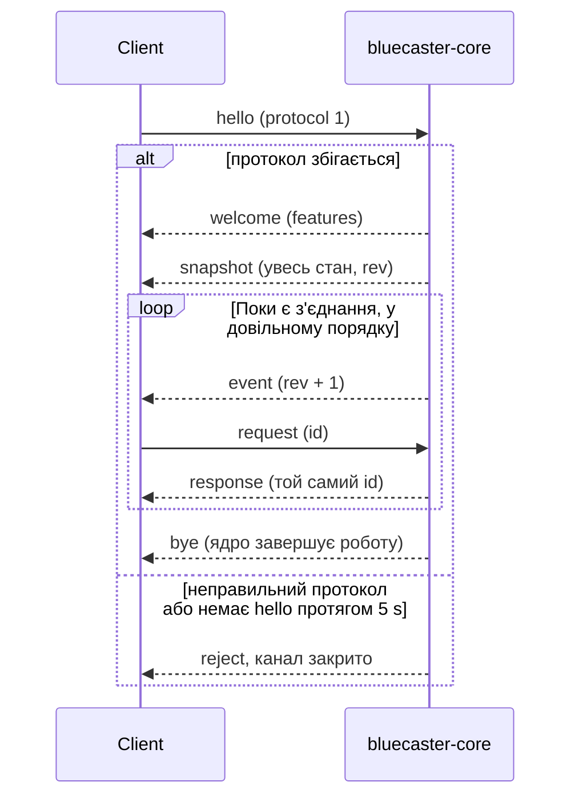

# Інтеграція (IPC)
{: .no_toc }

Як сторонній інструмент взаємодіє з ядром BlueCaster: показує стан потоку, запускає й зупиняє профілі, задає гучність або звертається до власних служб навушників через Bluetooth-з'єднання BlueCaster. Інструменти, які це роблять, перелічено на сторінці [Сумісні програми](works-with).

{: .warning }
> Протокол ще може змінюватися під час бета-версій 2.0.2. Джерелом істини є [`app/src/crates/ipc/src/protocol.rs`](https://github.com/SeiyaFunaokaJP/BlueCaster/blob/main/app/src/crates/ipc/src/protocol.rs) і згенеровані з нього типи TypeScript у [`app/src/ui/src/ipc/bindings`](https://github.com/SeiyaFunaokaJP/BlueCaster/tree/main/app/src/ui/src/ipc/bindings). Ця сторінка пояснює, як ними користуватися; вона не перелічує всіх полів.

## Зміст
{: .no_toc .text-delta }

1. TOC
{:toc}

## Підключення {#connecting}

Ядро (`bluecaster-core.exe`) працює, поки працює BlueCaster, з вікном або без нього. Воно очікує підключень на іменованому каналі користувача, від імені якого запущене:

```
\\.\pipe\bluecaster-<user SID>
```

- `<user SID>` — рядок SID користувача, який увійшов у систему (`S-1-5-21-...`), наприклад із `whoami /user`. Кожен користувач має власне ядро й канал; DACL каналу допускає лише цього користувача, а віддалені клієнти отримують відмову.
- Канал працює в байтовому режимі. Одночасно можуть бути підключені кілька клієнтів (вікно BlueCaster — один із них); кожен отримує той самий стан і ті самі події.
- До 2.0.x канал називався `\\.\pipe\a2dpwb-<user SID>`. BlueCaster 3.0.0 обслуговує **обидві** назви й обслуговуватиме стару щонайменше 6 місяців після 3.0.0. Клієнт має спершу пробувати `bluecaster-<user SID>`, а в разі невдачі — стару назву. Версія протоколу залишається 1.
- Якщо каналу не існує, ядро не запущене. Перевіряйте це за каналом, а не за м'ютексом ядра.
- Збірки для розробки, запущені з `BLUECASTER_INSTANCE=<name>`, натомість очікують підключень на `\\.\pipe\bluecaster-<SID>-<name>`, щоб працювати поруч зі встановленою.

### Кадри

Кожне повідомлення в обох напрямках — це один кадр: довжина JSON як **u32 little-endian**, потім сам JSON (UTF-8). Кадри понад 4 MiB відхиляються.

### Рукостискання

1. Клієнт надсилає `hello` протягом 5 секунд після підключення:
   ```json
   {"type": "hello", "protocol": 1, "client": "mytool/1.2.0"}
   ```
   `client` — довільні назва й версія; вони з'являються в журналі ядра.
2. Ядро відповідає `welcome` або `reject` і закриває канал (неправильна версія протоколу або немає hello):
   ```json
   {"type": "welcome", "protocol": 1, "server": "bluecaster-core/2.0.2-beta.12", "features": ["rfcomm"]}
   {"type": "reject", "reason": "protocol 2 not supported (core speaks 1)"}
   ```
3. Ядро надсилає `snapshot` з усім своїм станом, а потім `event`.

Версія протоколу має збігатися точно. Доповнення, з якими версія 1 і далі працює, натомість оголошуються в `features` (див. [Сумісність](#compatibility)).



## Стан і події {#state-and-events}

```json
{"type": "snapshot", "rev": 41, "state": {"adapter": {...}, "devices": [...], "stream": {...}, "profiles": [...], "active_profile": "WH-1000XM5", "settings": {...}, ...}}
{"type": "event", "rev": 42, "event": {"kind": "stream", "value": {"state": "streaming", "profile": "WH-1000XM5", "info": {"codec": "ldac", "bitrate_kbps": 990, ...}, "volume": 80, ...}}}
```

Клієнт не веде власного стану: він зберігає останній знімок і застосовує до нього кожну подію. Кожна подія стану **замінює одну частину знімка цілком**:

| Подія `kind` | Замінює |
|:--|:--|
| `adapter` | `adapter` |
| `devices` | `devices` |
| `scanning`, `le_scanning` | `scanning`, `le_scanning` |
| `stream` | `stream` (стан, повідомлення, профіль, відомості про кодек, гучність, заряд акумулятора) |
| `profiles` | `profiles` і `active_profile` |
| `settings` | `settings` |
| `update` | `update` |
| `capture` | `capture` |
| `v1_running`, `verbose`, `crashes` | поле з тією самою назвою |

`stream.state` — одне з `idle`, `connecting`, `streaming`, `reconnecting`, `error`; `stream.message` вказує причину як [ключ повідомлення](#errors-and-messages).

**Ревізії.** Кожна подія стану несе наступну ревізію (`rev` + 1). Пропуск означає, що подію втрачено: надішліть `state.snapshot`, щоб отримати новий знімок. Клієнт, який читає надто повільно, також отримує від ядра новий `snapshot` без запиту. Події, що не стосуються стану (`link`, `log`, `receiver`, `rfcomm_data`, `rfcomm_closed`), несуть поточну ревізію й не збільшують її.

Завершуючи роботу, ядро надсилає подію `bye` і закриває канал.

## Запити {#requests}

```json
{"type": "request", "id": 7, "method": "stream.start", "params": {"profile": "WH-1000XM5"}}
{"type": "response", "id": 7, "result": null, "error": null}
```

- `id` — будь-яке число на вибір клієнта; відповідь повертає його. Запити виконуються паралельно, тож відповіді можуть надходити в іншому порядку, ніж запити.
- Для методів без параметрів `params` пропускається.
- Запит, який змінює стан, відповідає, щойно виконано, а зміна також надходить як подія. Клієнти мають показувати стан за подіями, а не за відповіддю.

### Помилки й повідомлення {#errors-and-messages}

```json
{"type": "response", "id": 8, "result": null, "error": {"code": "rfcomm.not_connected", "message": {"key": "ipc.error.rfcomm_not_connected", "args": []}}}
```

`code` призначено для програми (`adapter.driver_missing`, `app.streaming`, ...). `message` — ключ перекладу з мовних файлів BlueCaster ([`app/lang`](https://github.com/SeiyaFunaokaJP/BlueCaster/tree/main/app/lang)) з аргументами у стилі printf, як і тексти стану; інструмент може знайти там ключ або показати для коду власний текст.

### Методи {#methods}

Методи для інструментів:

| Метод | Параметри | Результат |
|:--|:--|:--|
| `state.snapshot` | -- | `Snapshot` |
| `stream.start` | `profile` | `null`; спершу зупиняє потік, що вже передається |
| `stream.stop` | -- | `null` |
| `stream.set_volume` | `volume` (абсолютна гучність AVRCP 0-127) | `null` |
| `profile.set_active` | `name` | `null` |
| `device.scan` | `seconds` (3-600) | `Device[]`, також як подія `devices` |
| `device.scan_stop` | -- | `null`; відповідає запущений `device.scan` |
| `audio.devices` | -- | `AudioDevice[]` (джерела запису) |
| `diag.subscribe` | `logs` (рівень або `null`), `link` (bool), `receiver` (bool, необов'язковий) | `null`; вмикає або вимикає події `log` / `link` / `receiver` для цього підключення |
| `diag.info` | `{"mask": bool}` (необов'язковий) | `DiagInfo` (текст «Копіювати діагностику») |
| `rfcomm.open`, `rfcomm.send`, `rfcomm.close` | див. [Наскрізний канал RFCOMM](#rfcomm-passthrough) | |

Методи, які використовує вікно BlueCaster і які інструменту слід використовувати лише обережно: `profile.save` / `profile.delete`, `settings.set` (замінює **всі** параметри: надсилайте останні `settings` зі своєю зміною, ніколи не частковий об'єкт), `device.forget` / `device.rename`, `adapter.*` (`adapter.assign_winusb` і `adapter.restore_driver` показують запит UAC; `adapter.probe` і `adapter.run_script`, інструменти для мікросхем у режимі розробника, зупиняють стек Bluetooth), `app.quit`. Решта (`stream.start_custom`, інші `device.*` (`device.import_windows_pairings` показує запит UAC), `audio.apps`, `audio.mixer` / `audio.mixer_set`, `diag.*` понад два наведені вище, `receiver.*`, `app.*`) обслуговують власні екрани вікна й можуть змінюватися без попередження. Повний список із параметрами й результатами — це перелік `Method` у `protocol.rs`.

## Наскрізний канал RFCOMM {#rfcomm-passthrough}

Доступний, коли `welcome.features` містить `"rfcomm"` (2.0.2-beta.10 і новіші). Він дає інструменту доступ до власних служб RFCOMM навушників (програми керування від виробників: акумулятор, шумозаглушення, еквалайзер) через з'єднання, яке BlueCaster уже має, адже Windows не бачить навушників, підключених через BlueCaster.

- `rfcomm.open {address, uuid}` → `{channel_id, mtu}`. `address` має бути пристроєм, на який передається потік; ядро ніколи не підключається й не виконує сполучення заради цього (`rfcomm.not_connected`). `uuid` — повний 128-бітний UUID або 16-бітний `"xxxx"` на основі базового UUID Bluetooth. Відповідь надходить протягом 20 s, навіть якщо запит чекає в черзі за іншими відкриттями: чекайте щонайменше 25 s. Помилки: `rfcomm.not_connected`, `rfcomm.service_not_found`, `rfcomm.open_failed`, `rfcomm.busy`.
- `rfcomm.send {channel_id, data}` → `null`. `data` — base64 (стандартний, із доповненням), щонайбільше 64 KiB на запит, надсилається кадрами розміром не більше `mtu` у порядку запитів. Помилки: `rfcomm.no_channel`, `rfcomm.busy` (черга заповнена, не надіслано), `rfcomm.timeout` (невідомо, чи надіслано: не повторюйте, відкрийте канал знову).
- Отримані дані надходять як події `rfcomm_data` `{channel_id, data}` лише до підключення, яке відкрило канал.
- `rfcomm.close {channel_id}` → `null`, після даних, надісланих перед ним; `rfcomm_closed` після цього не надходить.
- Канал також закривається, коли завершується підключення до іменованого каналу, або з подією `rfcomm_closed` `{channel_id, reason}`: `remote` (пристрій закрив його або з'єднання розірвалося), `disconnected` (A2DP-підключення завершилося), `stopped` (стек Bluetooth зупинився), `overflow` (клієнт залишив непрочитаними понад 1 MiB отриманих даних).

## Сумісність {#compatibility}

- **Можливості.** Перш ніж використовувати доповнення, перевірте `welcome.features`. Ядра до 2.0.2-beta.10 не містять цього поля.
- **Невідомі запити.** На запит, який ядро не може прочитати (невідомий метод, хибні параметри), надходить помилка `ipc.bad_request`; підключення залишається відкритим. Ядра до 2.0.2-beta.10 натомість закривають підключення. Будь-який інший нечитабельний кадр закриває його.
- **Нові поля.** З часом ядро додає поля до стану й подій. Ігноруйте поля, яких ви не знаєте; не відхиляйте через них повідомлення.
- **Перейменування в 3.0.0** ([#193](https://github.com/SeiyaFunaokaJP/BlueCaster/issues/193)): канал стає `\\.\pipe\bluecaster-<SID>`. Ядро й далі очікує підключень також на `\\.\pipe\a2dpwb-<SID>`, з тим самим протоколом, щонайменше 6 місяців після 3.0.0; про його вилучення буде заздалегідь оголошено в примітках до випуску. Спершу пробуйте `bluecaster-<SID>`, а в разі невдачі — `a2dpwb-<SID>`. М'ютекс ядра стає `Local\BlueCaster_Core`; протягом того самого періоду воно й далі утримує також `Local\A2DPWB_v2_Core`, і про обидва вилучення буде оголошено разом.

## Приклад {#example}

Мінімальний клієнт на Python (лише стандартна бібліотека), який виводить стан потоку й стежить за його змінами:

```python
import json, struct, subprocess

sid = subprocess.run(["whoami", "/user", "/fo", "csv", "/nh"],
                     capture_output=True, text=True).stdout.strip().split(",")[1].strip('"')
pipe = open(rf"\\.\pipe\bluecaster-{sid}", "r+b", buffering=0)

def send(msg):
    b = json.dumps(msg).encode()
    pipe.write(struct.pack("<I", len(b)) + b)

def read_exact(n):
    buf = b""
    while len(buf) < n:
        chunk = pipe.read(n - len(buf))
        if not chunk:
            raise EOFError
        buf += chunk
    return buf

def recv():
    (n,) = struct.unpack("<I", read_exact(4))
    return json.loads(read_exact(n))

send({"type": "hello", "protocol": 1, "client": "example/0.1"})
welcome = recv()
assert welcome["type"] == "welcome", welcome
snap = recv()
print("stream:", snap["state"]["stream"]["state"])
while True:
    m = recv()
    if m["type"] == "event" and m["event"]["kind"] == "stream":
        s = m["event"]["value"]
        print("stream:", s["state"], (s.get("info") or {}).get("codec"))
    elif m["type"] == "event" and m["event"]["kind"] == "bye":
        break
```

Щоб випробувати інструмент, не зачіпаючи встановлений BlueCaster, запустіть збірку для розробки із заданими `BLUECASTER_INSTANCE` і `BLUECASTER_CONFIG_DIR` (див. [Збирання](building)) і підключіться до її каналу.
