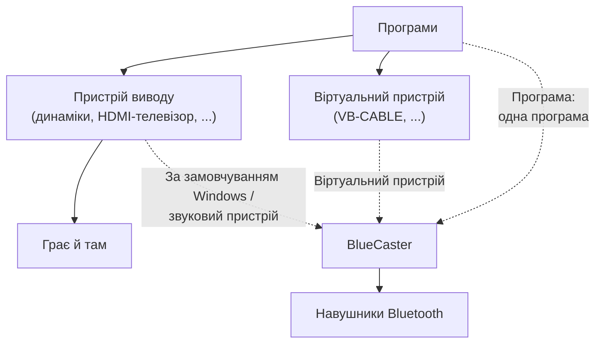
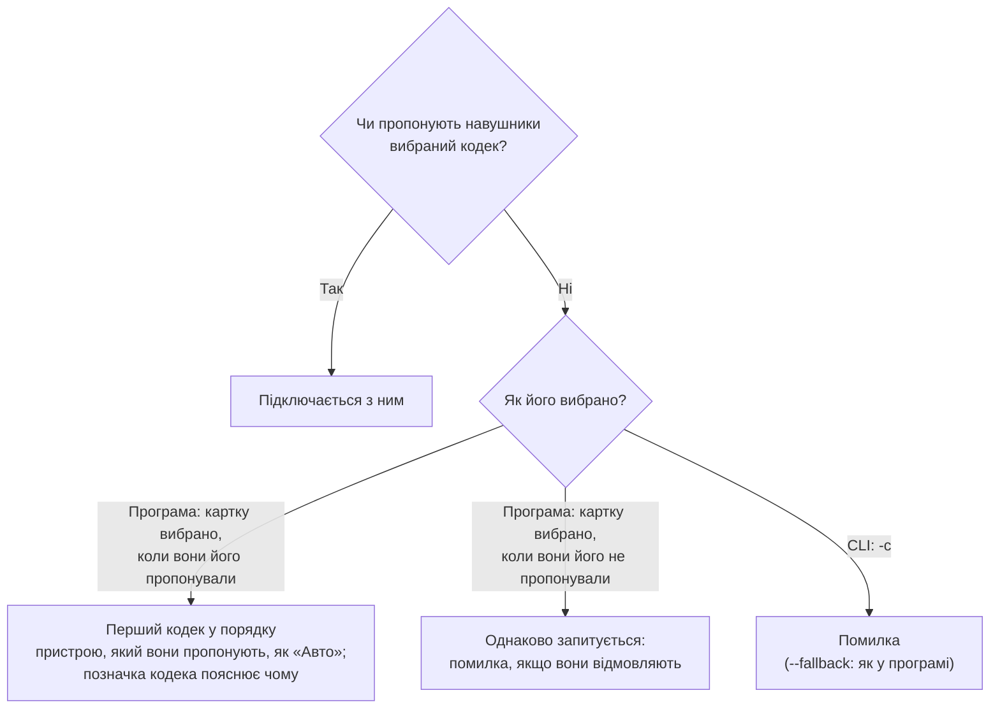

# Використання
{: .no_toc }

## Зміст
{: .no_toc .text-delta }

1. TOC
{:toc}

---

## Вікно

Запустіть **BlueCaster** з меню «Пуск» (або `bluecaster.exe`). Меню ліворуч містить описані нижче екрани («Головна», «Кодеки», «Аудіопристрої», «Адаптери», «Діагностика», «Параметри», «Про програму», а в режимі розробника — «Розробник» і, якщо його там увімкнено, «Мікшер гучності»); у вузькому вікні воно згортається до значків. Вікно лише показує, що робить резидентний `bluecaster-core.exe`: його закриття не зупиняє передавання (див. [Область сповіщень і вікно сповіщень](#tray)).

### Головна

- Картка для кожного збереженого аудіопристрою, поруч одна з одною: його стан, заряд акумулятора і, для підключеного, кодек, що використовується (список замість назви, див. нижче), з його бітрейтом. Коли використовується не той кодек, що вибрано, рядок кодека кілька секунд пояснює причину поруч із назвою, наприклад **aptX Adaptive (Opus не підтримується)** (або *уже використовується*), після чого лишається тільки значок попередження (наведіть на нього вказівник, щоб побачити причину); рядок стану показує просто **Підключено**
- **Підключити** / **Відключити** під кожною карткою. Одночасно підключено лише один пристрій: **Підключити** на іншому пристрої відключає поточний і підключає вибраний
- **Гучність**: гучність навушників (див. [Гучність](#volume)); клацніть динамік, щоб вимкнути звук (надсилається тиша), і ще раз, щоб увімкнути. Картки інших пристроїв зберігають повзунок, але неактивний
- Кодек пристрою, що використовується, вибирається зі списку на його картці для швидкого перемикання (скажімо, один для ігор і один для музики): кодеки, які підтримує пристрій, як на екрані [Кодеки](#codecs), лише за назвою. Список показує кодек, що використовується, також і за автовибору; вибір кодека вимикає автовибір (увімкніть його знову на екрані «Кодеки»). Вибір застосовується одразу (пристрій знову підключається з ним; наступний вибір чекає, доки підключення завершиться, як на екрані «Кодеки»)
- Для пристрою, що використовується, якість зв'язку з невеликим графіком на його картці, поки триває передавання. Джерело виводу вибирається на екрані **Аудіопристрої**; поки програму, задану як джерело виводу, ще не запущено, картка пристрою повідомляє про це
- Помилка показується з причиною і, якщо є, з кнопкою, що її виправляє (**Замінити драйвером WinUSB**, **Відкрити сторінку завантаження**, **Перезапустити Bluetooth**, **Повторити**, **Кодеки**, **Аудіопристрої**, ...)
- Над картками, доки їх не закрито: попередження, коли у Windows активний інший адаптер Bluetooth, і коли навушники OPPO ввімкнули Hi-Res (див. [Кодеки](#codecs))

Бічна панель показує те саме для кожного пристрою на кожному екрані, а вікно області сповіщень — для пристрою, що використовується.

### Кодеки {#codecs}

Кодек кожного збереженого аудіопристрою, по одному розділу на пристрій (крапка, зелена, поки пристрій підключено, його назва, позначки **Сполучено** / **Аудіо**; адреса — на екрані **Аудіопристрої**) з картками кодеків, від найвищої якості звуку, якщо ви не впорядкували їх по-своєму, кожна з трьома смугами (якість звуку, низька затримка, стабільність) і позначкою, чи запропонував пристрій цей кодек під час останнього підключення: **Підтримується** (зелена позначка) або **Не підтримується** (червона позначка). Коли ввімкнено **Показувати лише підтримувані кодеки** (за замовчуванням), показані картки не потребують позначки **Підтримується** і не мають її. Пристрій, який ще ніколи не підключався (наприклад, імпортований з Windows), тоді показує лише картку **SBC** — кодек, який має кожен аудіопристрій Bluetooth, — а також вибраний для нього кодек; інші картки з'являються після першого підключення або коли перемикач вимкнено. Навушники Huawei і Honor зберігають картку **LDAC** як **Не підтверджено**, доки не вкажуть цей кодек: вони можуть зробити це лише після того, як його вибрано. Навушники OPPO, які вказують піковий бітрейт для LHDC V5, один раз отримують запит на Hi-Res, коли передається LHDC V5, вибраний вручну чи режимом «Авто» (не з якістю **Низька** і не з ABR): заради цього вони один раз підключаються знову, і екран «Головна» повідомляє, якщо це підвищило їхній бітрейт; після цього Hi-Res лишається ввімкненим у навушниках (навушникам, яким це нічого не дало, налаштування повертається назад). У режимі розробника **Запитати Hi-Res знову** в параметрах LHDC V5 забуває, що вказав пристрій і що його вже запитували, тож під час наступного підключення запит надсилається знову.

- **Автоматично вибирати кодек найвищої якості** (один параметр для всіх пристроїв, угорі сторінки; за замовчуванням увімкнено): кожен пристрій використовує кодек найвищої якості звуку, який він підтримує, у такому порядку: LHDC V5 > LDAC > aptX Adaptive > Opus > aptX HD > aptX > aptX LL > AAC > SBC XQ > SBC, з параметрами за замовчуванням: висока якість, 24 біт, якщо кодек це підтримує, і 48 kHz (інша частота, яку вказує пристрій, якщо 48 kHz у нього немає, спершу 44,1 kHz; власна частота Windows перераховується), як **Авто** в параметрах кодека. Картки доступні лише для читання, крім їхнього порядку (перетягуються, як описано нижче: «Авто» бере першу картку, яку підтримує пристрій), а кодек, що використовується (або той, який вибере «Авто»), виділено; клацання картки або її **...** запитує, чи вимкнути автовибір (**Вимкнути автовибір** / **Скасувати**); після вимкнення вибирається клацнута картка (її **...** відкриває її параметри). Вимкніть його, щоб самостійно вибирати кодек кожного пристрою та його параметри; пристрій, для якого ще нічого не вибрано, зберігає вибір «Авто». Кодек, вибраний для пристрою, зберігається, поки автовибір увімкнено. Параметри з версій до 2.0.2, у яких для будь-якого пристрою було вибрано кодек, починають із вимкненим автовибором
- Коли його вимкнено, клацніть картку, щоб вибрати кодек цього пристрою; вибір зберігається одразу, а пристрій, що передає, знову підключається з ним. Картка, яку пристрій не підтримує (видно, коли **Показувати лише підтримувані кодеки** вимкнено), теж вибирається: BlueCaster однаково запитує її в пристрою, і якщо пристрій відмовляє, підключення зупиняється з помилкою, яка це пояснює (виберіть іншу картку або ввімкніть автовибір). «Головна», бічна панель, вікно області сповіщень і підказка значка в області сповіщень тоді кількома словами називають причину (наприклад, *LDAC не підтримується*), як і для будь-якої зупинки через кодек (кодек, який пристрій не підтримує, відхиляє або використовує для іншого джерела); вибір іншої картки чи інших параметрів для цього пристрою або ввімкнення автовибору знову його підключає. Кодек, вибраний, коли пристрій його пропонував, і пізніше вже не запропонований (навушники перейшли на інший кодек), замінюється першою карткою в порядку пристрою, яку він підтримує: найкращим підтримуваним кодеком, якщо ви не змінювали порядок (див. [Явно вибраний кодек не пропонується](#codec-fallback))
- Перетягуйте картки пристрою (поки кнопку утримано, показується рука; з вимкненим автовибором також Alt зі стрілкою на картці), щоб упорядкувати його кодеки по-своєму; кожен пристрій зберігає власний порядок. Автовибір і пристрій, для якого ще не вибрано кодек, використовують першу картку, яку він підтримує, як і вибраний кодек, якого він не підтримує. FastStream і Opus 05 (картка **Opus (PipeWire)**, лише в режимі розробника: без нього вибраний Opus 05 теж не використовується) ніколи не використовуються, якщо їх не вибрано, незалежно від їхнього місця. **Скинути порядок кодеків** скидає порядок; кнопка видна, лише поки показані картки стоять не в порядку за замовчуванням (якщо повернути їх назад, порядок знову стає стандартним). Пристрій, що передає з кодеком, якого це стосується, знову підключається
- Вибір іншого кодека для пристрою, що передає, знову підключає його з цим кодеком. Картки (і список кодеків на екрані «Головна» та у вікні області сповіщень) тоді чекають, доки він знову підключиться, перш ніж прийняти наступний вибір, тож швидка серія клацань не перериває підключення, яке ще встановлюється. Перемикання кодеків не показує сповіщення про підключення; підключення пристрою — показує
- **Показувати лише підтримувані кодеки** (за замовчуванням увімкнено; вимкніть, щоб показувати і підтримувані, і непідтримувані кодеки): кодеки, які пристрій не запропонував, не показуються. До першого підключення пристрою показується лише **SBC** (і вибраний для нього кодек)
- **...** на картці відкриває параметри цього кодека. Зміна застосовується одразу: для кодека, що використовується, вона зберігається, і пристрій знову підключається з нею, крім **Bitpool**, який змінюється, поки ви слухаєте, і перемикача нижче, коли потік у будь-якому разі налаштовувався б однаково; для іншого кодека вона зберігається до моменту, коли цей кодек буде вибрано. Кожен кодек зберігає власні параметри, так само як aptX Adaptive і aptX Adaptive LL: якщо вибрати інший кодек і повернутися, вони відновлюються. Пропонується лише те, що вміє цей кодек і що пристрій вказав під час останнього підключення. Угорі **Показувати лише варіанти, які підтримує *пристрій*** (за замовчуванням увімкнено; з'являється, щойно пристрій їх вказав), якщо вимкнути, пропонує все, що має кодек, наприклад частоту дискретизації, розрядність, якість чи bitpool, яких пристрій не вказав (позначені *(не підтримується)*). Пристрій може їх відхилити: тоді підключення зупиняється з помилкою, яка це пояснює. Якщо ввімкнути знову, те, чого пристрій не вказав, повертається до «Авто». Кожен кодек має власні; автовибір ніколи їх не використовує:
  - **Якість**: LDAC **Висока** / **Середня** / **Низька** (990 / 660 / 330 kbps), LHDC V5 **Висока** / **Вище середньої** / **Середня** / **Низька** (1000 / 900 / 500 / 400 kbps, чотири рівні Android); aptX Adaptive **Висока** (його режим низької затримки — окрема картка, **aptX Adaptive LL**: 265 kbps, 48 kHz, без ABR; див. [aptX Adaptive](#aptx-adaptive)); коли для LHDC V5 увімкнено ABR, якість неактивна (ABR тримається на 400 kbps або нижче). AAC, Opus, Opus 05, SBC і SBC XQ мають один рівень, **Висока**, який показується, а не вибирається: найвищий бітрейт, який приймає пристрій (ABR або VBR, де вони є, однаково його змінюють; SBC і SBC XQ показують бітрейт, який дають їхній bitpool і параметри кадру). aptX, aptX HD, aptX LL і FastStream мають бітрейт, зафіксований кодеком. Якість, збережена попередньою версією, якої кодек більше не має (Standard / Mobile в aptX Adaptive, нижчі рівні AAC, ...), завантажується як «Висока»
  - **Адаптивний бітрейт (ABR)**: для LDAC, LHDC V5, aptX Adaptive, SBC і SBC XQ (див. [ABR](#abr)); **Змінний бітрейт (VBR)** для AAC
  - **Частота дискретизації**: «Авто», показане з частотою, яку воно дає (наприклад, *Авто (48000 Hz)*), — це 48 kHz або інша частота, яку вказує пристрій, якщо 48 kHz у нього немає, спершу 44,1 kHz (96 kHz додає затримку й гірше сумісна без чутного виграшу, а Windows мікшує на 48 kHz); щоб використовувати 96 kHz, виберіть її тут. Пропонуються лише частоти, які вказує пристрій (LHDC V5 не має 88,2 kHz; 96 kHz для aptX Adaptive — лише для пристрою, який її вказує, див. [aptX Adaptive](#aptx-adaptive)); пристрій, що вказує лише одну частоту, показує її без «Авто»
  - **Розрядність**: 16 або 24 біт для LDAC і LHDC V5 («Авто»: 24 біт; для LHDC V5 — лише якщо пристрій її вказує), наскільки пристрій їх вказує; 24 біт для aptX HD і aptX Adaptive, 16 біт для решти. 24 біт LDAC надходять у кодувальник як 32-бітні відліки, як і за вибору 32 біт в Android: розрядність не входить до конфігурації LDAC, тож навушники в будь-якому разі отримують той самий потік
  - **Bitpool** (SBC, SBC XQ): один повзунок із двома маркерами — мінімальним і максимальним bitpool — у межах діапазону, який вказує пристрій. Максимальний — це bitpool, що використовується; мінімальний — найнижчий, що використовується (нижня межа діапазону, з яким налаштовується підключення, і межа, до якої може знижувати ABR). **Авто** повертає обидва: максимальний — за якістю, мінімальний — власний для пристрою та ABR. Рядок під ним показує режим каналів, фіксований для кожного кодека: joint stereo для SBC, dual channel для SBC XQ. Bitpool SBC XQ сягає 47 на 44,1 kHz і 43 на 48 kHz, або до 53, якщо **Показувати лише варіанти, які підтримує *пристрій*** вимкнено.
  - **Параметри кадру** (SBC і SBC XQ, лише в режимі розробника): блоки, підсмуги, розподіл бітів і, для SBC, режим каналів. «Авто» тримає 16 блоків, 8 підсмуг, Loudness і Joint stereo. Значення, якого пристрій не приймає, під час підключення повертається до «Авто». З пристроєм Sony, який тестував користувач, 12 блоків спотворюють звук і можуть розірвати з'єднання (вивід кодувальника декодується правильно; інші кількості блоків грають). Вибір лишається збереженим, але не використовується, коли режим розробника вимкнено. Бітрейти AAC і LHDC V5 лишаються в межах максимуму, який вказує пристрій

Значення за замовчуванням дають найкращий звук; більшості пристроїв не потрібно нічого, крім **Авто**. Пристрій LE Audio (експериментально) має дві картки, **LC3** і **LC3 LL** (див. [LE Audio](#le-audio)); їхня **...**, як і в кодеків для дзвінків, показує ті самі поля, що й для кодека A2DP, лише для читання. Режим низької затримки aptX Adaptive має окрему картку, **aptX Adaptive LL**, поруч з **aptX Adaptive**; «Авто» ніколи його не вибирає, а aptX Adaptive, встановлений на Low Latency попередньою версією, показується на ній.

Поки мікрофон класичного пристрою відкрито (див. [Аудіопристрої](#audio-devices)), його музичні картки поступаються місцем кодекам для дзвінків, які він може використовувати: LC3 (32 kHz), mSBC (16 kHz) і CVSD (8 kHz), з вибраним відкритим. За **автовибору** з'єднання для дзвінків вибирає найкращий кодек, який підтримують обидві сторони, а клацання картки запитує, чи вимкнути автовибір. Коли його вимкнено, клацніть картку, щоб вибрати кодек для дзвінків: мікрофон знову відкривається з ним або з наступним нижчим, якщо навушники його не підтримують. **...** показує їхні параметри лише для читання. Коли мікрофон закривається, музичні картки повертаються. Вибраний кодек для дзвінків зберігається, поки автовибір увімкнено. З **Показувати лише підтримувані кодеки** ті, яких навушники не підтримують, не показуються.

Поки мікрофон пристрою LE Audio відкрито, за його музичними картками йде картка **Мікрофон** (LC3, моно). З вимкненим автовибором її **...** вибирає частоту дискретизації мікрофона серед тих, які підтримують навушники (**Авто** бере першу; зміна знову підключає пристрій); за автовибору вона показує частоту, що використовується.

За лаштунками BlueCaster зберігає один запис на пристрій у `profiles.json` (його кодек, параметри кожного кодека й порядок кодеків), який там названо «*пристрій* | *кодек*»; вікно й меню в області сповіщень показують назву пристрою. Попередні версії дозволяли створювати кілька профілів для одного пристрою: перший запуск версії з екраном «Кодеки» зберігає останній використаний (інакше перший) і об'єднує з ним інші, зберігаючи їхні параметри кодеків (якість, частоту дискретизації, розрядність, ABR, налаштування SBC) для відповідних кодеків. Їхні власні назви, джерела виводу й розміри пакетів не зберігаються; `profiles.json` у попередньому вигляді один раз зберігається як `profiles-before-codecs.json` у папці параметрів. **Auto's order…** з попередніх випусків 2.0.2 (один порядок для всіх пристроїв, у режимі розробника) більше не використовується: тепер кожен пристрій має власний порядок.

### Аудіопристрої {#audio-devices}

Навушники й динаміки, на які BlueCaster може передавати звук, кожен із власними параметрами, а під ними **Додавання аудіопристрою**: **Шукати пристрої** шукає пристрої поблизу через USB-адаптер (30 секунд, показує їх у міру того, як вони відповідають; **Зупинити пошук** завершує пошук; переведіть навушники в режим сполучення; поки якийсь пристрій підключено, програма спершу пропонує його відключити). **Додати** зберігає знайдений пристрій і підключає його. Пристрої, з якими BlueCaster уже сполучався, позначено як **Сполучено**. Якщо пошук їх не знаходить, введіть адресу в полі **Вручну:** і натисніть **Додати**; введені або вставлені адреси форматуються під час введення (`aa-bb-cc-dd-ee-ff`, `AABBCCDDEEFF` і `AA BB CC DD EE FF` перетворюються на `AA:BB:CC:DD:EE:FF`). Навушники бачать адаптер під назвою вашого комп'ютера з BlueCaster поруч, наприклад *Taro-PC (BlueCaster)*, тож він відрізняється від власного Bluetooth Windows. Для пристрою, який Windows сполучила через інший адаптер, наприклад вбудований Bluetooth ПК, програма спершу запитує (**Сполучено у Windows**: видаліть його там або натисніть **Однаково додати**); так само й для пристрою, який Windows сполучила через цей адаптер (імпорт його сполучення виконує майстер налаштування, див. [Служби й ключі сполучення](#shared-pairing)). Збережений пристрій можна перейменувати або видалити (видалення стирає також його параметри й сполучення, тож він не зможе підключитися, доки його не буде сполучено знову), і він має:

- **Джерело виводу**: **За замовчуванням Windows**, окремо першим у списку (пристрій виводу Windows за замовчуванням, назва якого вказана в дужках; ним може бути й віртуальний пристрій; типове значення для нового пристрою); у розділі **Звукові пристрої** — один пристрій виводу; віртуальний пристрій; або програма (див. [Режими захоплення](#capture-modes)). Поруч — формат, у якому Windows мікшує захоплюваний пристрій (частота дискретизації й розрядність, лише для читання), бурштиновим кольором, коли пристрій передає (або, якщо не підключений, його параметри кодека запитують) інший формат, з рядком нижче, що наводить обидва формати (передавання однаково триває, з перетворенням); під ним — що робить це джерело
- **Робити пристроєм виводу Windows за замовчуванням, поки підключено** — з віртуальним або звуковим пристроєм, у режимі розробника
- **Джерело вводу**: мікрофон навушників і **Робити пристроєм вводу Windows за замовчуванням, поки підключено** в режимі розробника (див. нижче)

**Джерело вводу** для кожного пристрою: мікрофон навушників надходить у Windows для дзвінків і голосового чату. BlueCaster не має власного аудіодрайвера, тож відтворює мікрофон у віртуальний аудіокабель, наприклад VB-CABLE. Список називає кожен кабель за стороною, з якої записують програми (*CABLE Output* для VB-CABLE), — саме її слід вибрати як мікрофон у ваших програмах. **Вимк.**, **Авто** або **Увімк.** поруч зі списком: **Авто** відкриває мікрофон, лише поки якась програма з нього записує, тож решту часу відтворення зберігає повну якість; **Увімк.** тримає його відкритим. Поки вибрано **Вимк.**, список лишається на місці, неактивний. **Вимк.** і кнопка мікрофона на екрані «Головна» та у вікні області сповіщень — один параметр: для пристрою з **Авто** або **Увімк.** вибір **Вимк.** вимикає мікрофон так само, як кнопка, і зберігає режим, який кнопка знову вмикає. **Робити пристроєм вводу Windows за замовчуванням, поки підключено** (у режимі розробника; коли режим розробника вимкнено, завжди ввімкнено) робить сторону запису кабелю (*CABLE Output*) мікрофоном Windows за замовчуванням, поки пристрій підключено, тож програми, що записують із мікрофона за замовчуванням, отримують мікрофон навушників, і **Авто** відкриває його для них; коли пристрій відключається, повертається попередній пристрій за замовчуванням, якщо тим часом не було вибрано інший. Пристрій, доданий відтепер, починає з VB-CABLE, якщо його встановлено, інакше з Hi-Fi Cable, якщо тільки його **Джерело виводу** не є цим кабелем: класичний пристрій — з **Авто**, пристрій LE Audio — з **Вимк.** (там **Авто** тримає мікрофон відкритим). Пристрій, мікрофон якого ввімкнено без кабелю, отримує кабель, щойно Windows його покаже. **Аудіопристрої** і майстер налаштування пропонують кабелі, яких бракує (див. [Режими захоплення](#capture-modes)); коли один із них установлено пізніше, пристрої, які BlueCaster налаштував сам, і ті, що мають **За замовчуванням Windows** з таким мікрофоном, налаштовуються заново так, як це зробив би майстер: з обома кабелями — Hi-Fi Cable для звуку й VB-CABLE для мікрофона; з одним — цей кабель для мікрофона й пристрій виводу з розділу **Звукові пристрої** для звуку (звук монітора чи телевізора, де він є, а серед кількох — пристрій виводу Windows за замовчуванням; інакше пристрій виводу Windows за замовчуванням), незалежно від того, який пристрій є пристроєм виводу Windows за замовчуванням; джерело виводу чи мікрофон, які ви вибрали самі, лишаються без змін. Без кабелю, коли у Windows є і звук монітора чи телевізора, і звукова карта, звук береться з першого, а мікрофон відтворюється у звукову карту з **Вимк.**: програма, що записує пристрій виводу (захоплення аудіовиводу в OBS), може взяти його звідти, щойно для нього вибрано **Увімк.**; **Авто** не може визначити, хто слухає звукову карту. Пристрій, доданий на екрані **Аудіопристрої**, починає так само. Пристрій із **За замовчуванням Windows**, мікрофон якого відтворюється в кабель, що є пристроєм виводу Windows за замовчуванням, теж переводиться на цей звук, бо інакше мікрофон звучав би в навушниках. Коли мікрофон відтворюється в Hi-Fi Cable, а його сторони відтворення й запису працюють у параметрах звуку Windows на різних частотах дискретизації, про це повідомляє попередження: якщо програми нічого не чують, встановіть для обох однакову частоту. Список містить лише кабелі, з яких програми можуть записувати. Кабель, який захоплює сам BlueCaster (**Джерело виводу** або пристрій виводу Windows за замовчуванням з **За замовчуванням Windows**, але не джерело виводу іншого пристрою, зроблене пристроєм за замовчуванням, поки той підключений), не показується, як і інша сторона того самого кабелю (*CABLE In 16ch* у VB-CABLE записує в той самий *CABLE Output*, що й *CABLE Input*): мікрофон змішувався б із тим, що відтворюється. Так само, поки **Джерело вводу** не **Вимк.**, список **Джерело виводу** не показує кабель, у який відтворюється мікрофон. Коли ввімкнено **Розробник > Параметри програми > Показувати всі аудіопристрої у списках джерел**, обидва списки пропонують усі пристрої: виводи без сторони запису (динаміки тощо) — у розділі **Прослуховування**, адже вони лише відтворюють мікрофон; 16-канальний кабель VB-CABLE — як *CABLE Output · CABLE In 16ch* (спільна сторона запису, потім його власна назва); а кабель джерела виводу — неактивним, з *(використовується як джерело виводу)* після назви. *CABLE Input* і *CABLE Output* — два кінці одного кабелю: для віртуального джерела виводу й мікрофона разом потрібні два кабелі. Рекомендовано: **Hi-Fi Cable** від VB-Audio (*HiFi-Cable & ASIO-Bridge* на [сторінці VB-Audio](https://vb-audio.com/Cable/)) для звуку, бо він додає найменшу затримку, і VB-CABLE для мікрофона. Пристрій мікрофона також не має бути пристроєм виводу Windows за замовчуванням: програми чули б відтворюваний звук, змішаний із мікрофоном, а джерело виводу, що є іншим пристроєм, нічого б не отримувало; про це повідомляє попередження під **Джерело вводу**. Класичний пристрій Bluetooth, поки мікрофон відкрито, відтворює через з'єднання для дзвінків: моно з якістю дзвінка (CVSD, mSBC або LC3, найкращий, який підтримують обидві сторони); його кодек тим часом приглушено, а коли мікрофон закривається, пристрій повертається до цього кодека без повторного підключення. Пристрій LE Audio продовжує відтворювати LC3 у звичайній якості й надсилає мікрофон паралельно; зміна режиму знову його підключає (там «Авто» тримає мікрофон відкритим). Деякі навушники можуть відмовити в цьому або показувати дзвінок, хоча жодного дзвінка немає. З **Авто** або **Увімк.** і вибраним пристроєм рядок **Мікр.:** під кодеком, на бічній панелі, на екрані «Головна» та у вікні області сповіщень показує мікрофон, поки пристрій підключено або підключається: його кодек і частоту з червоною крапкою, поки він відкритий (*Мікр.: mSBC 16 kHz*), і приглушено з режимом, поки він закритий. На екрані «Головна» та у вікні області сповіщень кнопка мікрофона поруч вимикає мікрофон (перекреслена: він закривається, класичний пристрій повертається до свого кодека, а **Джерело вводу** показує **Вимк.**); ще одне клацання знову вмикає його в його режимі, так само як вибір **Авто** або **Увімк.** у **Джерело вводу**. Кнопка штрихова, поки «Авто» чекає на програму, і показує знак попередження з причиною в підказці, якщо мікрофон не відкрився.

**Усі аудіопристрої** над списком містить перемикачі, які діють для всіх пристроїв: **Синхронізація гучності з Windows** (див. [Гучність](#volume)), **Керувати відтворенням кнопками аудіопристрою** і **Автоматично підключатися знову**. **Макс. розмір медіапакета** кожного пристрою задається на екрані **Розробник** (див. [Макс. розмір медіапакета](#max-packet)).

### Діагностика

- **Якість зв'язку** під час передавання: фактичний бітрейт, пакети, пакети, відкинуті до надсилання, звук, втрачений під час захоплення, черга надсилання, затримка, яку повідомляє пристрій (див. [Затримка](#latency)), використаний ефірний час, сигнал (RSSI) і канали AFH (див. [Якість зв'язку й AFH](#link-quality)). Поки мікрофон гарнітури відкрито, з'єднання для дзвінків класичного пристрою вимірюється так само (його кодек, наприклад mSBC, і що він надсилає), з карткою **Мікрофон** для пакетів, що надходять назад: отримані, пошкоджені в ефірі й замасковані
- **Радіо**: 79 каналів Bluetooth у діапазоні 2,4 GHz, які з них використовує з'єднання, а які адаптер пропускає, з каналами Wi-Fi під ними, і кілька порад для чистішого з'єднання. У режимі розробника **Сканувати** додає мережі Wi-Fi 2,4 GHz поблизу (див. [Вкладка «Радіо»](#radio-tab))
- **Подробиці кодека** під час передавання: медіанавантаження, заголовки, кадр кодека й кадрів на пакет, а також що вказує кінцева точка пристрою поруч із тим, що використовується: для SBC — bitpool, частоти дискретизації, режими каналів, блоки, підсмуги й розподіл бітів; для AAC — типи об'єктів, частоти дискретизації, канали, піковий бітрейт і VBR; для інших кодеків — частоти дискретизації, розрядності й піковий бітрейт
- **Мікрофон**: перевіряє мікрофон гарнітури класичного пристрою Bluetooth під час передавання. **Записати** відкриває мікрофон (пристрій тим часом грає з якістю дзвінка; якщо в його підключенні мікрофон ще жодного разу не відкривався, він спершу підключається знову) і записує до 10 секунд, показуючи рівень на смузі; **Відтворити** відтворює запис у навушниках. Вихід із вкладки завершує перевірку, і відтворення повертається до свого кодека. Пристрої LE Audio поки не підтримуються
- **Хід підключення**: одинадцять етапів останньої спроби підключення (початок, адаптер Bluetooth, підключення ACL / AVDTP, виявлення можливостей, вибір кодека, захоплення звуку, конфігурація потоку, кодувальник, запуск потоку, надсилання звуку, підтримання з'єднання з відключеннями / повторними підключеннями) як «OK», «Попередження» або «Помилка», із затраченим часом. **Копіювати хід** копіює його
- **Журнал**: у реальному часі, з фільтром за рівнем (усі, інформація й вище, попередження й помилки, лише помилки), за текстом і за поточною спробою підключення (**Лише поточна спроба**). **Копіювати показаний журнал** копіює показане. **Відкрити папку журналів** відкриває папку з файлами журналів; на відміну від **Копіювати діагностику**, ці файли не замасковано (вони містять адреси Bluetooth та ваше ім'я користувача Windows)
- **Почати захоплення HCI** / **Зупинити захоплення HCI** (див. [Перевірка медіапотоку](#verify-stream))
- **Копіювати діагностику**: версію, ОС, адаптер, аудіопристрій (кодек, його параметри й порядок), хід підключення, попередження / помилки й останні рядки журналу в буфер обміну, готові для вставлення у звіт про помилку. **Приховати адреси Bluetooth** (за замовчуванням увімкнено) замінює адреси на `<addr-1>`, `<addr-2>`... (власну адресу адаптера — на `<adapter>`), а назви пристроїв — на `<device-1>`, `<device-2>`..., і приховує серійні номери USB, шляхи до файлів вище власної папки програми (`<path>\BlueCaster\logs\...`) і ваш обліковий запис Windows (ім'я користувача й SID). Те саме маскування застосовується до звіту про збій і текстів помилок, скопійованих для звіту про помилку
- **Повідомити про проблему**:
  - **Докладне журналювання**: **Докладно (debug)** або **Усе (trace, 1 година)** записує в журнал значно більше про Bluetooth, USB, захоплення звуку й кодування. Debug лишається ввімкненим 24 години, зокрема й після перезапусків (для проблем під час запуску), а потім вимикається сам. Увімкніть його, відтворіть проблему, а потім збережіть пакет діагностики
  - **Пакет діагностики > Зберегти…**: виберіть, чи додавати захоплення HCI (вимкнено, якщо вас про них не просили: вони зберігають адреси й назви пристроїв) і чи маскувати адреси Bluetooth у текстових файлах, а потім збережіть один `.zip` (у `logs\bundles\` папки параметрів, зберігаються 3 найновіші): діагностичні дані, файли журналів ядра, вікна й допоміжної програми драйвера, звіти про збої, відомості про систему (USB-адаптери Bluetooth та їхні драйвери, сполучені пристрої Windows, аудіопристрої), параметри й параметри кодеків кожного пристрою (ніколи не ключі зв'язку), а також бортовий реєстратор HCI. Захоплення HCI зберігають адреси (але не ключі сполучення). Розмір по можливості тримається в межах ліміту вкладень GitHub у 25 MB (спершу найновіші журнали, до 48 MB тексту, 5 найновіших записів і 2 мінідампи)
  - **Повідомити на GitHub** (після збереження): відкриває новий звіт про помилку із заповненими версією, збіркою Windows, адаптером, навушниками, кодеком, режимом захоплення й діагностичними даними (адреси замасковано) і показує пакет у Провіднику, щоб перетягнути його у звіт

BlueCaster також постійно записує деякі дані, щоб одноразову проблему можна було дослідити пізніше:

- **Бортовий реєстратор HCI**: останні кілька хвилин трафіку Bluetooth зберігаються в пам'яті (медіанавантаження скорочено, ключі сполучення видалено) і записуються в `logs\hci\` щоразу, коли потік збоїть або з'єднання втрачається (зберігаються 10 найновіших файлів)
- **Звіти про збої**: якщо BlueCaster аварійно завершує роботу, мінідамп `.dmp` і файл `.txt` записуються в `logs\crash\` (5 найновіших для кожної програми)

Використання диска обмежене: журнал звичайного дня займає значно менше 1 MB, і зберігаються 7 днів; з докладним журналюванням файл за день займає щонайбільше 100 MB рядків debug і trace (після цього до наступного дня записуються лише рядки рівня info й вище); файли бортового реєстратора займають щонайбільше кілька MB, зберігаються 10.

### Розробник {#developer}

Показується, поки ввімкнено **Параметри > Режим розробника**; більшості користувачів він ніколи не знадобиться. Він призначений для тестування пристроїв і усунення неполадок: деякі його параметри працюють лише з деякими пристроями. Шість вкладок:

- **Параметри програми**: **Використовувати мікшер гучності** (за замовчуванням вимкнено): екран **Мікшер гучності**, список програм у вікні області сповіщень і вимкнення звуку виводу (див. [Режими захоплення](#capture-modes)). Не рекомендовано; VB-CABLE — кращий спосіб зберегти тишу на ПК. **Показувати всі аудіопристрої у списках джерел** (за замовчуванням вимкнено): **Джерело виводу** і **Джерело вводу** на екрані **Аудіопристрої** пропонують усі пристрої, зокрема й ті, що для них не підходять (див. [Аудіопристрої](#audio-devices)). **Приховати попередження про віртуальні звукові пристрої** (за замовчуванням вимкнено) прибирає попередження про те, що бракує кабелю VB-Audio (див. [Режими захоплення](#capture-modes)). **Враховувати альфа-версії під час перевірки оновлень** (за замовчуванням увімкнено в альфа-збірці) пропонує також альфа-випуски (див. [Оновлення](#updates))
- **Параметри кодеків**: перемикачі для з'ясування, чому пристрій мовчить (біт маркера RTP, запис перших медіапакетів у журнал, конфігурація AAC і параметри кодувальника), **Макс. розмір медіапакета** кожного збереженого пристрою (див. [Макс. розмір медіапакета](#max-packet)). **Використовувати параметри кодека, коли його вибрано автоматично**: коли автовибір увімкнено, **…** картки кодека відкривається без вимкнення автовибору, а кодек, вибраний режимом «Авто», підключається з цими параметрами замість параметрів «Авто». **Узгоджувати частоту дискретизації й розрядність із виводом ПК**: частота дискретизації або розрядність зі значенням «Авто» відповідає формату пристрою виводу в параметрах звуку Windows замість 48 kHz: серед частот, які пристрій вказує для кодека, — власна частота ПК, інакше найближча з того самого сімейства (кратні 44,1 або 48 kHz), інакше найближча вища; 16-бітний вивід передається як 16 біт. **Ігнорувати піковий бітрейт пристрою**: кожен кодек працює з бітрейтом вибраної якості, навіть коли пристрій вказує нижчий максимум (бітрейт LHDC V5, AAC або Opus 05, bitpool SBC), а екран **Кодеки** пропонує всі рівні якості й bitpool. Понад свій максимум пристрій може переривати звук або замовкати. **Ліміт черги надсилання**: скільки медіапакет може чекати в черзі надсилання, перш ніж його буде відкинуто, від 50 до 2000 ms (порожньо = 350 ms); на хорошому з'єднанні він не зменшує затримку (див. [Затримка](#latency)). **Кодувати під час надсилання**: поки з'єднання стоїть, звук чекає незакодованим, а не як уже закодовані пакети, тож з увімкненим ABR (SBC, SBC XQ, LDAC, LHDC V5 і aptX Adaptive) він виходить із бітрейтом, до якого ABR тим часом знизився, а не з тим, що використовувався на початку зупинки. Саму зупинку це не скорочує: нічого не виходить, доки радіо знову не почне передавати, і лише подальше надолужування потребує менше даних. Звук, що чекає довше за ліміт черги надсилання, відкидається в будь-якому разі; діагностика враховує звук, що чекає, у часі очікування в черзі надсилання. Усе це за замовчуванням вимкнено й застосовується з наступного запуску потоку; поки щось увімкнено, про це повідомляє банер. **Вимкнути все** скидає їх
- **Виробники**: коли BlueCaster використовує власні протоколи навушників (Huawei: LDAC, OPPO: Hi-Res; див. [Кодеки](#codecs)), для кожного є **Власний протокол**: **Авто** (навушники, назва яких указує на цього виробника; за замовчуванням), **Завжди** (будь-який пристрій) або **Ніколи**. Для OPPO також є **Запитувати Hi-Res під час кожного підключення (щоразу перепідключається)**. Зміни застосовуються з наступного запуску потоку; поки щось змінено, про це повідомляє банер, а **Вимкнути все** скидає їх. Вони не використовуються, коли режим розробника вимкнено
- **Журналювання**: скільки зберігаються файли журналів (за замовчуванням 7 днів), денний ліміт розміру (за замовчуванням 100 MB), докладне журналювання, яке лишається ввімкненим (без обмеження в 24 години чи 1 годину, також із запуску ядра), рядок стану потоку кожні 10 секунд і **Додати мітку** (нумерований рядок у журналі, щоб потім знайти потрібний момент). Вимкнення режиму розробника повертає значення за замовчуванням
- **Тест із приймачем-партнером**: передає звук на вимірювальний приймач на іншому ПК і порівнює надіслане з отриманим (див. [Тест із приймачем-партнером](#receiver))
- **Мікросхема**: виконує скрипт мікросхеми на адаптері з WinUSB: запити до мікросхеми, введені вручну або відкриті з файлу, для тих, хто додає підтримку мікросхеми (див. [Додавання підтримки мікросхем](chip-support#chip-scripts)). Рядки, які можуть змінити мікросхему, виконуються лише після **Виконати їх**; Bluetooth для цього зупиняється й знову запускається під час наступного використання
- **Налагодження**: експерименти, усі за замовчуванням вимкнені. **Realtek**: **Завантажувати мікропрограму RTL8761B з драйвера Realtek для Windows на цьому ПК** завантажує мікропрограму, встановлену драйвером Realtek для Windows (вона лишається після переведення адаптера на WinUSB), замість мікропрограми з папки мікропрограм; файл конфігурації однаково береться з папки, а без цього драйвера завантажується мікропрограма з папки. Тоді адаптер може повідомляти новішу версію Bluetooth; чи покращується щось іще, не перевірено. **Ключі сполучення і Windows**: **Також передавати Windows ключі LE під час відновлення початкового драйвера** записує ключі LE BlueCaster (Long Term Key, EDIV, Rand, розмір ключа, Identity Resolving Key) у Windows під час **Відновити початковий драйвер**, лише для пристроїв, ключі LE яких Windows уже зберігає для цього адаптера; старі ключі Windows зберігаються в `pairing\replaced_windows_keys.json`, доступному для читання лише вашому користувачу Windows. **Порівняти з Windows** (дозвіл адміністратора) підраховує для одного адаптера пристрої, ключі зв'язку й ключі LE яких однакові в BlueCaster і Windows, різні або є лише з одного боку. Він показує й записує в журнал лише числа, ніколи не адресу чи ключ, тож результатом можна поділитися. Він також перелічує назви, типи й розміри значень, які Windows зберігає для адаптера та його пристроїв LE, ніколи не їхні дані

### Адаптери

- Виявлені USB-адаптери Bluetooth з їхньою мікросхемою, адресою, USB ID, версією Bluetooth, **Драйвер** і **Мікропрограма**; список оновлюється сам, коли адаптер під'єднують або від'єднують. Драйвер — це **Початковий драйвер** (встановлений Windows або виробником; наведіть вказівник, щоб побачити його назву) або **Драйвер WinUSB** (той, який використовує BlueCaster). Адаптер Realtek показує свою адресу, взяту з серійного номера USB, ще до першого використання; для інших адреса й версія Bluetooth з'являються, щойно адаптер використав Bluetooth Windows або BlueCaster (наведіть вказівник на рядок, щоб побачити причину). Адаптер, який BlueCaster не може використовувати (деякі MediaTek і Qualcomm), зберігає свій драйвер: його кнопки WinUSB і мікропрограми неактивні. У режимі розробника йому однаково можна призначити WinUSB, а **Зчитати дані мікросхеми** на адаптері з WinUSB зберігає відповіді його мікросхеми на кілька команд читання в `logs\probe\` для тих, хто додає її підтримку (Bluetooth для цього зупиняється й знову запускається під час наступного використання); **Повідомити на GitHub** потім відкриває issue з цими даними. Поки запускається адаптер, мікропрограму якого BlueCaster завантажує сам (Intel, MediaTek, Qualcomm), екран показує завантаження і те, чи воно не вдалося
- **Замінити драйвером WinUSB** / **Відновити початковий драйвер** (див. [Налаштування](setup#winusb)); щоразу Windows запитує дозвіл адміністратора, як і для кожної кнопки зі щитом. Відновлення передає Windows і новіші сполучення BlueCaster для пристроїв, які Windows сполучила через цей адаптер, тож вони підключаються у Windows без повторного сполучення. **Обмеження:** ключі LE не передаються, тому пристрій, який Windows використовує через LE (LE Audio), потрібно сполучити у Windows знову (у режимі розробника можна спробувати: **Розробник > Налагодження**)
- **Мікросхема Bluetooth** для мікропрограми, з кнопками **Завантажити мікропрограму**, **Відкрити сторінку завантаження** і **Відкрити папку мікропрограм** (див. [Мікропрограма](setup#firmware)). Адаптер іншого виробника натомість показує, звідки береться його мікропрограма, наприклад **З драйвера MediaTek**, **З папки мікропрограм** або **Не потрібно**, і **Завантажено**, щойно BlueCaster її завантажив
- **Уникати каналів Wi-Fi**: «Авто», «Вимк.» або «Вручну», з каналами Wi-Fi поруч: ті, яких зараз уникає «Авто», і нічого для «Вимк.» (обидва лише для читання), а для «Вручну» — ті, що ви вводите (див. [Якість зв'язку й AFH](#link-quality))
- **Стек Bluetooth**: зупинено (запускається з першим пошуком чи підключенням), запускається, готовий або помилка, і **Перезапустити Bluetooth**

### Параметри

| Розділ | Параметри |
|:-------|:----------|
| Оформлення | Мова, тема (Системна / Світла / Темна) |
| Запуск | **Запускати разом із Windows** і **Запускати в області сповіщень** (див. [Запуск разом із Windows](#autostart)), **Згортати в область сповіщень** і **Відкривати вікно з області сповіщень через** (див. [Область сповіщень і вікно сповіщень](#tray)) |
| Сповіщення | **Сповіщати, коли пристрій підключається** (пристрій, його заряд, кодек і з якими параметрами він працює; за замовчуванням увімкнено), **Сповіщати про низький заряд акумулятора**: **Нижче 20%** (за замовчуванням), **Нижче 10%**, **Нижче 5%** або **Ніколи**, один раз за підключення (знову — лише після того, як заряд підніметься на 5 пунктів вище) |
| Оновлення | **Перевірити наявність оновлень**, **Перевіряти оновлення під час запуску**, **Враховувати попередні випуски під час перевірки оновлень** (пропонувати також бета-випуски), **Оновити зараз** (див. [Оновлення](#updates)) |
| Додатково | **Режим розробника** (додає екран [Розробник](#developer), **Параметри кадру** SBC у параметрах кодека, ключі сполучення під позначкою **Служби** на екрані **Аудіопристрої** (див. [Служби й ключі сполучення](#shared-pairing)), кодек **Opus (PipeWire)**, **Зчитати дані мікросхеми** на екрані **Адаптери** і більше подробиць у журналі; перезапуск не потрібен), **Папка параметрів** з **Відкрити папку параметрів**, **Запустити налаштування** |

**Вийти з BlueCaster** розташовано внизу. Екран **Про програму** містить версію та ліцензію BlueCaster, а в розділі **Стороннє програмне забезпечення** — бібліотеки, **Ліцензії сторонніх компонентів**, примітку про те, що кабелі VB-Audio є їхнім donationware, і діалогове вікно кабелів (**Віртуальні аудіопристрої**).

### Налаштування під час першого запуску

Перший запуск (ще немає аудіопристрою або жоден адаптер не має WinUSB) відкриває **Майстер налаштування**, доки його один раз не буде завершено або пропущено: вибір адаптера, драйвер і мікропрограма (пристрої, які Windows сполучила через адаптер, називаються першими, бо вони перестануть працювати з Windows), пошук аудіопристроїв («Підключити» зберігає пристрій із найкращими для нього параметрами й підключає його; для пристрою, сполученого Windows, програма спершу запитує; **Імпортувати сполучення з Windows** показує пристрої, які Windows сполучила через цей адаптер, див. [Служби й ключі сполучення](#shared-pairing); **Далі** працює й без пристрою, його можна додати пізніше на екрані **Аудіопристрої**), потім **Загальні параметри**: тема, **Запускати разом із Windows** і **Запускати в області сповіщень** (перше налаштування вмикає обидва), сповіщення і **Перевіряти оновлення під час запуску**. Див. [Налаштування](setup#first-run). **Параметри > Запустити налаштування** відкриває його знову.

## Область сповіщень і вікно сповіщень {#tray}

BlueCaster працює в області сповіщень, з вікном або без нього:

- **Клацніть лівою кнопкою** значок в області сповіщень, щоб відкрити вікно області сповіщень: пристрій і його стан, **Підключити** / **Відключити**, гучність, перемикач пристроїв, кодек (список для його вибору, як на екрані «Головна»), якість зв'язку і **Відкрити BlueCaster**. Його висота відповідає вмісту. Esc або клацання в іншому місці приховує його. Якщо для помилки потрібен екран головного вікна («Кодеки», «Аудіопристрої», адаптер), її кнопка відкриває вікно на цьому екрані
- **Параметри > Відкривати вікно з області сповіщень через** (за замовчуванням **Значок в області сповіщень**): у Windows 11 з **Швидкі параметри (кнопка гучності)** значок в області сповіщень відкриває головне вікно, а вікно області сповіщень натомість відкривається разом зі швидкими параметрами, поверх тамтешніх панелей, і закривається разом із ними. Там воно працює, не закриваючи їх. Якщо екран надто низький, воно відкривається ліворуч від них. З **Ніде** вікно області сповіщень не відкривається, а значок в області сповіщень відкриває головне вікно.
- **Клацніть правою кнопкою**, щоб відкрити меню: **Відкрити BlueCaster**, перші 10 пристроїв за назвою (запис LE Audio позначено «(LE Audio)»; той, що передає, позначено галочкою; клацніть пристрій, щоб його підключити), **Відключити** і **Вийти**. Меню відкривається одразу, без запуску вікна
- Підказка показує, чи BlueCaster неактивний, чи підключений

Коли ввімкнено **Параметри > Згортати в область сповіщень** (за замовчуванням), згортання або закриття вікна лише ховає його в область сповіщень, і передавання триває. Якщо параметр вимкнено, вікно згортається на панель завдань, а його закриття завершує роботу BlueCaster. **Вийти** в меню області сповіщень або **Параметри > Вийти з BlueCaster** зупиняє передавання, звільняє адаптер і повністю закриває BlueCaster.

## Запуск разом із Windows {#autostart}

**Параметри > Запускати разом із Windows** запускає BlueCaster, коли ви входите в систему. Якщо ввімкнено **Запускати в області сповіщень**, він запускається у фоновому режимі: з'являється лише значок в області сповіщень, з якого відкривається вікно. Якщо цей параметр вимкнено (за замовчуванням), відкривається головне вікно. Це значення `BlueCaster` у розділі `HKEY_CURRENT_USER\Software\Microsoft\Windows\CurrentVersion\Run` з даними `"<folder>\bluecaster-core.exe"`, за якими йде `--background`, коли ввімкнено **Запускати в області сповіщень**. Щоб вимкнути автозапуск вручну, видаліть це значення. Встановлення v2 поверх v1 вмикає **Запускати в області сповіщень**, бо v1 завжди запускалася в області сповіщень.

## Режим CLI

`bluecaster-core.exe --cli` передає звук із консолі з тим самим ядром, що й вікно. Спершу закрийте BlueCaster (область сповіщень > **Вийти**): адаптер одночасно може використовувати лише одна програма. CLI не читає параметри збережених пристроїв; усе задається параметрами командного рядка.

### Основи

```bash
# Автоматично вибрати найкращий кодек
bluecaster-core.exe --cli -d AA:BB:CC:DD:EE:FF
```

Ctrl+C зупиняє передавання. CLI виводить стан, кодек і бітрейт, а наприкінці — кількість надісланих і відкинутих пакетів.

### Вибір кодека

```bash
bluecaster-core.exe --cli -d AA:BB:CC:DD:EE:FF -c ldac      # LDAC
bluecaster-core.exe --cli -d AA:BB:CC:DD:EE:FF -c aptxhd    # aptX HD
bluecaster-core.exe --cli -d AA:BB:CC:DD:EE:FF -c aptxll    # aptX Low Latency
bluecaster-core.exe --cli -d AA:BB:CC:DD:EE:FF -c aptx      # aptX
bluecaster-core.exe --cli -d AA:BB:CC:DD:EE:FF -c aac       # AAC
bluecaster-core.exe --cli -d AA:BB:CC:DD:EE:FF -c sbc       # SBC
bluecaster-core.exe --cli -d AA:BB:CC:DD:EE:FF -c lhdcv5    # LHDC V5
bluecaster-core.exe --cli -d AA:BB:CC:DD:EE:FF -c opus      # Opus (48 kHz, 256 kbps)
bluecaster-core.exe --cli -d AA:BB:CC:DD:EE:FF -c opus05    # Opus 05 від PipeWire (на приймачі PipeWire)
bluecaster-core.exe --cli -d AA:BB:CC:DD:EE:FF -c aptxad    # aptX Adaptive (48 kHz; --rate 96000 для 96 kHz)
```

Пріоритет автовибору: LHDC V5 > LDAC > aptX Adaptive > Opus > aptX HD > aptX > aptX LL > AAC > SBC XQ > SBC (FastStream і Opus 05 — лише якщо вибрано)

Якщо навушники не пропонують запитаний кодек, CLI зупиняється з помилкою, яка пояснює причину; використайте `-c auto` (за замовчуванням), щоб узяти найкращий запропонований кодек, або `--fallback`, щоб, як і програма, узяти найкращий запропонований кодек замість запитаного -- див. [Сімейство aptX і aptX Adaptive](#aptx-compatibility).

### Якість

```bash
bluecaster-core.exe --cli -d AA:BB:CC:DD:EE:FF -c ldac -q hq   # Висока, 990 kbps (за замовчуванням)
bluecaster-core.exe --cli -d AA:BB:CC:DD:EE:FF -c ldac -q sq   # Середня, 660 kbps
bluecaster-core.exe --cli -d AA:BB:CC:DD:EE:FF -c ldac -q mq   # Низька, 330 kbps

# LHDC V5: hq 1000 / mhq 900 / sq 500 / mq 400 kbps
bluecaster-core.exe --cli -d AA:BB:CC:DD:EE:FF -c lhdcv5 -q sq   # Середня, 500 kbps

# aptX Adaptive: hq 427 / ll 265 kbps
bluecaster-core.exe --cli -d AA:BB:CC:DD:EE:FF -c aptxad -q ll   # Низька затримка
```

Інші кодеки не мають вибору якості: вони працюють як `hq`, з найвищим бітрейтом, який приймають навушники (aptX, aptX HD, aptX LL і FastStream: фіксований кодеком). Рівень, якого кодек не має (`mhq` для будь-якого кодека, крім LHDC V5, `sq` / `mq` для aptX Adaptive, `ll` для будь-якого кодека, крім aptX Adaptive), працює як `hq`.

### ABR (адаптивний бітрейт) {#abr}

```bash
bluecaster-core.exe --cli -d AA:BB:CC:DD:EE:FF -c ldac -a
bluecaster-core.exe --cli -d AA:BB:CC:DD:EE:FF -c lhdcv5 -a
bluecaster-core.exe --cli -d AA:BB:CC:DD:EE:FF -c aptxad -a
```

ABR автоматично знижує бітрейт, коли з'єднання Bluetooth нестабільне, і підвищує його, коли умови покращуються. LDAC перемикається між своїми режимами якості; LHDC V5 дотримується політики Android і тримається між 160 і 400 kbps; aptX Adaptive у режимі High переходить між своїми рівнями (див. [aptX Adaptive](#aptx-adaptive)); SBC і SBC XQ щосекунди знижують bitpool на 2 і підвищують на 1. Для SBC, SBC XQ і aptX Adaptive bitpool або рівень, з якого підключення відступило, знову пробується лише через 10 s, і щоразу вдвічі довше, коли воно знову з нього відступає (до 2 хвилин), тож пристрій, який справляється на крок нижче, там і зупиняється; хвилина без проблем на цьому рівні знову робить наступну спробу першою. У вікні ABR розташовано в параметрах кодека (**...** на його картці на екрані **Кодеки**).

### Пошук пристроїв

```bash
# Пристрої поблизу, знайдені через USB-адаптер (10 секунд; --scan 20 для довшого пошуку)
bluecaster-core.exe --cli --scan
```

Спершу переведіть навушники в режим сполучення.

### Усі параметри {#all-options}

| Параметр | Опис |
|:---------|:-----|
| `-d <addr>` | Адреса Bluetooth навушників / приймача (`AA:BB:CC:DD:EE:FF`; за замовчуванням: перший аудіопристрій, сполучений із Windows) |
| `--device-name <name>` | Його назва, разом із `-d`, як у збереженого пристрою (за нею розпізнаються навушники Huawei) |
| `-l` | Показати пристрої Bluetooth, сполучені з Windows, і вийти |
| `-u <adapter>` | USB-адаптер, який слід використовувати, коли WinUSB мають кілька: ідентифікатор екземпляра, шлях до пристрою або `VID:PID` (наприклад, `0bda:8771`) |
| `-c <codec>` | `ldac`, `aptxhd`, `aptxll`, `aptx`, `aptxad`, `aac`, `sbcxq`, `sbc`, `lhdcv5`, `opus`, `opus05`, `faststream`, `auto` (за замовчуванням: `auto`) |
| `-q <mode>` | Якість: `hq` (Висока, за замовчуванням); LDAC і LHDC V5 також `sq` (Середня) і `mq` (Низька), LHDC V5 також `mhq` (Вище середньої); aptX Adaptive також `ll` (Низька затримка). Інші кодеки виконують будь-який рівень як `hq` |
| `-a` | ABR (LDAC, LHDC V5 і aptX Adaptive; SBC / SBC XQ: адаптивний bitpool) |
| `--fallback` | Кодек `-c`, якого навушники не пропонують, замінюється найкращим запропонованим, як у програмі, замість помилки |
| `-m <mode>` | Режим захоплення: `loopback` (за замовчуванням), `virtual`, `app` |
| `--audio-device <id>` | Пристрій відтворення для `-m virtual` |
| `--app <exe>` | Виконуваний файл для `-m app` (наприклад, `spotify.exe`) |
| `--headset-mic` | Мікрофон гарнітури (див. [Аудіопристрої](#audio-devices)): мікрофон навушників відтворюється в `--mic-output`; класичний пристрій тим часом грає з якістю дзвінка. З `--le-audio` — конфігурація LE Audio, яка передає й мікрофон |
| `--mic-output <name>` | Пристрій виводу, у який відтворюється мікрофон, за частиною його назви (наприклад, `"CABLE Input"`; за замовчуванням: пристрій виводу Windows за замовчуванням), або файл `.wav` для запису |
| `--voice-codec <cvsd\|msbc\|lc3_swb>` | З `--headset-mic`, класичний пристрій: найкращий кодек для дзвінків (наступний нижчий, якщо навушники його не підтримують; за замовчуванням: найкращий, який підтримують обидві сторони) |
| `--mic-rate <Hz>` | З `--headset-mic --le-audio`: частота дискретизації мікрофона (наприклад, `16000`; частота, яку навушники не підтримують, замінюється першою підтримуваною) |
| `--rate <hz>` | Частота дискретизації захоплення (за замовчуванням: 48 kHz або інша частота, яку вказує пристрій, якщо 48 kHz у нього немає) |
| `--bits <16\|24>` | Розрядність (за замовчуванням: 24, якщо кодек це підтримує) |
| `--max-packet <bytes>` | Макс. розмір медіапакета, 679-1679, за замовчуванням 1023 (див. [Макс. розмір медіапакета](#max-packet)) |
| `--sbc-blocks <n>`, `--sbc-subbands <n>`, `--sbc-alloc <method>`, `--sbc-bitpool <n>` | Параметри кадру SBC / SBC XQ: блоки 4/8/12/16 (за замовчуванням 16), підсмуги 4/8 (за замовчуванням 8), розподіл `loudness` (за замовчуванням) або `snr`, bitpool (за замовчуванням: за якістю) |
| `--sbc-mode <mode>` | Режим каналів SBC: `joint_stereo` (за замовчуванням), `stereo`, `mono` (dual channel — це `-c sbcxq`) |
| `--afh <auto\|off\|6,11>` | Класифікація каналів AFH хостом (див. [Якість зв'язку й AFH](#link-quality)) |
| `--remote-sink <host[:port]\|auto>` | Показувати, що отримує приймач-партнер; без `-d` — передавати на цей приймач (див. [Тест із приймачем-партнером](#receiver)) |
| `--scan [seconds]` | Показати пристрої поблизу й вийти (за замовчуванням 10 секунд) |
| `--probe` | Зберегти відповіді адаптера на команди читання в `logs\probe\` і вийти, для адаптерів, яких BlueCaster ще не може використовувати (див. [Додавання підтримки мікросхем](chip-support)) |
| `--script <file>`, `--allow-writes` | Виконати скрипт мікросхеми на адаптері, зберегти звіт і вийти; `--allow-writes` дозволяє виконувати рядки, які можуть змінити мікросхему (див. [Додавання підтримки мікросхем](chip-support#chip-scripts)) |
| `-h` | Показати довідку |

Для розробки й тестування є також `--hci-tcp <host:port>` (віртуальний контролер через TCP замість адаптера WinUSB), `--test-tone` (1 kHz ліворуч / 1,5 kHz праворуч замість захопленого звуку), `--duration <s>` (зупинитися через указану кількість секунд), `--sessions <n>` (передавати n разів поспіль, як «Відключити» / «Підключити» в програмі), `--restart` (з `--sessions`: перезапускати Bluetooth між ними), `--restart-on-link` (запускати сеанс знову, щойно з'єднання встановилося, як це робить параметр, змінений під час підключення), `--wait-off` (вимкнення навушників не завершує роботу) і `--hci-capture <file.pklg>` (захоплення HCI усього запуску); див. [Збирання](building#emu). Параметри LE Audio показує `-h` (див. [LE Audio](#le-audio)). `--services` після початку передавання показує служби, які пристрій надає в SDP.

Без `--cli` `bluecaster-core.exe` є резидентною програмою: він також запускає вікно, крім випадку з `--background` (лише значок в області сповіщень; використовується **Запускати разом із Windows**, коли ввімкнено **Запускати в області сповіщень**). `bluecaster-core.exe --quit` просить запущений BlueCaster зупинити передавання й завершити роботу (це використовує програма встановлення).

## Режими захоплення {#capture-modes}

BlueCaster підтримує чотири режими захоплення звуку, показані як **За замовчуванням Windows** (окремо, першим) і в розділах **Звукові пристрої**, **Віртуальний пристрій** і **Програма**. Кожен записує звук у різній точці звукового тракту:

| Режим | Що записується |
|:------|:---------------|
| За замовчуванням Windows | Те, що відтворює пристрій виводу Windows за замовчуванням: усі програми, змішані разом |
| Віртуальний пристрій | Те, що програми відтворюють на вибраний пристрій (наприклад, VB-CABLE) |
| Звуковий пристрій | Те, що відтворює один пристрій виводу (динаміки, USB-гарнітура, телевізор, ...) |
| Програма | Лише те, що відтворює одна програма (та її дочірні процеси), після її власної обробки. Потрібна Windows 11 або Windows 10 версії 2004 (збірка 19041) чи новішої |



**Аудіопристрої** показує те саме пояснення під **Джерело виводу**. Новий пристрій захоплює **За замовчуванням Windows**, що працює без встановлення будь-чого іншого (якщо встановлено віртуальний кабель, див. **Джерело вводу** вище, з чим він починає); виберіть для нього інше джерело там.

Захоплення **За замовчуванням Windows** копіює звук; воно не забирає його в пристрою виводу за замовчуванням, тож звук грає й там (динаміки, дротові навушники, HDMI-телевізор, ...). Щоб чути його лише в навушниках Bluetooth, використовуйте віртуальний пристрій, наприклад VB-CABLE.

У режимі розробника з увімкненим **Розробник > Параметри програми > Використовувати мікшер гучності** параметр **Вимикати звук пристрою виводу Windows за замовчуванням, поки підключено** (на екрані **Мікшер гучності**; за замовчуванням вимкнено) вимикає звук цього пристрою під час передавання й вмикає його знову, коли передавання припиняється, для будь-якого джерела захоплення, крім тестового сигналу. Це не впливає на те, що захоплює BlueCaster. Клавіша вимкнення звуку Windows тоді натомість вимикає звук у навушниках (надсилається тиша; натисніть її ще раз, щоб відтворення продовжилося), а пристрій лишається без звуку; клавіші гучності, які у Windows також вмикають звук, лишають пристрій без звуку, а навушники — з відтворенням. З пристроєм LE Audio клавіша вимкнення звуку лише тримає пристрій без звуку. Пристрій, звук якого ви вимкнули самі, лишається без звуку, а якщо BlueCaster неочікувано завершить роботу, пристрій лишиться без звуку: увімкніть його у Windows. Коли режим розробника вимкнено, вимкнення звуку не діє, хоч би яким був цей параметр.

Коли цей перемикач увімкнено, екран **Мікшер гучності** і вікно області сповіщень задають гучність кожної програми, з цим вимкненням звуку чи без нього. Вони працюють, поки звук виводу вимкнено, коли мікшер Windows може обривати звук. Якщо пристрій виводу Windows за замовчуванням є віртуальним пристроєм, вимкнення його звуку може заглушити й потік: тоді вимкніть цю функцію.

З віртуальним або звуковим пристроєм **Робити пристроєм виводу Windows за замовчуванням, поки підключено** робить вибраний пристрій пристроєм виводу Windows за замовчуванням під час передавання, тож програми відтворюють на нього без зміни параметрів Windows. Коли передавання припиняється, BlueCaster повертає попередній пристрій за замовчуванням. Перемикач доступний у режимі розробника; коли режим розробника вимкнено, він завжди ввімкнений, хоч би як його було встановлено.

- Список **Джерело виводу** в розділі «Віртуальний пристрій» пропонує лише пристрої, які BlueCaster розпізнає як віртуальні аудіопристрої.
- **Віртуальні кабелі**: для звуку рекомендовано **Hi-Fi Cable** від VB-Audio (він додає найменшу затримку), а для мікрофона навушників — **VB-CABLE**. Поки одного з них бракує, **Аудіопристрої** і майстер налаштування показують попередження, яке не можна закрити, а коли встановлено обидва — зелений рядок, що про це повідомляє (**Розробник > Параметри програми > Приховати попередження про віртуальні звукові пристрої** прибирає обидва); його **Докладніше** перелічує обидва кабелі, і це вікно також доступне з **Про програму**. **Встановити** для VB-CABLE завантажує пакет VB-CABLE з сайту VB-Audio (1,3 MB) і встановлює його без змін (запит адміністратора; якщо завантаження не вдається, **Завантажити** натомість відкриває сторінку VB-Audio; якщо запит не з'являється, перезавантажте Windows); **Завантажити** для Hi-Fi Cable відкриває сторінку VB-Audio. Для встановленого кабелю є **Видалити**, яка запускає власний інсталятор VB-Audio для його видалення, а потім шукає зміни обладнання, як це робить Диспетчер пристроїв (один запит адміністратора); якщо кабель після цього досі в списку, перезавантажте Windows. Hi-Fi Cable іде разом з ASIO Bridge — програмою, з якою його встановлюють. Пристрій, що використовував видалений кабель, налаштовується заново з тим, що залишилося, як новий пристрій. Обидва кабелі — donationware від VB-Audio ([vb-cable.com](https://vb-cable.com/)), як зазначено в **Про програму**, і пожертви йдуть VB-Audio; у компанії чи іншій організації VB-Audio просить ліцензію на кожне встановлення ([ліцензування](https://vb-audio.com/Services/licensing.htm)).
- Пристрій зв'язку за замовчуванням (який використовують програми для дзвінків) не змінюється.
- Деякі програми продовжують відтворювати на попередньому пристрої, доки їх не перезапустити.
- Якщо BlueCaster неочікувано завершить роботу, пристрій за замовчуванням не буде повернуто. Змініть його в параметрах звуку Windows.

У розділі **Звукові пристрої** список **Джерело виводу** містить кожен пристрій виводу, який має Windows, по одному разу (16-канальний кабель VB-CABLE — лише з **Розробник > Параметри програми > Показувати всі аудіопристрої у списках джерел**). BlueCaster записує те, що відтворює вибраний пристрій, і, як із віртуальним пристроєм, робить його пристроєм виводу Windows за замовчуванням під час передавання (див. **Робити пристроєм виводу Windows за замовчуванням, поки підключено** вище), тож запасний вивід, наприклад HDMI-звук монітора, може замінити віртуальний кабель; **Синхронізація гучності з Windows** синхронізує гучність цього пристрою. Якщо під час підключення його немає (від'єднано або вимкнено), BlueCaster натомість передає **За замовчуванням Windows**, і стан підключення про це повідомляє; **Аудіопристрої** показує його як не підключений.

### Режим «Програма» {#application-mode}

Режим «Програма» передає звук однієї програми, наприклад музичного програвача, браузера або програми ефектів. Виберіть програму в списку **Джерело виводу**, у розділі «Програма». Він показує програми, які зараз відтворюють звук; якщо вашої немає, почніть у ній відтворення й натисніть **Оновити** поруч зі списком. Дочірні процеси програми враховуються, тож браузер, що відтворює звук з окремого процесу, теж працює.

- Програма не обов'язково має бути запущена. BlueCaster однаково підключається до навушників і починає передавання, щойно програма запуститься. Коли програма завершує роботу під час передавання, BlueCaster лишається підключеним і знову підхоплює програму, коли її перезапустять.
- Програма продовжує відтворювати й на власному пристрої виводу. Щоб чути її лише в навушниках, вимкніть звук цього пристрою виводу (його загальну гучність): це не впливає на те, що захоплює BlueCaster. Проте не вимикайте звук програми в мікшері гучності Windows, інакше навушники теж отримуватимуть тишу.
- Повзунок програми в мікшері гучності Windows змінює рівень, що надсилається в навушники (і на її пристрій виводу). Загальна гучність і клавіші гучності не змінюють надісланий звук; з увімкненим **Синхронізація гучності з Windows** вони натомість змінюють гучність навушників (див. [Гучність](#volume)).
- Windows перетворює звук на частоту дискретизації, яку запитує BlueCaster, тож формат пристрою в параметрах звуку її не обмежує.
- У Windows 10 до версії 2004 (збірка 19041) Windows не має захоплення окремих програм. Підключення пристрою із захопленням «Програма» тоді показує помилку з проханням вибрати інше джерело виводу.

### Гучність {#volume}

Під час передавання повзунок **Гучність** на екрані «Головна» та у вікні області сповіщень працює, якщо навушники підтримують абсолютну гучність AVRCP (інакше він лишається неактивним). Він задає гучність безпосередньо в навушниках, тож надісланий звук зберігає повну роздільність. Динамік поруч вимикає звук (гучність 0 у навушниках) і вмикає його (повертає попередню гучність). На гучності 0, хоч би як її встановлено (динамік, повзунок, Windows або кнопки навушників), BlueCaster надсилає тишу, бо багато навушників на найнижчій гучності все одно ледь чутно грають. Повзунок також відстежує кнопки гучності й сенсорне керування на навушниках.

**Синхронізація гучності з Windows** (на екрані **Аудіопристрої**, для всіх пристроїв; за замовчуванням увімкнено) об'єднує гучність Windows і гучність навушників в одну під час передавання. Синхронізується гучність Windows того пристрою, який захоплює BlueCaster: пристрою виводу за замовчуванням з **За замовчуванням Windows** і програмою, вибраного пристрою — з віртуальним пристроєм або одним звуковим пристроєм. Якщо функцію вимкнено, гучність Windows і гучність навушників незалежні.

- Кнопки гучності й жести навушників, а також повзунок **Гучність**, змінюють синхронізовану гучність Windows, а її повзунок у параметрах звуку змінює гучність навушників.
- Клавіші гучності й регулятор гучності Windows завжди діють на пристрій виводу за замовчуванням, тож змінюють гучність навушників лише тоді, коли пристрій виводу за замовчуванням є синхронізованим (завжди, крім віртуального або звукового пристрою без **Робити пристроєм виводу Windows за замовчуванням, поки підключено**).
- Коли передавання починається, гучність Windows переходить до навушників; коли передавання припиняється, пристрій отримує назад гучність, яку мав раніше.
- Звук захоплюється до застосування гучності Windows, тож він знижується лише один раз, у навушниках. Якщо синхронізована гучність також змінює захоплюваний звук, гучність застосовується двічі: тоді вимкніть синхронізацію (див. [Програми системних ефектів](#effects-apps)).
- Вимкнення звуку не синхронізується: вимкнення звуку пристрою виводу лишає ПК без звуку, але не вимикає звук у навушниках.

Попередні версії дозволяли пристрою відстежувати гучність іншого пристрою виводу (у режимі розробника); цей вибір більше не використовується.

BlueCaster зберігає власну гучність кожного аудіопристрою і встановлює її знову, щойно пристрій підключається, ще до надсилання будь-якого звуку, тож гучність одного пристрою не переноситься на інший.

### Кнопки навушників {#headphone-buttons}

Керування відтворенням/паузою, наступним і попереднім треком на навушниках (кнопки або сенсорні жести, наприклад подвійний дотик на WH-1000XM4) керує відтворенням на ПК під час передавання: BlueCaster передає їх у Windows як медіаклавіші, які надходять до програми, показаної в медіаелементах керування Windows (Spotify, браузер, медіапрогравач...). Зупинка теж передається.

- Відтворення й пауза діють як клавіша Windows «Відтворити/Пауза», тож дотик завжди перемикає між відтворенням і паузою, навіть якщо уявлення навушників про стан застаріло.
- BlueCaster повідомляє навушникам, чи відтворюється звук (за тим, чи є звук для захоплення), тож навушники, які ставлять паузу, коли їх знімають, надсилають правильну команду.
- Швидке перемотування вперед / назад (утримання кнопки) не має медіаклавіші Windows і ігнорується.
- Жести гучності змінюють власну гучність навушників; із **Синхронізація гучності з Windows** синхронізована гучність Windows змінюється слідом (див. [Гучність](#volume)).
- Вимкніть це за допомогою **Аудіопристрої > Керувати відтворенням кнопками аудіопристрою** (один перемикач для всіх пристроїв), наприклад якщо інша програма вже реагує на медіаклавіші й вони спрацьовують двічі.

Для цього навушникам потрібен AVRCP, який є майже в усіх. Без нього передавання працює як завжди, лише без кнопок.

### Програми системних ефектів {#effects-apps}

Програма системних ефектів (еквалайзер, покращувач звуку, програма віртуального об'ємного звуку, ...) зазвичай встановлює власний віртуальний пристрій виводу. Інші програми відтворюють на цей пристрій; програма ефектів обробляє звук і відтворює результат на пристрій виводу, який ви вибираєте в ній. Від вибраного режиму BlueCaster залежить, чи отримають навушники ефекти:

| Параметр | Що надходить у навушники |
|:---------|:-------------------------|
| Віртуальний пристрій: власний віртуальний пристрій програми ефектів | Звук **до** ефектів: те, що програми надсилають у програму ефектів |
| Програма: програма ефектів | Звук **після** ефектів: те, що відтворює програма ефектів (рекомендовано) |
| Віртуальний пристрій: пристрій виводу програми ефектів (наприклад, VB-CABLE, заданий як її вивід) | Звук після ефектів (для версій Windows без режиму «Програма») |

У режимі «Програма» пристроєм виводу програми ефектів може бути будь-який пристрій: BlueCaster бере те, що відтворює програма, а не те, що відтворює пристрій, тож пристрій лише дає звуку місце, куди йти. Щоб ПК не відтворював звук одночасно, виберіть вивід, який ніхто не слухає (наприклад, HDMI-звук монітора), або вимкніть загальну гучність цього пристрою. Віртуальний пристрій, наприклад VB-CABLE, теж підходить як беззвучне місце призначення, але він не обов'язковий. Пристрій має бути ввімкненим і підключеним.

Якщо власний віртуальний пристрій програми ефектів є пристроєм виводу Windows за замовчуванням, його гучність також знижує те, що отримує програма ефектів. З увімкненим **Синхронізація гучності з Windows** зміна гучності тоді застосовується двічі (на вході програми ефектів і в навушниках). Вимкніть її і користуйтеся гучністю навушників або повзунком **Гучність**.

#### Чому BlueCaster не має власного віртуального пристрою виводу {#no-virtual-device}

Запис навушників Bluetooth у списку пристроїв виводу Windows, який програма ефектів могла б вибрати безпосередньо, потребував би аудіодрайвера режиму ядра. BlueCaster його не містить:

- Написання й підтримка аудіодрайвера ядра — велика робота, а помилка в ньому може призвести до збою Windows (синій екран).
- Windows 10 і 11 завантажують лише драйвери, підписані Microsoft. Для отримання такого підпису потрібен сертифікат підпису коду EV (кілька сотень доларів США на рік) і обліковий запис Microsoft Partner Center, який зазвичай реєструють на компанію.
- Єдиний спосіб обійти підпис — тестовий режим підписування Windows, який знижує безпеку системи й порушує роботу деяких програм (наприклад, ігор з античитом). BlueCaster не покладатиметься на нього.

Режим «Програма» або безкоштовний віртуальний пристрій, наприклад VB-CABLE, покривають те саме застосування.

- Windows не має загальнодоступного API для зміни пристрою за замовчуванням. BlueCaster використовує незадокументований інтерфейс IPolicyConfig, як і інші інструменти перемикання звуку (Windows 10 і 11).

{: .warning }
Звукові й віртуальні пристрої використовують спільний режим WASAPI: коли частота дискретизації встановлена на «Авто» (зокрема й за автовибору), BlueCaster запитує 48 kHz або іншу частоту, яку вказують навушники, якщо 48 kHz у них немає (спершу 44,1 kHz), і WASAPI перераховує **Формат за замовчуванням** пристрою в неї. Щоб використовувати LDAC на 96 kHz, виберіть 96 kHz у параметрах кодека; **Формат за замовчуванням** у **Параметри звуку > Властивості пристрою > Додатково** змінювати не потрібно.

## Порівняння кодеків

| Кодек | Найкраще для | Компроміс |
|:------|:-------------|:----------|
| LHDC V5 | Найвищий бітрейт і частота дискретизації (до 1000 kbps, 192 kHz) | Мало пристроїв; потрібне стабільне з'єднання |
| LDAC (HQ) | Найвища якість звуку на багатьох пристроях Sony та орієнтованих на Android | Вища затримка, потрібне стабільне з'єднання |
| LDAC (ABR) | Якість + стабільність | Бітрейт коливається разом зі з'єднанням |
| aptX Adaptive | Висока якість із режимом низької затримки на пристроях на основі Qualcomm | Бітрейт змінюється залежно від з'єднання |
| Opus | Ефективний, хороша якість на 256 kbps | Мало приймачів (A2DP Opus від Android, PipeWire) |
| aptX HD | Висока якість, ширша підтримка пристроїв | Фіксовані 576 kbps |
| aptX | Найширша підтримка пристроїв aptX | 16 біт, 352/384 kbps |
| aptX LL | Ігри, відео (низька затримка) | Нижча якість звуку (16 біт) |
| AAC | Пристрої Apple, хороша ефективність | Середня якість |
| SBC XQ | Набагато кращий за SBC на будь-якому пристрої, SBC якого це дозволяє | Потрібні dual channel і bitpool ≥ 29; ~385-552 kbps |
| SBC | Максимальна сумісність | Найнижча якість звуку |

Екран **Кодеки** показує те саме порівняння у вигляді трьох смуг на кожній картці кодека.

## Сімейство aptX і aptX Adaptive {#aptx-compatibility}

BlueCaster підтримує три кодеки aptX, кодування яких виконує [libopenaptx](https://github.com/pali/libopenaptx), і aptX Adaptive, кодування якого виконує кодувальник із [AKS-Logic/aptx-adaptive-linux](https://github.com/AKS-Logic/aptx-adaptive-linux).

{: .warning }
**aptX HD і aptX Low Latency** відтворюють реалізації Android / PipeWire і проходять тести кодування й декодування туди-назад, але ще не перевірені зі справжніми навушниками.

{: .note }
**Потрібен лише класичний aptX?** Windows 10 уже підтримує класичний aptX у вбудованому стеку Bluetooth (але не aptX HD, aptX LL чи aptX Adaptive), тож для нього BlueCaster не потрібен. BlueCaster корисний насамперед для LDAC, aptX HD і aptX Low Latency.

| Кодек | Vendor ID / Codec ID | Заголовок RTP | Стан |
|:------|:---------------------|:--------------|:-----|
| aptX Adaptive | 0x000000D7 / 0x00AD | Так | Підтримується (265-427 kbps, 48 / 96 kHz, 24 біт) |
| aptX HD | 0x000000D7 / 0x0024 | Так | Підтримується (576 kbps, 24-бітний вхід) |
| aptX | 0x0000004F / 0x0001 | Ні | Підтримується (352/384 kbps на 44,1/48 kHz) |
| aptX Low Latency | 0x0000000A або 0x000000D7 / 0x0002 | Ні | Підтримується (352 kbps) |

### aptX Adaptive {#aptx-adaptive}

{: .note }
**aptX Adaptive підтверджено зі справжніми навушниками на 48 kHz:** користувач передавав його на EarFun Air Pro 4+ у 2.0.2-beta.6 без перебоїв і заїкань, так само стабільно, як класичний aptX ([#86](https://github.com/SeiyaFunaokaJP/BlueCaster/issues/86)). Він також проходить модульні тести, набір тестів побітової відповідності з оригінального проєкту й наскрізний тест із віртуальним приймачем Bluetooth (`tools/emu`, який перевіряє заголовок RTP, розміри пакетів і типи кадрів; звук не декодується, бо відкритого декодера немає). Автори оригінального проєкту повідомляють, що він працює в Linux / PipeWire із Bose QuietComfort Ultra (1-го покоління) і B&W Px7 S2e на 48 kHz у режимах High і Low Latency. 96 kHz (High, 646 kbps) теж підтверджено зі справжніми навушниками ([#86](https://github.com/SeiyaFunaokaJP/BlueCaster/issues/86)): ця частота використовується, якщо її вибрано в параметрах кодека (CLI `--rate 96000`) і навушники є приймачем R2, що її вказує (лише тоді параметри її пропонують), і ніколи в Low Latency. «Авто», зокрема й за автовибору, передає 48 kHz. [Звіти вітаються](https://github.com/SeiyaFunaokaJP/BlueCaster/issues/11).

Кодувальник — кодувальник aptX Adaptive на чистому Rust із [AKS-Logic/aptx-adaptive-linux](https://github.com/AKS-Logic/aptx-adaptive-linux) (MIT). Автори описують його як реалізацію методом «чистої кімнати», числові таблиці якої відтворено із законно отриманих готових двійкових файлів Qualcomm і записів з ефіру; код, SDK чи двійкові файли Qualcomm не включено (див. [Ліцензії](licenses)).

- **Вибір**: «Авто» вибирає його, коли навушники не пропонують ні LHDC V5, ні LDAC. Або виберіть **aptX Adaptive** на екрані **Кодеки** чи `-c aptxad`.
- **Формат**: 48 kHz стерео, 24 біт; 96 kHz у High, якщо вибрано, для пристрою, що її вказує (aptX Adaptive R2); запит на 44,1 kHz захоплюється з 48 kHz.
- **Навушники**: приймачі R1 (без розширення можливостей, наприклад B&W Px7 S2e) і приймачі R2 (бітовий потік R2).

| Якість (**...** / `-q`) | Приймачі R1 | Приймачі R2 | Пакети |
|:------------------------|:------------|:------------|:-------|
| High (`hq`) | 427 kbps | 427 kbps | 12 ms, 656 байт |
| Low Latency (`ll`) | 265 kbps | 270 kbps | 10 ms, 348 байт |

`ll` використовує лише aptX Adaptive; інші кодеки вважають його рівнем High. Рівні Standard і Mobile (R1 364 / 318 kbps, R2 270 / 204 kbps) більше не пропонуються як рівні якості: пристрій, збережений з одним із них, а також `-q sq` / `-q mq` працюють як High; ABR і далі проходить через них.

**ABR** (параметр кодека **Адаптивний бітрейт (ABR)**, CLI `-a`): у High бітрейт знижується на один рівень (Standard, потім Mobile, не нижче), поки в черзі надсилання 3 або більше пакетів, щонайчастіше раз на ~0,5 s, і повертається на один рівень вище (до High) після ~3 s з не більше ніж одним пакетом у черзі. Low Latency не має ABR.

### Немає «відкату» з aptX Adaptive на aptX

Коли BlueCaster підключається, навушники оголошують **список кодеків** (кінцеві точки потоку AVDTP). BlueCaster вибирає з цього списку один кодек. aptX Adaptive і класичний aptX — окремі записи в ньому, тож усередині кодека нічого не «відкочується» з одного на інший:

- **Навушники також вказують класичний aptX** -- Багато навушників з aptX Adaptive так роблять, бо Qualcomm позиціонує aptX Adaptive як зворотно сумісний з aptX / aptX HD. «Авто» вибирає aptX Adaptive (вище за aptX HD і aptX); класичний aptX використовується, коли ви його вибираєте, як окремий кодек зі списку навушників, а не як спрощений режим aptX Adaptive.
- **Навушники вказують лише aptX Adaptive** (без класичного aptX, aptX HD чи aptX LL) -- вибір aptX замінюється найкращим кодеком, який вони пропонують (у порядку пристрою на екрані **Кодеки**), зазвичай самим aptX Adaptive.

Пріоритет автовибору: LHDC V5 > LDAC > aptX Adaptive > Opus > aptX HD > aptX > aptX LL > AAC > SBC XQ > SBC (FastStream і Opus 05 — лише якщо вибрано)

### Явно вибраний кодек не пропонується {#codec-fallback}

Коли ви запитуєте певний кодек, якого навушники не вказують:

| Де | Поведінка |
|:---|:----------|
| Програма (**Кодеки**, «Авто» вимкнено) | Підключається з першим кодеком у порядку пристрою (порядок пріоритету «Авто», якщо ви не перетягували картки), який пропонують навушники, як це зробило б «Авто» (вибрано Opus, навушники з aptX Adaptive, aptX, AAC і SBC: aptX Adaptive, а не aptX нижче Opus; якщо SBC XQ перетягнуто на перше місце: SBC XQ), а позначка кодека кілька секунд показує, який кодек використовується натомість і чому. Це стосується кодека, вибраного, коли навушники його пропонували: екран **Кодеки** показує використаний кодек як вибраний. Картка, вибрана, коли навушники її не пропонували (під час останнього підключення), однаково запитується, без заміни: якщо навушники відмовляють, підключення зупиняється з помилкою. |
| CLI (`-c <codec>`) | Зупиняється з помилкою («Пристрій не підтримує ...»); якщо ви запитали aptX, aptX HD або aptX LL, а навушники пропонують лише aptX Adaptive, повідомлення про це каже. Додайте `--fallback`, щоб замінити кодек, як це робить програма, або використайте `-c auto`. |



Попередні версії натомість мали параметр **Use another supported codec if this one is not available**; тепер заміна завжди ввімкнена. Деякі попередні випуски 2.0.2 брали наступний кодек нижче вибраного, а не найкращий.

### Кодек відсутній, поки навушники підключені до іншого пристрою {#sep-in-use}

Навушники пропонують кожен кодек на кінцевій точці потоку (SEP). За подвійного (multipoint) підключення кінцева точка, що передає на телефон або ПК, позначається як **використовується**, і її кодек не можна використати, доки цей потік не зупиниться. Деякі навушники також пропонують кодеки високої роздільності (LDAC, L2HC, ...) лише тоді, коли підключено один пристрій. BlueCaster тоді записує в журнал:

```
remote SEP 6: sink audio, IN USE (codec not queried)
remote SEPs in use by another connection: 1 of 6 audio sink SEP(s); ...
capability discovery complete (LDAC=false ... , 1 of 6 audio sink SEP(s) in use)
```

а помилка повідомляє, що кінцеві точки використовує інший пристрій. Відключіть навушники від телефона / ПК (або вимкніть подвійне підключення в програмі навушників) і підключіться знову. ПК, вбудований Bluetooth якого досі сполучений із навушниками, теж вважається іншим пристроєм.

Навушники Sony, як-от WH-1000XM4, не пропонують LDAC, поки ввімкнено **Connect to 2 devices simultaneously** (multipoint): вимкніть цей параметр у програмі Sony Sound Connect, а потім підключіться знову. Деякі моделі, як-от WH-1000XM6, підтримують LDAC разом із multipoint.

Власна програма навушників (заряд, шумоподавлення, еквалайзер) потребує окремого з'єднання з навушниками, з телефона або з вбудованого Bluetooth цього ПК. Поки вона підключена, навушники перебувають у подвійному підключенні, і зміна кодеків у BlueCaster може тривати довше або не вдаватися. Перш ніж змінювати кодеки, відключіть телефон або закрийте програму. [EncoDeck](works-with) натомість керує навушниками через власне з'єднання BlueCaster, тож не додає другого підключення.

### Частота дискретизації

aptX, aptX HD і aptX LL підтримують лише 44,1 kHz і 48 kHz (aptX Adaptive — 48 kHz; 96 kHz, якщо вибрано і навушники її вказують). BlueCaster вибирає одну з частот, які оголошують навушники (з «Авто» 48 kHz, інакше 44,1 kHz), і дає WASAPI перерахувати захоплений звук. Для aptX не потрібно змінювати параметри звуку Windows.

### Як перевірити, що пропонують навушники

1. Підключіться до навушників.
2. Відкрийте **Діагностика** і введіть `remote` у фільтр журналу.

Ті самі рядки є у файлах журналів у папці конфігурації (`%APPDATA%\BlueCaster\logs\<YYYY-MM-DD>\core.log`; вони не замасковані, тож перегляньте їх, перш ніж додавати до звіту); у режимі CLI вони виводяться в консоль. Рядки можливостей точно показують, які кодеки вказують навушники:

```
remote supports aptX (SEID ..., [...])
remote supports aptX Adaptive (SEID ..., [...])
remote vendor codec 0x........./0x.... (SEID ...) - unsupported
capability discovery complete (LDAC=false aptX HD=false aptX LL=false aptX=true aptX Adaptive=true SBC=true SBC XQ=true AAC=true LHDC V5=false Opus=false Opus 05=false FastStream=false)
```

- `aptX=true` -- класичний aptX доступний (навіть якщо також `aptX Adaptive=true`); «Авто» його використовує.
- `aptX=false`, `aptX HD=false`, `aptX LL=false` з `aptX Adaptive=true` -- навушники пропонують лише aptX Adaptive; виберіть aptX Adaptive або «Авто», AAC чи SBC.
- `aptX Adaptive=true [not usable]` -- навушники пропонують aptX Adaptive без 48 kHz стерео, яке потрібне BlueCaster.
- `remote vendor codec ... - unsupported` -- інший вендорний кодек, якого BlueCaster не реалізує.

## Макс. розмір медіапакета (для кожного пристрою) {#max-packet}

**Макс. розмір медіапакета** кожного пристрою (екран **Розробник**, одне поле на кожен збережений пристрій; CLI: `--max-packet <bytes>`) задає верхню межу звукових даних у кожному пакеті Bluetooth, від 679 до 1679 байт, тож аудіопристрої, яким потрібне інше значення, можуть мати власне. Екран «Розробник» показується в режимі розробника (**Параметри > Режим розробника**); більшості користувачів він ніколи не знадобиться. Власне обмеження аудіопристрою (MTU) теж діє завжди; BlueCaster використовує менше з двох значень. Зміна застосовується з наступного підключення. Раніше це був параметр профілю (у розділі **Додатково**): пристрій зберігає значення профілю, залишеного для нього (див. [Кодеки](#codecs)); профілі, збережені v1 до версії 1.1, беруть значення, яке тоді було задано глобально.

**Рекомендовано 1023 (за замовчуванням).** Це значення вміщується в один пакет основної смуги Bluetooth (3-DH5). Більші значення заощаджують лише 1–2% накладних витрат, а кожен втрачений пакет тоді забирає більше звуку. 679 вміщується в один пакет 2-DH5 і є мінімумом, який приймає LDAC.

## Перевірка медіапотоку (bluecaster_decode) {#verify-stream}

Більшість навушників не можуть показати, який кодек використовується. **Діагностика > Почати захоплення HCI** / **Зупинити захоплення HCI** записує журнал пакетів HCI (`logs\hci\hci_<date>_<time>.pklg` у папці конфігурації) з узгодженням кодека й кожним надісланим медіапакетом. На LDAC 990 kbps він росте приблизно на 0,5 GB за годину, тож записуйте лише стільки, скільки потрібно. У режимі CLI `--hci-capture <file.pklg>` записує весь запуск.

Захоплення можна почати до підключення або вже під час передавання. Якщо воно починається під час підключення, BlueCaster спершу записує запам'ятовані пакети встановлення з'єднання (налаштування каналу L2CAP і сигналізацію AVDTP, зокрема узгодження кодека), тож файл однаково можна проаналізувати. Діагностика показує шлях до файлу під час запису й після зупинки.

Відкрийте захоплення у Wireshark або перевірте його інструментом розробника `bluecaster_decode` (збирається з вихідного коду, див. [Збирання](building)):

```
bluecaster_decode "%APPDATA%\BlueCaster\logs\hci\hci_20260925_120000.pklg" -o C:\temp\check
```

Інструмент відстежує сигналізацію AVDTP (SET_CONFIGURATION / RECONFIGURE і чи прийняли її навушники), витягує медіапакети, надіслані BlueCaster, і перевіряє їх на відповідність узгодженій конфігурації:

| Кодек | Що перевіряється | Результат |
|:------|:-----------------|:----------|
| SBC, SBC XQ, FastStream, AAC, aptX, aptX HD, aptX LL, Opus, Opus 05 | Повне декодування еталонними декодерами; параметри кадрів порівняно з конфігурацією; кількість кадрів у заголовку медіанавантаження | `<prefix>.<n>.<codec>.wav` для прослуховування |
| LDAC | Лише заголовки кадрів (слово синхронізації, частота дискретизації, режим каналів, довжина кадру), кількість кадрів, бітрейт. Декодера LDAC з відкритим кодом не існує | Лише звіт |
| LHDC V5 | Лише заголовки кадрів (кількість кадрів у заголовку медіанавантаження, порядкові номери), бітрейт. Декодера з відкритим кодом не існує | Лише звіт |
| aptX Adaptive | Лише його власний заголовок RTP (позначка часу за кількістю відліків, режим затримки) і заголовок пакета кодека. Декодера з відкритим кодом не існує | Лише звіт |

`bluecaster_decode --le-audio` робить те саме для захоплення LE Audio (LC3 через CIS).

Для кожного потоку він також повідомляє про пропуски порядкових номерів RTP, швидкість зростання позначки часу RTP, бітрейт і кількість пакетів ACL, про завершення яких повідомив контролер Bluetooth. Останній рядок — `RESULT: OK` або `RESULT: PROBLEMS FOUND` (код виходу 0 або 1).

{: .note }
Це показує, що надіслав BlueCaster і що це коректно для узгодженого кодека. Оскільки приймач може декодувати лише узгоджений кодек, правильний звук у навушниках разом із чистим звітом є вагомим доказом того, що кодек справді використовується.

## Якість зв'язку й AFH {#link-quality}

**Діагностика > Якість зв'язку** показує, що BlueCaster надсилає під час передавання: фактичний бітрейт, надіслані пакети, пакети, відкинуті до надсилання (вони надто довго чекали в черзі надсилання: радіоканал не встигав), звук, втрачений під час захоплення (ПК не встигав), чергу надсилання, використаний ефірний час і **Сигнал відносно ідеалу**: RSSI з'єднання відносно «золотого» діапазону приймання контролера (0 = добре, від'ємне = надто слабкий; не абсолютний рівень; нижче діапазону далі вказано, яким щонайбільше може бути фактичний рівень у dBm), а також на скількох із 79 каналів Bluetooth стрибає з'єднання (AFH). Екран «Головна» та вікно області сповіщень підсумовують це як «Добра», «Задовільна» або «Погана», або «ПК перевантажений», коли з'єднання в порядку, але ПК втратив звук.

Сама Windows теж може пропускати звук, перш ніж його отримає BlueCaster, коли її звуковий рушій збоїть (велике навантаження або інше звукове програмне забезпечення, що його затримує). **Копіювати діагностику** підраховує ці пропуски й втрачений через них звук окремо від «ПК перевантажений» і від радіо: перебій, врахований там, — не вина з'єднання.

Bluetooth сам уникає зайнятих каналів (AFH), але про Wi-Fi дізнається лише з помилок. BlueCaster також повідомляє своєму контролеру, яких каналів уникати (класифікація каналів AFH хостом), для кожного підключення:

| AFH | |
|:--|:--|
| Авто (за замовчуванням) | Лише канал Wi-Fi 2,4 GHz, до якого підключено цей ПК (перевіряється знову кожні 30 секунд під час підключення). Нічого, коли ПК не в мережі Wi-Fi 2,4 GHz: відключений, на 5 GHz або підключений кабелем. Зчитується лише номер каналу, для чого не потрібен дозвіл на розташування; канал 6 GHz з номером від 1 до 14 вважається каналом 2,4 GHz |
| Вимк. | Нічого: контролер вирішує сам |
| Вручну, наприклад `6,11` | Ці канали Wi-Fi (від 1 до 14) |

«Авто» залишає мережі, які ПК лише чує, власному AFH контролера: уникання зайнятого каналу сусіда забирає зі стрибків 22 MHz і може погіршити з'єднання, а не покращити. Щоб однаково уникати такого каналу, введіть його в режимі «Вручну».

Щонайменше 20 каналів Bluetooth завжди лишаються в користуванні. Задайте параметр на екрані **Адаптери**, через `"afh"` у `settings.json` (папка конфігурації) або через `--afh` у режимі CLI. Рядок радіо показує, яких каналів Wi-Fi уникають. Чи допоможе це, залежить від середовища: вимірюйте за допомогою тесту з приймачем-партнером.

### Вкладка «Радіо» {#radio-tab}

**Діагностика > Радіо** малює карту каналів, яку адаптер повідомляє для з'єднання (Read AFH Channel Map), тож видно, де воно стикається із завадами, навіть на ПК без Wi-Fi. Червоні канали — ті, які виключив власний AFH адаптера; коли більша частина ширини одного каналу Wi-Fi червона, вкладка називає цей канал. Канали, яких BlueCaster попросив адаптер уникати («Авто» або «Вручну» вище), мають контур.

У режимі розробника **Сканувати** просить Windows виконати нове сканування Wi-Fi і малює кожну мережу 2,4 GHz над діапазоном, тим вище, чим вона гучніша. У Windows 11 24H2 і новіших цей список вважається даними про розташування: Windows може запитати доступ до розташування, а якщо **Дозволити класичним програмам доступ до вашого розташування** вимкнено, список не надається. Сканування не змінює AFH: «Авто» і далі уникає лише власного каналу ПК (чому — див. вище).

### Поєднати {#afh-blend}

У режимі розробника **Уникати каналів Wi-Fi** також пропонує **Поєднати** з рівнем **Слабка**, **Середня** або **Сильна**. Цей режим уникає того самого, що й «Авто», а також каналів Bluetooth, де на завади вказують два сигнали: мережі Wi-Fi, які чути в межах 11 MHz (враховуються від -90 dBm, повністю від -50 dBm), і те, як часто сам адаптер виключав канал зі своїх останніх карт каналів. Гучної мережі, яку адаптер і далі без проблем використовує, на рівнях «Слабка» і «Середня» самої по собі недостатньо. Що суворіший рівень, то охочіше канал уникається і то менше каналів завжди лишаються в користуванні: 56 («Слабка»), 48 («Середня») або 40 («Сильна») із 79.

Поки працює «Поєднати», BlueCaster сканує Wi-Fi кожні 2 хвилини, для чого потрібен доступ до розташування, як і для **Сканувати**; без нього вирішує лише карта адаптера. «Поєднати» ще не вимірювався на справжніх адаптерах і може погіршити з'єднання порівняно з «Авто»: порівняйте його за допомогою [тесту з приймачем-партнером](#receiver), перш ніж залишати. Без режиму розробника він працює як «Авто». У `settings.json` і з `--afh` це `blend-mild`, `blend-medium` або `blend-strong`.

## Затримка {#latency}

Те, що ви чуєте, відстає від ПК на суму кількох затримок. На ПК: період звукового рушія 10 ms, цикли кодувальника по 10 ms і власні кадри кодека (1024 відліки AAC — це 21 ms, пакети LDAC — близько 5 ms), а також черга надсилання, яка на хорошому з'єднанні лишається майже порожньою (її показує **Діагностика > Якість зв'язку**). Найбільша частина — в аудіопристрої: він буферизує потік перед відтворенням, щоб пережити пропуски в радіоканалі, і буферизує більше для бітрейтів LDAC і LHDC V5. Ця частина однакова, хоч би що надсилало звук, зокрема й телефон.

Якщо пристрій підтримує Delay Reporting, він повідомляє BlueCaster цю затримку, щойно потік налаштовано, і знову, коли вона змінюється; **Діагностика > Якість зв'язку** показує її як **Затримка пристрою (за його даними)** (і **Копіювати діагностику** її включає). Пристрій, який цього не підтримує, показує прочерк. Android використовує те саме повідомлення, щоб затримувати відео й зберігати синхронність зі звуком; у Windows такого механізму немає, тож відеопрогравач показує зображення раніше за звук на величину цієї затримки. Більшість програвачів можуть затримати звук або відео на вибрану величину (параметр зсуву або затримки звуку): встановіть повідомлену затримку або підбирайте значення, доки рух губ не збігатиметься зі звуком. Іграм так не допомогти: нижчий бітрейт (LDAC «Середня» або «Низька», кодек із меншими кадрами, aptX Adaptive LL, aptX LL) дає деяким пристроям змогу буферизувати менше.

**Ліміт черги надсилання** в режимі розробника (**Розробник > Параметри кодеків**) обмежує, скільки пакет може чекати, перш ніж його буде відкинуто, і сам по собі не є затримкою: на хорошому з'єднанні жоден пакет до нього не наближається. Він має значення лише тоді, коли радіо зупиняється, і тоді коротший ліміт обмінює пропуск у звуці на меншу затримку після нього.

## Тест із приймачем-партнером (tools/linux_sink) {#receiver}

Подання якості зв'язку показує, що надсилає BlueCaster. Щоб побачити, що справді надходить, запустіть `tools/linux_sink/bluecaster_sink.py` на другому ПК з Linux. Він безпосередньо (Bumble через користувацький канал HCI) керує звичайним адаптером Bluetooth цього ПК — вбудований теж підійде — як A2DP-приймачем для кожного кодека, зокрема LDAC, вимірює кожен медіапакет, що надходить, і надає статистику через мережу:

Скопіюйте папку `tools/linux_sink` на ПК з Linux (достатньо самої папки), а потім:

```bash
sh setup.sh      # один раз: бібліотеки декодерів, середовище Python (Ubuntu / Debian, Python 3.11+)
sudo sh run.sh   # запустити приймач (root: він забирає адаптер Bluetooth)
```

На ПК з Windows закрийте BlueCaster (область сповіщень > **Вийти**) і виконайте:

```bash
bluecaster-core.exe --cli --remote-sink auto -c ldac --test-tone
```

`--remote-sink auto` знаходить приймач у локальній мережі, передає на його адаптер Bluetooth, якщо `-d` не вказує інший пристрій, і виводить статистику приймача кожні 5 секунд і наприкінці: бітрейт, втрачені й запізнілі пакети (порядкові номери RTP), джитер і пропуски, перебої та пропуски модельованого буфера відтворення, помилки потоку / декодування і RSSI на приймачі (відносно його «золотого» діапазону приймання: 0 = добре, від'ємне = надто слабкий). Без `--test-tone` він надсилає системний звук. `--remote-sink <host[:port]>` вказує приймач замість його пошуку.

Той самий тест працює у вікні: з увімкненим **Параметри > Режим розробника** відкрийте **Розробник > Тест із приймачем-партнером**. Залиште **Приймач** порожнім, щоб знайти його в локальній мережі (або введіть його адресу), **Підключити** підключається до його статистики; виберіть кодек, його параметри, джерело (**Тестовий сигнал** або **Системний звук**) і, за потреби, L2CAP MTU та буфер відтворення, які пропонує приймач, а потім натисніть **Почати**. Тест перевіряє кожен крок і показує, що надіслав цей ПК, поруч із тим, що нарахував приймач. Нічого не потрібно закривати: вікно використовує запущений BlueCaster.

Обидві сторони рахують пакети потоку від його першого пакета, тож надіслані й отримані пакети можна порівняти: вони мають збігатися. Bluetooth повторно передає втрачені радіопакети всередині контролерів, а BlueCaster не відмовляється від пакета, поки з'єднання активне, тож поганий радіоканал проявляється на приймачі як пропуски, джитер і перебої, а не як втрачені пакети; коли з'єднання не встигає, пакети відкидаються до надсилання на стороні передавання. Жодна сторона не бачить, як часто контролери повторюють передавання; невдалі контакти адаптера враховують лише пакети, від яких він відмовився, тож зазвичай лишаються на 0, адже BlueCaster не відмовляється від пакетів.

Адаптер приймача недоступний для його власного стека Bluetooth, поки працює інструмент. Пошук використовує широкомовлення UDP на порту 51201, тож обидва ПК мають бути в одному сегменті мережі (інакше введіть адресу). Усі параметри й протокол статистики описано в `tools/linux_sink/README.md`.

## Служби й ключі сполучення {#shared-pairing}

Збережений пристрій має позначку **Служби** на екрані **Аудіопристрої**. Позначка запису LE Audio перелічує служби GATT, які він мав під час останнього підключення, без ключів. Позначка класичного пристрою відкриває:

- у режимі розробника спершу **Ключі сполучення**, згорнуті, доки ви не клацнете, у вигляді таблиці **Назва** і **Значення**, як і служби: **Ключ зв'язку** — ключ зв'язку, який BlueCaster зберігає для пристрою, і його тип; **Long Term Key (LTK)** (з розміром, наприклад *Розмір ключа 16*) і **Identity Resolving Key (IRK)** — ключі LE пристрою. Ключі LE походять від ключа зв'язку: BlueCaster запитує їх у пристрою одразу після сполучення або під час наступного підключення, якщо пристрій було сполучено раніше (один раз для кожного пристрою після кожного запуску Bluetooth); обидві сторони виводять Long Term Key з ключа зв'язку (cross-transport key derivation), а пристрій надає свій Identity Resolving Key. Їх надають лише пристрої, які це підтримують, і лише під час підключення, яке веде BlueCaster (зазвичай яке він відкрив); LE Audio не обов'язково має бути ввімкнено. Ключ, якого BlueCaster не має, показується як **Недоступно**, ніколи не вигадане значення. Коли ключів LE бракує, рядок під ключами пояснює причину: ще не запитано (BlueCaster запитує лише під час підключення, яке відкриває сам) або що відповів пристрій (не може їх надати, відмовив, немає відповіді). Ключі показано в тому порядку, в якому їх надсилає Bluetooth (молодший байт першим). Кнопка копіювання поруч із ключем копіює його, наприклад щоб дати іншій системі на тому самому ПК таке саме сполучення з тим самим адаптером. Будь-хто з цими ключами може видавати себе за пристрій: не діліться ними
- під ними (поза режимом розробника — окремо) служби, які вказує пристрій, у вигляді таблиці **Назва** (назва Bluetooth, інакше власна назва пристрою, інакше назва відомого виробника, наприклад Qualcomm GAIA чи Google Fast Pair; **Невідома служба** для служби без назви) і **GUID**. Запитуються, поки пристрій підключено; коли ні, показується список з його останнього підключення

**Імпортувати сполучення з Windows** у кроці пристроїв майстра налаштування (адаптер на WinUSB; показується, поки Windows сполучила через нього пристрій, якого BlueCaster не зберіг) перелічує ці пристрої, усі позначені, і переносить ключі зв'язку, які Bluetooth Windows зберігав для цього адаптера до того, як йому призначили WinUSB: навушники, сполучені з Windows через нього, тоді підключаються до BlueCaster без повторного сполучення. Windows запитає дозвіл адміністратора, бо лише система може читати ці ключі. Пристрій, для якого BlueCaster уже має ключ, зберігає власний (його сполучено з BlueCaster пізніше, тож ключ Windows застарілий). Ключі, які Windows створила з іншим адаптером, наприклад вбудованим Bluetooth ПК, не працюють: сполучення прив'язане до адреси адаптера. Windows не зберігає тип ключа, тож імпортований ключ отримує тип 4. Ключі LE пристрою (Long Term Key та Identity Resolving Key) переносяться разом із його ключем зв'язку для LE Audio. Імпортовані навушники додаються до збережених пристроїв під назвами, відомими Windows, і готові до підключення. Пристрій, сполучений Windows, зазвичай не перебуває в режимі сполучення, тож пошук його не показує; імпорт переносить його без режиму сполучення. Коли пошук його все ж показує або вводиться його адреса, **Додати** (**Підключити** в майстрі налаштування) спершу попереджає, що його сполучила Windows; **Однаково додати** сполучає його знову як новий пристрій.

## LE Audio (експериментально) {#le-audio}

BlueCaster також може передавати звук на навушники й навушники-вкладиші LE Audio (LC3 через підключені ізохронні потоки, BAP unicast) з гучністю гарнітури (VCP), медіакнопками (MCP), обома вкладишами пари (CSIP) і режимом низької затримки для ігрових гарнітур (GMAP). Це **експериментальна** функція, яка вмикається для кожного пристрою окремо: вона використовується лише для запису LE Audio пристрою. Її перевірено на одному адаптері (MediaTek MT7925), з відомими проблемами, і з емулятором Bluetooth, тож вона може не працювати з вашим; для щоденного прослуховування використовуйте класичний A2DP.

Що потрібно:

- USB-адаптер Bluetooth із **Bluetooth 5.2 або новішим, що підтримує ізохронні канали (ISO)**, з призначеним WinUSB, як і для A2DP. Адаптер без підтримки ISO відхиляється з повідомленням «adapter does not support LE Audio (no ISO buffers)».
- Навушники або вкладиші з підтримкою LE Audio (LC3); деяким потрібно спершу ввімкнути LE Audio у власній програмі.

Як користуватися:

1. Переведіть навушники в режим сполучення й запустіть пошук пристроїв на екрані **Аудіопристрої**. Пристрої LE Audio позначено **LE Audio**, пару вкладишів — **Набір LE Audio** (виберіть будь-який: BlueCaster знайде інший). Навушники, які підтримують також A2DP, показано один раз: **Додати** зберігає їх для обох, а **Використовувати LE Audio, якщо доступно (експериментально)** визначає, яке з'єднання підключається. Сполучення через одне з них достатньо для обох, якщо навушники це підтримують (після класичного сполучення BlueCaster запитує в них ключі LE).
2. На екрані **Кодеки** пристрій має дві картки: **LC3** (вибрано за замовчуванням) — найкраща конфігурація LC3, яку приймають навушники, і **LC3 LL**, що використовує коротші кадри LC3 з гарнітурами, які підтримують ігрову роль GMAP; інші гарнітури в будь-якому разі отримують конфігурацію для медіа. **...** показує частоту й бітрейт під час відтворення. Попередні версії мали LC3 LL за замовчуванням і не зберігали його вибір, тож пристрій, що мав його, тепер починає з LC3; пристрій, встановлений на LC3, зберігає його. Захоплювати можна лише звукові й віртуальні пристрої.
3. **Джерело вводу** на екрані **Аудіопристрої** також надсилає на ПК мікрофон вкладишів, а відтворення зберігає свою якість LC3 (див. [Аудіопристрої](#audio-devices); `--headset-mic` у режимі CLI).

LE Audio вимкнено, і поки що воно доступне лише в режимі розробника. Щоб ним користуватися, увімкніть там **Використовувати LE Audio, якщо доступно (експериментально)** на екрані **Адаптери**; перемикач є лише тоді, коли адаптер підтримує LE Audio, і Bluetooth перезапускається, коли ви його змінюєте. Підключений пристрій тоді одразу підключається знову, через LE Audio або через своє класичне з'єднання.

У режимі CLI: `--le-audio -d <address>` передає на пристрій LE Audio, `--le-device <address>` додає ще один пристрій групи (другий вкладиш), `--le-scan` показує пристрої LE Audio поблизу, а `--le-low-latency` / `--le-preset <name>` вибирають конфігурацію (`bluecaster-core.exe --cli -h` перелічує всі параметри LE).

## Оновлення {#updates}

BlueCaster перевіряє GitHub Releases щонайбільше раз на день (**Параметри > Перевіряти оновлення під час запуску**; **Враховувати попередні випуски під час перевірки оновлень** пропонує також бета-випуски). Коли доступна нова версія, діалогове вікно показує кілька рядків про нове (повні примітки — за посиланням) з кнопками **Оновити зараз** (**Відкрити сторінку завантаження** для портативної копії) і **Пізніше**; **Пізніше** залишає оновлення в параметрах до наступної версії. Параметри теж про це повідомляють:

- **Встановлена копія**: **Оновити зараз** завантажує підписане оновлення. Поки аудіопристрій підключено, воно чекає й встановлюється, коли пристрій відключиться, тож оновлення ніколи не перериває звук. Потім BlueCaster закривається, встановлює нову версію й сам запускається знову.
- **Портативна копія** (або збірка без підписування оновлень): **Відкрити сторінку завантаження** відкриває сторінку випуску.

У режимі розробника **Розробник > Параметри програми > Враховувати альфа-версії під час перевірки оновлень** пропонує також альфа-випуски: збірки між бета-версіями, наприклад із підтримкою нових мікросхем, які виходять частіше й тестуються менше. Поза режимом розробника вони не пропонуються.

## Усунення неполадок

Звук переривається чи заїкається, підключення не вдається або бітрейт нижчий за очікуваний: див. **[Перебої та проблеми з підключенням](wireless)**, де підсумовано, чим досі виявлялися звіти і що перевірити спершу.

### Вікно повідомляє, що ядро не працює

Вікну потрібен `bluecaster-core.exe` поруч, і воно запускає його саме. «Не вдалося запустити BlueCaster» означає, що його не вдалося запустити: перевстановіть BlueCaster (або знову розпакуйте портативний zip). «Невідповідність версій» означає, що дві програми мають різні версії: встановіть однакову версію обох (найновіший випуск робить саме це).

### Не вдається призначити або відновити драйвер

- «Запит адміністратора відхилено»: драйвер не змінено. Натисніть кнопку ще раз і підтвердьте запит.
- «Не вдалося змінити драйвер»: подробиці див. у **Діагностика > Журнал**.
- «Адаптер не повернувся до попереднього драйвера»: якщо адаптер налаштовано через Zadig, Windows може знову вибрати пакет драйвера WinUSB від Zadig. Видаліть цей пакет драйвера в Диспетчері пристроїв (адаптер > «Видалити пристрій», з «Спробувати видалити драйвер для цього пристрою»), потім від'єднайте й знову під'єднайте адаптер.
- «Драйвер повернуто, але Windows працює лише з одним адаптером Bluetooth одночасно»: у Windows використовується інший адаптер Bluetooth (наприклад, вбудований у ПК). Щоб натомість використовувати у Windows цей, вимкніть інший у Диспетчері пристроїв, потім від'єднайте й знову під'єднайте цей.
- Пристрій не підключається у Windows після повернення адаптера до його драйвера: видаліть його в параметрах Windows і сполучіть знову. BlueCaster передає Windows лише сполучення пристроїв, які Windows сполучала через цей адаптер, без їхніх ключів LE.

### Адаптер Bluetooth не відповідає {#adapter-no-answer}

Якщо адаптер нічого не повертає після відкриття (не відповідає на HCI Reset), BlueCaster через 5 секунд припиняє спроби, відкриває його ще раз і, якщо відповіді знову немає, показує «Адаптер Bluetooth не відповідає». Від'єднайте адаптер, під'єднайте знову й повторіть спробу (або натисніть **Перезапустити Bluetooth**). Перезапускати BlueCaster не потрібно: невдалий запуск звільняє адаптер, і кожен новий запуск ініціалізує його заново.

Щоб адаптер не зависав, BlueCaster скидає його канали USB під час відкриття й надсилає HCI Reset під час закриття.

### Windows не може зчитати адаптер Bluetooth {#adapter-hung}

Якщо BlueCaster неочікувано зупиняється, поки адаптер зайнятий, мікросхема адаптера може зависнути. Тоді Windows показує його в Диспетчері пристроїв як «Невідомий USB-пристрій (помилка запиту дескриптора пристрою)», а BlueCaster показує «Windows не може зчитати адаптер Bluetooth».

Мікросхема відновлюється лише після втрати живлення:

- USB-адаптер: від'єднайте його й під'єднайте знову.
- Вбудований адаптер: утримуйте **Shift**, вибираючи **Завершити роботу**, потім знову ввімкніть ПК. Перезавантаження або завершення роботи зі швидким запуском лишає мікросхему під живленням.

### Проблеми зі сполученням після оновлення

BlueCaster сполучається через SSP (Just Works) з **General Bonding**, а ключі зв'язку зберігаються, тож навушники можуть підключатися знову без повторного сполучення (v2 читає ключі зв'язку v1). Якщо ви сполучили навушники зі старішою збіркою BlueCaster і вони більше не підключаються, видаліть сполучення з BlueCaster на навушниках (як очистити список сполучень, див. посібник до навушників) і сполучіть їх знову.

### Тайм-аути підключення {#connection-timeouts}

BlueCaster реєструє записи SDP (A2DP Source, AVRCP Controller / Target), щоб навушники могли розпізнати його як джерело звуку. Якщо час спроби підключення минає, напіввідкрите з'єднання розривається, тож можна просто повторити спробу без перезапуску BlueCaster. Переконайтеся, що навушники ввімкнені, перебувають у зоні дії і не підключені до іншого пристрою.

Невдале підключення автоматично повторюється (до 3 спроб), коли з'єднання встановилося, але потім нічого не передавало, і коли навушники не відповіли. Якщо навушники більше не пам'ятають сполучення (скинуті або сполучені з іншим ПК), збережений ключ видаляється, і сполучення виконується ще раз. Тоді помилка пояснює, що сталося:

| Повідомлення | Значення |
|:--|:--|
| Пристрій не відповів | Вимкнений, поза зоною дії або недоступний для підключення (новий пристрій: режим сполучення) |
| З'єднання встановилося, але потім нічого не передавало | Умови радіо: спробуйте ще раз або перемістіть адаптер / пристрій |
| Пристрій відповів, але потім сам розірвав з'єднання | Зараз він не приймає підключення: вимикається, заряджається або підключений до іншого пристрою |
| Помилка автентифікації, також після повторного сполучення | Переведіть пристрій у режим сполучення або видаліть запис у його списку сполучень і повторіть спробу |

**Перше підключення** до навушників потребує режиму сполучення; наступні підключаються знову зі збереженим ключем зв'язку. Якщо воно не вдається, хоча навушники в режимі сполучення, вони, можливо, досі підключені до телефона або іншого ПК (зокрема через LE Audio): відключіть їх там, вимкніть LE Audio в програмі навушників, якщо там є такий параметр, переведіть їх у режим сполучення й підключіться ще раз. Тоді журнал показує `signaling connection failed (0x66)` (відмова з міркувань безпеки: навушники зберегли ключ попереднього сполучення, наприклад із Bluetooth Windows цього ПК) або `(0x67)` (відмова через нестачу ресурсів: зайняті іншим пристроєм).

Втрачене з'єднання відновлюється автоматично (до 10 спроб). Коли ПК переходить у сон під час передавання, BlueCaster підключається знову після виходу зі сну; ці спроби не враховуються.

Вимкніть **Аудіопристрої > Автоматично підключатися знову**, якщо ви перемикаєте навушники між ПК і телефоном, вимикаючи та вмикаючи їх. Втрачене з'єднання тоді лишається розірваним, і BlueCaster відпускає адаптер Bluetooth, тож навушники можуть підключитися до телефона. Знову підключіть їх до ПК кнопкою **Підключити** на екрані «Головна».
